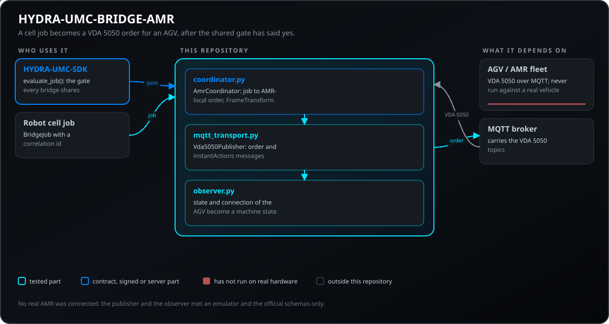
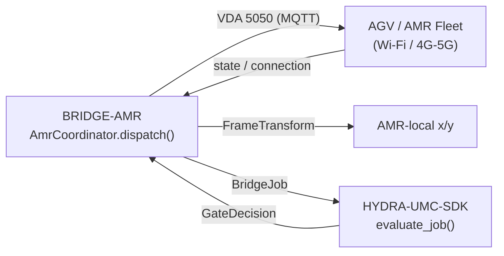
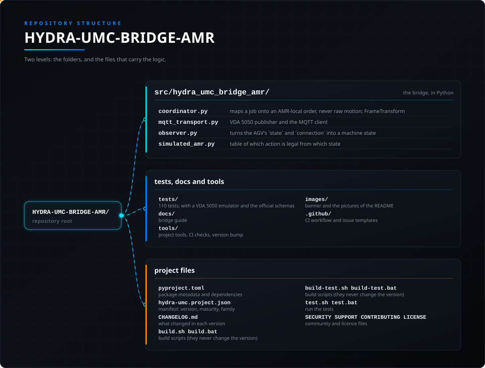

<!-- =============================================================================
HYDRA-UMC-BRIDGE-AMR - AMR/AGV coordination bridge
Copyright (C) JuanenRac (Electro Hobby 3D) <electrohobby3d@gmail.com>
GPL-3.0-or-later - see LICENSE
============================================================================= -->

<p align="center">
  
</p>

# 🚚 HYDRA-UMC-BRIDGE-AMR

<p align="center">🇺🇸 <b>English</b> | <a href="README_spa.md">🇪🇸 Español</a> | <a href="README_fra.md">🇫🇷 Français</a> | <a href="README_ita.md">🇮🇹 Italiano</a> | <a href="README_deu.md">🇩🇪 Deutsch</a> | <a href="README_zho.md">🇨🇳 简体中文</a> | <a href="README_jpn.md">🇯🇵 日本語</a> | <a href="README_por.md">🇵🇹 Português</a></p>

### 🔗 Dependency-Free Coordination Boundary Between HYDRA-UMC and AGV/AMR Fleets

<p align="center">
  
  
  
  
  
  
</p>

---

> **Honesty check - what actually runs today:** the coordinate-frame transform and job gate (`coordinator.py`'s `AmrCoordinator`/`FrameTransform`, funneling every dispatch through `HYDRA-UMC-SDK`'s own `evaluate_job()`) and the VDA 5050 message-shape/topic logic (`mqtt_transport.py`'s `Vda5050Publisher`) are real and covered by 110 passing unit tests (`python tools/build_test.py` - `test_coordinator.py`, `test_mqtt_transport.py`, plus `test_vda5050_emulator.py` running the bridge against a protocol-faithful, hand-written VDA 5050 AGV emulator, not a live one). None of it has been exercised against a real MQTT broker, a real `paho-mqtt` client, or a physical AMR/fleet manager - `test_mqtt_transport.py`'s own `FakeMqttClient` stands in for `paho-mqtt` entirely (the real library isn't even required to be installed for these tests to pass), and there is no live `run` command yet because no real fleet-manager transport has been selected or validated. See "Roadmap & Known limits" below, which already states this plainly, and `CHANGELOG.md` for exactly what has shipped so far.

> **Safety and security status:** this ecosystem is not a certified safety system. There is no hardware E-STOP path, no firmware-enforced limits or interlocks and no verified motion command yet; firmware images are checked with CRC32 and a shared-key HMAC-SHA256, not with an asymmetric signature; TLS and mutual TLS are optional and off by default; no custom board has been populated or tested yet. Read the [security baseline](https://github.com/JuanenRac/HYDRA-UMC-DOCS/blob/main/docs/SECURITY_BASELINE.md) and the [threat model](https://github.com/JuanenRac/HYDRA-UMC-DOCS/blob/main/docs/THREAT_MODEL.md) before relying on any statement here for the safety of a person.

---

## 📋 At a glance

| | |
|---|---|
| Version | `0.1.4` |
| Maturity | Functional |
| Tests | 110 (`python tools/build_test.py`) |
| Stack | Python / VDA 5050 (subset) / MQTT / HYDRA-UMC-SDK |
| On real hardware | Simulated only: tested against emulators, fakes or simulators; no run on real hardware is recorded for this version |

**Jump to:** [Overview](#-overview) · [Architecture](#-architecture) · [Features](#-features) · [Security & Safety](#-security--safety) · [Interfaces](#-interfaces) · [Configuration](#-configuration) · [Quick start](#-quick-start) · [Testing](#-testing) · [Troubleshooting](#-troubleshooting) · [Repository Structure](#-repository-structure) · [Related Projects](#-related-projects)

## 🚦 Project status

Each line is one part of this repository and the light says how far it is today. It is written from what the repository can show (tests, builds, runs), not from what is planned.

🟢 Done and verified · 🟡 Works, with known limits · 🟠 Partly done or not verified yet · 🔴 Not done or not working

| Area | State | What it means here |
|---|---|---|
| Software | 🟡 | Works for its main purpose; the honesty check above lists what is still missing |
| Tests | 🟢 | 110 automated tests, run on every change |
| Real hardware | 🟠 | Simulated only: tested against emulators, fakes or simulators; no run on real hardware is recorded for this version |
| Documentation | 🟢 | README in eight languages, checked against the manifest on every change |

## 🎯 Overview

**HYDRA-UMC-BRIDGE-AMR** is the bidirectional, high-level coordination boundary between HYDRA-UMC and an AGV/AMR (autonomous mobile robot) fleet, reachable over Wi-Fi or a cellular (4G/5G) link. It does exactly two real things before a job reaches an AMR: resolves a factory-frame coordinate into that specific AMR's own local frame via a real, hand-checkable 2D rigid-body transform, and maps a job phase onto a minimal, VDA-5050-inspired order action. It has no navigation, localization or obstacle-avoidance logic of its own, and it cannot bypass HYDRA-UMC-SERVER, MCU limits, watchdogs or E-STOP.

It belongs to the **Mobile & Autonomous Bridges** family alongside `HYDRA-UMC-BRIDGE-DROIDS` and `HYDRA-UMC-BRIDGE-UAV`, and shares the same `HYDRA-UMC-SDK` job-and-safety contract as the stationary **External Automation Bridges** (CNC, LASER, OPENPNP, PRINTER3D, ROS2) - so no bridge, mobile or stationary, invents its own definition of "safe to work".

## 🧩 Role in HYDRA-UMC

**HYDRA-UMC-BRIDGE-AMR** coordinates an AGV or AMR fleet with a robot cell. It turns a gated cell job into a VDA 5050 order (never raw motion) and reads the vehicle's own `state` and `connection` messages back, so the gate knows whether the vehicle can take an order.

Every bridge speaks the shared safety contract of `HYDRA-UMC-SDK`: a job is accepted only after the shared `evaluate_job()` gate says so, and the gate fails closed. The parent project is `HYDRA-UMC-SERVER`; this bridge does not call it, it answers over MQTT through `HYDRA-UMC-MQTT-BROKER` to whoever commands the cell.

## 🏛️ Architecture

<p align="center">
  
</p>

<details>
<summary>Text version of the diagram (Mermaid)</summary>



</details>

**Why it is built this way**

* **Why a real coordinate-frame transform lives here, and not just a pass-through.** HYDRA-UMC's own cell coordinates and any given AMR's local map rarely share an origin or heading - the pasted architecture note this project started from calls this out explicitly ("map factory-map coordinates onto the robot's own local map"). `FrameTransform` is the real, hand-verified math that closes that gap, kept as plain trigonometry with no fleet-manager dependency so it is testable anywhere.
* **Why the order-action vocabulary is shaped around VDA 5050.** VDA 5050 is the real, open, vendor-neutral fleet-integration standard several commercial AMR fleets (and a growing number of open-source stacks) already speak - naming this repo's own actions after its real vocabulary (`CANCEL_ORDER`, node/action-shaped movement) means a future real VDA 5050 adapter is a natural fit rather than a translation layer bolted on after the fact.
* **Why `AmrCoordinator.dispatch()` still funnels every job through the shared `evaluate_job()` gate.** An AMR is just another client of the same `bridge_contract` that CNC, LASER, OPENPNP, PRINTER3D, ROS2 and DROIDS use - it gets no special bypass of the IDLE/READY logic every other bridge and HYDRA-UMC-SERVER enforce.
* **Why `CANCEL_ORDER` stays requestable during a fault.** The gate's productive-phase requirement (`IDLE` + `READY`) is intentionally not applied the same way to an abort request - an operator must always be able to cancel an AMR's current order, even mid-fault.
* **Why there is no vendor-specific fleet-manager adapter in this repo yet.** (The VDA 5050 MQTT publisher exists, see above.) Committing to one AMR's real REST/WebSocket protocol before a real fleet is selected and tested would risk baking in assumptions this local, dependency-free core cannot verify.
* **How this fits the rest of the ecosystem.** BRIDGE-AMR sits between a real AMR fleet and `HYDRA-UMC-SDK` → `HYDRA-UMC-SERVER` → MCU safety - it is a coordination boundary, never a navigation or motor-control node, and it cannot bypass HYDRA-UMC-SERVER, MCU limits, watchdogs or E-STOP.

## ✨ Features

* 🧾 **Official VDA 5050 schemas and a configurable hold:** the tests check every message the bridge builds against the official VDA 5050 2.0.0 JSON schemas (`order` and `instantActions`, vendored in `tests/vda5050_schemas`); an instant action now carries `actionName` next to `actionType`, because the official instantActions schema asks for it. `AmrCoordinator(abort_action=AmrCoordinator.START_PAUSE)` makes the abort phase hold the vehicle with `startPause` instead of dropping its order with `cancelOrder` (the default); both are always forwarded. `MOVE_TO_HOME` goes through the same gate as every movement. `AmrCoordinator.resume()` sends `stopPause` only for a READY cell and a vehicle read as paused, and `abort_action=AmrCoordinator.ABORT_BOTH` sends `cancelOrder` and then `startPause`. *(implemented)*
* ✅ **Real, hand-checkable coordinate-frame transform:** `FrameTransform` maps a factory-frame `(x, y)` into a specific AMR's own local frame given that AMR's real origin/heading on the factory floor - verified with an identity case, a pure translation, a 90-degree heading rotation and a real round-trip test. *(implemented, tested in `tests/test_coordinator.py`)*
* ✅ **Real, VDA-5050-inspired order-action vocabulary, on the real two-channel split:** `MOVE_TO_STAGING`, `PICK_LOAD`, `MOVE_TO_DESTINATION`, `DROP_LOAD`, `MOVE_TO_HOME` publish on the real VDA 5050 `order` topic (queued, part of a route); `CANCEL_ORDER` publishes on the real, separate `instantActions` topic (immediate, bypasses the order queue) - matching VDA 5050's own real `cancelOrder` action name AND its own real channel, checked against the [official schemas](https://github.com/VDA5050/VDA5050/tree/main/json_schemas). *(implemented)*
* ✅ **Real per-action coordinate validation:** a movement action missing `x`/`y`, or carrying a non-numeric one, is rejected locally before the transform ever runs. *(implemented, tested)*
* ✅ **Real shared safety gate:** every job dispatched through `AmrCoordinator.dispatch()` is evaluated by `evaluate_job()` from `HYDRA-UMC-SDK`'s `bridge_contract`, the same gate every sibling bridge and HYDRA-UMC-SERVER use; a productive phase requires an `IDLE` external machine and a `READY` HYDRA-UMC cell, while `CANCEL_ORDER` remains requestable during a fault. *(implemented)*
* ✅ **Fail-closed phase routing and static evidence:** an unknown future SDK phase is denied. `inspect_order_plan.py` emits the static schema `1.1` order plan (real `actions`/`instant_actions` channel split) without opening any transport. *(implemented, tested)*
* ✅ **Real VDA 5050 MQTT publisher:** `mqtt_transport.py`'s `Vda5050Publisher` sends an already-gated dispatch as a real, spec-shaped message on the correct real topic (`{interfaceName}/{majorVersion}/{manufacturer}/{serialNumber}/{order|instantActions}`) - a rejected dispatch never reaches the network. *(implemented, tested in `tests/test_mqtt_transport.py`)*
* ✅ **Non-mutating build/test:** `build-test.bat`/`.sh` compile the source and run deterministic unit tests without changing version or CHANGELOG. *(implemented, see Build & Release below)*
* 🔜 **A vendor-specific fleet-manager REST/WebSocket adapter** (for a fleet platform that isn't VDA 5050-native) - introduced only after that platform is selected and tested. *(planned)*
* ✅ **Observed machine state and order ids that survive a restart:** `AmrCoordinator.dispatch()` accepts the state the fleet manager reported for the vehicle, which the shared gate uses instead of the `machine_state` written in the job (a message anybody on the broker may publish); `Vda5050Publisher` gives each order an `orderId` with a token of its own, so that a restart that counts `headerId` from the beginning again does not reuse the id of an earlier order (VDA 5050 refuses it). *(implemented, tested in `tests/test_observed_and_order_ids.py`)*
* ✅ **VDA 5050 names on the wire, a client the broker accepts and an observer that listens:** the internal `CANCEL_ORDER` / `PICK_LOAD` / `DROP_LOAD` go out as the case-sensitive VDA 5050 action types `cancelOrder` / `pick` / `drop` (before, `CANCEL_ORDER` went out as it is, which an AGV does not recognize as a cancel), and a movement is only its destination node, with no invented action type; `actionId` and `nodeId` carry the session token like the `orderId`; `header_id` and `timestamp_iso` can be left out (the publisher counts per topic and stamps UTC) and are validated when given; a coordinate that overflows, a non-finite number or a point outside `FrameTransform.bounds` is refused (`allow_nan=False`). `open_mqtt_client()` takes a `client_id` (the broker authenticates by its prefix), uses callback API v2 and waits for the broker's answer instead of returning a client that cannot publish; with a `Vda5050Observer` it subscribes to the AGV's `state` and `connection` topics and derives the machine state the gate uses (OFFLINE when stale, not ONLINE or not in AUTOMATIC mode; otherwise SAFE_STOP, FAULT, HOLDING, RUNNING or IDLE). *(implemented, tested against fakes and the emulator; never run against a real AGV or fleet manager, and a route that starts at the node the AGV stands on (two nodes and an edge, which needs the plant graph) is NOT built yet, so a real AGV will refuse these single-destination-node orders)*

## 🔒 Security & Safety

| Threat | Defence | Where |
|---|---|---|
| A job for a cell or machine that is not in a safe state | Every job goes through the shared `evaluate_job()` gate of the SDK, which fails closed; the bridge has no accept/reject logic of its own | SDK `bridge_contract` |
| Oversized or unbounded job data | At most 32 parameters, keys up to 64 characters, values up to 1024, identifiers up to 128 (`MAX_PARAMETERS`, `MAX_PARAMETER_KEY_CHARS`, `MAX_PARAMETER_VALUE_CHARS`, `MAX_IDENTIFIER_CHARS`) | SDK `bridge_contract` |
| A repeated or replayed order | An `IdempotencyStore` remembers each key for 24 hours and at most 10 000 entries; a repeat gets the first answer instead of being evaluated again | SDK `job_intake` |
| A raw motion order sent to a vehicle | The coordinator maps a job to an AMR-local order only; `simulated_amr.TRANSITIONS` says which action is legal from which state (for example `MOVE_TO_STAGING` only from `IDLE`) | `coordinator.py`, `simulated_amr.py` |
| A malformed VDA 5050 message | Every `order` and `instantActions` message the publisher builds is validated in the tests against the official VDA 5050 2.0.0 JSON schemas, vendored unchanged | `tests/test_vda5050_schemas.py` |
| A vehicle that cannot take an order | A rejected dispatch never reaches the network; the observer treats a missing or stale (over 90 seconds) `state` or `connection` as not ready | `mqtt_transport.py`, `observer.py` |

**What it never does:** it never sends raw motion, and it has never run against a real vehicle or fleet manager.

## 🔌 Interfaces

The VDA 5050 topics are `{interface_name}/{major_version}/{manufacturer}/{serial_number}/{channel}` (`Vda5050Target.topic()`), for example `vda5050/v2/acme/agv-01/order`.

| Topic or route | What it carries |
|---|---|
| `order`, `instantActions` | published; each has its own `header_id` counter and a UTC timestamp |
| `state`, `connection` | observed by `Vda5050Observer`; the subscription is renewed after every reconnect |

The library: `AmrCoordinator`, `FrameTransform`, `Vda5050Publisher`, `Vda5050Target`, `Vda5050Observer`, `SimulatedAmr`, `open_mqtt_client()`. The default MQTT client ID is `hydra-umc-bridge-amr`.

## ⚙️ Configuration

| Variable | Default | What it sets |
|---|---|---|
| `HYDRA_MQTT_USERNAME` | none | The MQTT user name; the broker binds it to a client-ID prefix |
| `HYDRA_MQTT_PASSWORD` | none | The password; only valid together with the user name |
| `HYDRA_MQTT_PASSWORD_FILE` | none | The password read from a file (a Docker or systemd secret); ignored when `HYDRA_MQTT_PASSWORD` is set |
| `HYDRA_MQTT_TLS_CA` | none | The CA file that signed the broker's certificate: the connection is TLS and the certificate is verified |
| `HYDRA_MQTT_TLS` | off | `1` turns TLS on, verified against the system's trusted CAs |
| `HYDRA_MQTT_TLS_CERT` / `HYDRA_MQTT_TLS_KEY` | none | The client certificate and its key for a broker that demands mutual TLS; both are needed |

There is no configuration file: the broker, `interface_name`, `major_version`, `manufacturer`, `serial_number` and the abort action (`cancelOrder`, `startPause` or both) are arguments of the constructors.

## 🚀 Quick start

Requires Python 3.11 or newer. The tests and the build scripts expect `HYDRA-UMC-SDK` checked out next to this repository (`../HYDRA-UMC-SDK`) or pointed at with `HYDRA_UMC_SDK_ROOT`.

Try it without hardware (this checks the whole bridge against its emulators and fakes):

```bash
py -3 tools/build_test.py          # Windows
python3 tools/build_test.py         # Linux, macOS
```

Start the service (there is no console script: the service is the `run_forever()` of the MQTT transport, which you call from your own start-up code):

```python
from hydra_umc_bridge_amr import AmrCoordinator, FrameTransform, Vda5050Publisher, Vda5050Target, open_mqtt_client
client = open_mqtt_client("192.168.0.180")        # connects; the credentials come from HYDRA_MQTT_*
target = Vda5050Target("vda5050", "v2", "acme", "agv-01")
dispatch = AmrCoordinator().dispatch(job, cell_state, FrameTransform(map_id="hall", origin_x=0.0, origin_y=0.0, heading_rad=0.0))
Vda5050Publisher().publish(client, target, None, None, dispatch)   # a rejected dispatch is never sent
```

The user name, the password and the TLS files come from the `HYDRA_MQTT_*` variables (see Configuration); the code above needs no credentials of its own.

## 🧪 Testing

110 automated `unittest` cases run with `python tools/build_test.py` (it also compiles every module). The tests need no hardware, no network and no optional package: the ones that would need `paho-mqtt`, `pyserial` or a vendor library use a stand-in or are skipped when the package is missing.

| Test file | Tests | What it covers |
|---|---|---|
| `test_coordinator.py`, `test_observed_and_order_ids.py`, `test_edge_cases.py` | - | job to order mapping, the rigid-body frame transform, ids, edge cases |
| `test_vda5050_schemas.py` | - | every message validated against the official VDA 5050 2.0.0 schemas |
| `test_vda5050_emulator.py`, `vda5050_emulator.py` | - | the real coordinator and publisher against a shape-level VDA 5050 vehicle on the MQTT bus |
| `test_mqtt_transport.py`, `test_mqtt_environment.py`, `test_hardening.py`, `test_simulated_amr.py` | - | publisher against a fake MQTT client, environment credentials, hostile inputs, the state table |

The CI runs `HYDRA_UMC_CI=1 python tools/ci_validate.py`, which checks the manifest, the documents, the eight READMEs and the pictures, and runs the tests with an SDK checkout.

## 🏗️ Build & Release

Requires Python 3.11+. `tools/build_test.py` expects `HYDRA-UMC-SDK` checked out as a sibling directory (`../HYDRA-UMC-SDK`) or pointed at via the `HYDRA_UMC_SDK_ROOT` environment variable.

```bash
# Windows
build-test.bat      # validate only — no version/CHANGELOG change
build.bat            # Validate and build (building never changes the version)

# Linux/macOS
bash build-test.sh
bash build.sh
```

`build-test` compiles every module under `src/` with `py_compile` and runs the full `unittest` suite discovered under `tests/` (every `test_*.py` file - 110 tests) - deterministically, with no real AMR connection, no network and no version/CHANGELOG change. `build` runs that same validation first and, only on success, calls `tools/bump_version.py` to synchronize the version across `pyproject.toml`, `hydra-umc.project.json` and `CHANGELOG.md`. There is no live hardware `run` command yet - that requires a validated fleet-manager transport adapter and a real AMR/fleet.

## 🩺 Troubleshooting

| You see | Because | Do |
|---|---|---|
| `ModuleNotFoundError: hydra_umc_sdk` | The SDK is not installed or not next to this repository | Check out `HYDRA-UMC-SDK` next to this repository or set `HYDRA_UMC_SDK_ROOT` |
| `paho-mqtt is not installed` | The MQTT client is an optional extra | `pip install ".[mqtt]"` (it needs `paho-mqtt` 2.1 or newer, below 3) |
| `password was given without a username` | MQTT credentials need both parts | Set `HYDRA_MQTT_USERNAME` as well as the password |
| `could not reach the MQTT broker after N attempts` | The broker is down, the address is wrong or the port is closed | Start `HYDRA-UMC-MQTT-BROKER`, check the host and port given to the transport (it tries 5 times, 2 seconds apart); a TLS handshake failure is not retried |
| `the MQTT broker refused the connection` | The broker refused the credential (or did not answer within the time limit) | Check `HYDRA_MQTT_USERNAME` and the password; the client ID must start with the prefix the broker bound to the credential |
| `"allowed": false` + `reason` | The shared gate or a guard refused the order | Read `reason` and fix the cause; do not retry blindly |

## 📂 Repository Structure

<p align="center">
  
</p>

<details>
<summary>Text version of the tree</summary>

```text
HYDRA-UMC-BRIDGE-AMR/
├── src/hydra_umc_bridge_amr/
│   ├── coordinator.py             maps a job onto an AMR-local order, never raw motion; FrameTransform
│   ├── mqtt_transport.py          VDA 5050 publisher and the MQTT client
│   ├── observer.py                turns the AGV's `state` and `connection` into a machine state
│   └── simulated_amr.py           table of which action is legal from which state
├── tests/                         110 tests, with a VDA 5050 emulator and the official schemas
├── docs/                          bridge guide
├── tools/                         build and test runner, version bump, CI validator, README and picture generators and checks
├── images/                        banner and the pictures of the README
├── .github/                       CI workflow and issue templates
├── pyproject.toml                 package metadata and dependencies
├── hydra-umc.project.json         manifest: version, maturity, family
├── CHANGELOG.md                   what changed in each version
├── build.sh build.bat             build scripts (they never change the version)
├── build-test.sh build-test.bat   build scripts (they never change the version)
├── test.sh test.bat               run the tests
└── SECURITY.md SUPPORT.md CONTRIBUTING.md CODE_OF_CONDUCT.md LICENSE LICENSE.md
```

</details>

## 🗺️ Roadmap & Known limits

**Known limits today**

**Real today:** version `0.1.4`, functional as a dependency-free coordination core (`AmrCoordinator`) with a real, hand-verified coordinate-frame transform (`FrameTransform`), fail-closed phase routing, a static `plan-only` order schema with the real VDA 5050 order/instantActions channel split, a real VDA 5050 MQTT publisher (`Vda5050Publisher`), and non-mutating build-test scripts wired into CI with an SDK checkout.

**Integration boundary:** this bridge is a coordination boundary only - it is not a navigation or motor-control node, and it cannot bypass HYDRA-UMC-SERVER, MCU limits, watchdogs or E-STOP; every dispatched job still passes through the same shared gate every sibling bridge uses.

**Still ahead:** no real fleet-manager transport (VDA 5050, vendor REST/WebSocket) or physical AMR has been validated yet - a real adapter will be introduced only after a specific fleet platform is selected and tested.

## 🌍 Languages

This README and the documents of the repository exist in eight languages: English, Spanish, German, French, Italian, Japanese, Chinese and Portuguese (Portugal). They are written together and checked in the CI so that the eight files have the same sections and the same links. This repository has no screen or message catalogue of its own, so there are no interface strings to translate.

## 🔗 Related Projects

This project is part of the HYDRA-UMC robotics ecosystem by the same author (JuanenRac / Electro Hobby 3D). Worth knowing about, since a request might actually be about one of these rather than this repository.

**Parent Project**
- **[HYDRA-UMC-SERVER](https://github.com/JuanenRac/HYDRA-UMC-SERVER)** — the real headless backend (REST/WebSocket) every control client actually talks to; the authenticated ecosystem boundary this bridge reports to once each command has cleared this bridge's own local safety gate.

**Sibling Projects** — also talk to HYDRA-UMC-SERVER's own API, each their own client
- **[HYDRA-UMC-STUDIO](https://github.com/JuanenRac/HYDRA-UMC-STUDIO)** — web control dashboard with real-time multi-robot 3D visualization.
- **[HYDRA-UMC-SUITE](https://github.com/JuanenRac/HYDRA-UMC-SUITE)** — desktop (PySide6) swarm command center for multiple servers at once, packaged as a standalone executable.
- **[HYDRA-UMC-ANDROID-CONTROL](https://github.com/JuanenRac/HYDRA-UMC-ANDROID-CONTROL)** — native Android control app with biometric login and a paired Wear OS companion.
- **[HYDRA-UMC-IOS-CONTROL](https://github.com/JuanenRac/HYDRA-UMC-IOS-CONTROL)** — iOS/iPadOS control app (Flutter) with real-time WebSocket sync.
- **[HYDRA-UMC-DSI](https://github.com/JuanenRac/HYDRA-UMC-DSI)** — native touch UI for the onboard 7" DSI touchscreen, embedded on the CM5 itself.
- **[HYDRA-UMC-BRIDGE-CNC](https://github.com/JuanenRac/HYDRA-UMC-BRIDGE-CNC)** — high-level CNC-cell coordinator with GRBL status/control-byte access (tested against an emulator only).
- **[HYDRA-UMC-BRIDGE-DROIDS](https://github.com/JuanenRac/HYDRA-UMC-BRIDGE-DROIDS)** — coordination boundary for legged/humanoid droids, with a Boston Dynamics Spot command sender (tested against an emulator only) — one of the ecosystem's 3 mobile-fleet bridges.
- **[HYDRA-UMC-BRIDGE-LASER](https://github.com/JuanenRac/HYDRA-UMC-BRIDGE-LASER)** — laser-cell coordinator reading 3 key/enclosure/interlock GPIO signals (tested against a fake chip only; it cannot arm or fire a laser).
- **[HYDRA-UMC-BRIDGE-OPENPNP](https://github.com/JuanenRac/HYDRA-UMC-BRIDGE-OPENPNP)** — safe high-level board-flow coordinator for OpenPnP pick-and-place.
- **[HYDRA-UMC-BRIDGE-PRINTER3D](https://github.com/JuanenRac/HYDRA-UMC-BRIDGE-PRINTER3D)** — safe coordination boundary for Moonraker/Klipper 3D printers, with real gated job commands.
- **[HYDRA-UMC-BRIDGE-ROS2](https://github.com/JuanenRac/HYDRA-UMC-BRIDGE-ROS2)** — coordinator with a lazily imported rclpy ROS 2 transport (not yet run against a ROS 2 installation).
- **[HYDRA-UMC-BRIDGE-UAV](https://github.com/JuanenRac/HYDRA-UMC-BRIDGE-UAV)** — coordination boundary for camera-equipped UAVs, with a MAVLink command sender (tested against an emulator only) — one of the ecosystem's 3 mobile-fleet bridges.

**Directly Related**
- **[HYDRA-UMC-SDK](https://github.com/JuanenRac/HYDRA-UMC-SDK)** — the shared JSON-Schema contract and software job-gate boundary every bridge validates its commands against (not a certified safety function).
- **[HYDRA-UMC-CONNECTOR-HUB](https://github.com/JuanenRac/HYDRA-UMC-CONNECTOR-HUB)** — declarative adapter-manifest registry and validator for external-machine connectors; extends the SDK's own contract idea to external machines without replacing the industrial-gateway projects.
- **[HYDRA-UMC-MQTT-BROKER](https://github.com/JuanenRac/HYDRA-UMC-MQTT-BROKER)** — `mqtt_transport.py`'s `Vda5050Publisher` sends every already-gated dispatch as a real, spec-shaped VDA 5050 `order`/`instantActions` message — unlike the other bridges' own `hydra/bridges/<name>/...` topic scheme, this one uses VDA 5050's own real topic shape directly.

**Also Part of the Ecosystem**

*Core Hardware & Platform*
- **[HYDRA-UMC](https://github.com/JuanenRac/HYDRA-UMC)** — the robot-arm motherboard design: CM5 host + dual-core STM32H745, meant to orchestrate up to 8 tool arms over CAN-OTA/SPI-OTA (firmware at an early stage; no populated board yet).
- **[HYDRA-UMC-OS](https://github.com/JuanenRac/HYDRA-UMC-OS)** — reproducible Raspberry Pi OS product layer for the CM5: read-only agent, validated config/profiles, WiFi first-contact provisioning.

*Core Backend & Clients*
- **[HYDRA-UMC-EDITOR-URDF](https://github.com/JuanenRac/HYDRA-UMC-EDITOR-URDF)** — desktop graphical URDF creator/editor that pushes finished models into STUDIO's own catalog.
- **[HYDRA-UMC-EDITOR-STL](https://github.com/JuanenRac/HYDRA-UMC-EDITOR-STL)** — desktop STL model editor, transforming/replacing/removing/adding real parts in the same model catalog HYDRA-UMC-EDITOR-URDF also edits.

*URTC Tool Platform*
- **[URTC](https://github.com/JuanenRac/URTC)** — firmware for the physical Universal Robot Tool Controller PCB, 25+ tool profiles over CAN bus.
- **[URTC-FLASHER](https://github.com/JuanenRac/URTC-FLASHER)** — desktop GUI flashing tool for URTC boards, CAN-OTA plus full-chip SWD/JTAG.
- **[URTC-TESTER](https://github.com/JuanenRac/URTC-TESTER)** — desktop live CAN-bus diagnostic tool for URTC boards, one panel per tool profile.
- **[URTC-WEB-STUDIO](https://github.com/JuanenRac/URTC-WEB-STUDIO)** — browser-based alternative to URTC-TESTER via the Web Serial API, no local install needed.
- **[URTC-GATEWAY](https://github.com/JuanenRac/URTC-GATEWAY)** — gateway in front of the URTC CAN bus: an allowed list of identifiers, a rate limit and a session key; software tested on a computer, not yet on a real bus.

*Vision AI Node (Hailo-8)*
- **[HYDRA-UMC-VISION-NODE](https://github.com/JuanenRac/HYDRA-UMC-VISION-NODE)** — integration hub for the Hailo-8 vision pipeline, with a real per-stage hardware-readiness check.
- **[HYDRA-UMC-DETECTION-HEF](https://github.com/JuanenRac/HYDRA-UMC-DETECTION-HEF)** — real compiled-model registry with Hailo-architecture/checksum safe-load verification.
- **[HYDRA-UMC-VISION-STREAMER](https://github.com/JuanenRac/HYDRA-UMC-VISION-STREAMER)** — real GStreamer pipeline + MediaMTX config generator with a real HailoRT integration boundary.
- **[HYDRA-UMC-VISUAL-SERVOING-API](https://github.com/JuanenRac/HYDRA-UMC-VISUAL-SERVOING-API)** — Position-Based Visual Servoing correction law with authorisation gated on the zone state; no camera pose estimation yet.
- **[HYDRA-UMC-SAFETY-ZONES](https://github.com/JuanenRac/HYDRA-UMC-SAFETY-ZONES)** — v0 zone-breach, calibration-freshness and E-STOP-request logic that takes object positions from a file; no detector feeds it and no physical E-STOP is wired to it yet.

*Cognitive AI Node (Hailo-10)*
- **[HYDRA-UMC-COGNITIVE-NODE](https://github.com/JuanenRac/HYDRA-UMC-COGNITIVE-NODE)** — integration hub for the Hailo-10 cognitive pipeline (LLM/VLA/voice orchestration).
- **[HYDRA-UMC-VLA-ENGINE](https://github.com/JuanenRac/HYDRA-UMC-VLA-ENGINE)** — real action-token encoding/decoding and trajectory generation for a Vision-Language-Action model.
- **[HYDRA-UMC-VOICE-UI](https://github.com/JuanenRac/HYDRA-UMC-VOICE-UI)** — real voice front-end (VAD + intent parser) with a bounded, confirmation-gated Watch relay.
- **[HYDRA-UMC-SEMANTIC-PLANNER](https://github.com/JuanenRac/HYDRA-UMC-SEMANTIC-PLANNER)** — real rule-based task decomposition and semantic error recovery over MCU error codes.
- **[HYDRA-UMC-DOCS-QA](https://github.com/JuanenRac/HYDRA-UMC-DOCS-QA)** — real stdlib-only TF-IDF document search over this ecosystem's own Markdown docs.
- **[HYDRA-UMC-LOCAL-TECHNICIAN](https://github.com/JuanenRac/HYDRA-UMC-LOCAL-TECHNICIAN)** — local, policy-gated AI maintenance technician for the ecosystem itself - observes, diagnoses and proposes fixes; the two highest risk levels are deliberately not implemented yet.

*Orchestration & Swarm*
- **[HYDRA-UMC-ORCHESTRATOR](https://github.com/JuanenRac/HYDRA-UMC-ORCHESTRATOR)** — integration hub with a real gRPC/Protobuf health-report contract and mission state machine.
- **[HYDRA-UMC-JOB-DISPATCHER](https://github.com/JuanenRac/HYDRA-UMC-JOB-DISPATCHER)** — real priority-based job queue with deduplication, over a real HTTP API.
- **[HYDRA-UMC-NODE-HEALING](https://github.com/JuanenRac/HYDRA-UMC-NODE-HEALING)** — real gRPC-based fleet health watchdog with retry/backoff and identity-mismatch detection.
- **[HYDRA-UMC-PATH-PLANNER-3D](https://github.com/JuanenRac/HYDRA-UMC-PATH-PLANNER-3D)** — real RRT-based 3D path planner with real obstacle/workspace collision validation.
- **[HYDRA-UMC-SWARM-SYNC](https://github.com/JuanenRac/HYDRA-UMC-SWARM-SYNC)** — real CRDT LWW-Element-Map state sync, property-tested for multi-cell convergence.

*Digital Twin & Simulation*
- **[HYDRA-UMC-TWIN](https://github.com/JuanenRac/HYDRA-UMC-TWIN)** — integration hub for the digital-twin engine, with a real version-compatibility sync contract.
- **[HYDRA-UMC-HIL-BRIDGE](https://github.com/JuanenRac/HYDRA-UMC-HIL-BRIDGE)** — hardware-in-the-loop router with a software collision interlock between simulation and real hardware (tested without real hardware).
- **[HYDRA-UMC-PHYSICS-REPLICA](https://github.com/JuanenRac/HYDRA-UMC-PHYSICS-REPLICA)** — real forward kinematics and joint-limit validation over a real URDF subset.
- **[HYDRA-UMC-SYNTHETIC-DATA-GEN](https://github.com/JuanenRac/HYDRA-UMC-SYNTHETIC-DATA-GEN)** — real procedural 2D scene generator with YOLO/COCO annotation export.

*Data & Analytics*
- **[HYDRA-UMC-DATALAKE](https://github.com/JuanenRac/HYDRA-UMC-DATALAKE)** — real sqlite3-backed time-series store with a real ingest/query HTTP API.
- **[HYDRA-UMC-ANOMALY-DETECTOR](https://github.com/JuanenRac/HYDRA-UMC-ANOMALY-DETECTOR)** — real FFT + statistical baseline anomaly detector with drift monitoring.
- **[HYDRA-UMC-PRODUCTION-REPORTS](https://github.com/JuanenRac/HYDRA-UMC-PRODUCTION-REPORTS)** — real OEE/availability calculation over DATALAKE history, with reproducible CSV export.
- **[HYDRA-UMC-TELEMETRY-COLLECTOR](https://github.com/JuanenRac/HYDRA-UMC-TELEMETRY-COLLECTOR)** — real CAN/WebSocket ingestion pipeline into DATALAKE, with sequence deduplication.

*Industrial Gateway*
- **[HYDRA-UMC-GATEWAY-INDUSTRIAL](https://github.com/JuanenRac/HYDRA-UMC-GATEWAY-INDUSTRIAL)** — integration hub relaying to industrial protocols, with a real command allowlist/backpressure layer.
- **[HYDRA-UMC-OPCUA-SERVER](https://github.com/JuanenRac/HYDRA-UMC-OPCUA-SERVER)** — real OPC-UA address space, verified with a real binary-protocol client session.
- **[HYDRA-UMC-MTCONNECT-ADAPTER](https://github.com/JuanenRac/HYDRA-UMC-MTCONNECT-ADAPTER)** — real MTConnect `/probe` and `/current` XML endpoints with degraded-mode output.

*Complementary Tools & Ecosystem Operations*
- **[HYDRA-UMC-DASHBOARD-AI](https://github.com/JuanenRac/HYDRA-UMC-DASHBOARD-AI)** — Smart Summaries and Anomaly Highlighting panels over DATALAKE/ANOMALY-DETECTOR, with an honest statistical fallback.
- **[HYDRA-UMC-TOOL-CLI](https://github.com/JuanenRac/HYDRA-UMC-TOOL-CLI)** — fleet CLI with a real, stable exit-code contract, a genuine live client of HYDRA-UMC-SERVER's own API.
- **[HYDRA-UMC-WATCH](https://github.com/JuanenRac/HYDRA-UMC-WATCH)** — WearOS companion app with haptic alert patterns and a paired-phone voice relay (not yet run on a physical watch).
- **[URTC-SMART-RACK](https://github.com/JuanenRac/URTC-SMART-RACK)** — firmware for a board-mounting rack with real tool-ID decoding and Smart Idle pre-heating logic.
- **[URTC-VISION-TOOL](https://github.com/JuanenRac/URTC-VISION-TOOL)** — firmware plus a real Python vision companion for a thermal/RGB inspection tool head.
- **[HYDRA-UMC-UPDATER](https://github.com/JuanenRac/HYDRA-UMC-UPDATER)** — administrative desktop tool that discovers, clones and updates every repo in this ecosystem.
- **[HYDRA-UMC-OS-REBUILDER](https://github.com/JuanenRac/HYDRA-UMC-OS-REBUILDER)** — Windows/Linux desktop tool that builds a ready-to-flash CM5 image pre-loaded with the ecosystem's most current versions, with Raspberry-Pi-Imager-style first-boot Wi-Fi/user/SSH configuration.
- **[HYDRA-UMC-OPS-AGENT](https://github.com/JuanenRac/HYDRA-UMC-OPS-AGENT)** — maintenance-incident coordinator: a low-privilege edge role collects a sanitized inventory/health snapshot, a control-plane role renders it read-only and asks an AI provider to suggest a diagnosis - never applies a patch or deploys anything.
- **[HYDRA-UMC-DEV-SERVER](https://github.com/JuanenRac/HYDRA-UMC-DEV-SERVER)** — reproducible development host (Raspberry Pi 5 / CM5) that stores the ecosystem's source and runs bounded build/test tasks under a durable queue; a dedicated dev role, explicitly not an operational CM5.

## 📚 Documentation

Where to read more:

* [docs/BRIDGE_GUIDE.md](docs/BRIDGE_GUIDE.md) - scope, the VDA 5050 messages, frames, scripts
* [Security baseline of the ecosystem](https://github.com/JuanenRac/HYDRA-UMC-DOCS/blob/main/docs/SECURITY_BASELINE.md)
* [Threat model of the ecosystem](https://github.com/JuanenRac/HYDRA-UMC-DOCS/blob/main/docs/THREAT_MODEL.md)
* [Changelog of this repository](CHANGELOG.md)
* [License of this repository](LICENSE.md)

## 🤝 Contributing & Community

* Before a pull request run `HYDRA_UMC_CI=1 py -3 tools/ci_validate.py` (or `HYDRA_UMC_CI=1 python3 tools/ci_validate.py`): it must print `CI_VALIDATION=PASS`. Do not run `build.sh` or `build.bat` for this check; building is not a check.
* The eight READMEs are written from one source in HYDRA-UMC-DOCS; do not edit them by hand. Change the source and write them again with `tools/make_readmes.py`.
* Do not state in a README what has not run: say "simulated" or "not tried on hardware" where that is the truth.
* See [CONTRIBUTING.md](CONTRIBUTING.md), the [code of conduct](CODE_OF_CONDUCT.md), [SECURITY.md](SECURITY.md) and [SUPPORT.md](SUPPORT.md).

## 👤 AUTHOR

**JuanenRac (Electro Hobby 3D)** · electrohobby3d@gmail.com

## 📜 LICENSE

GPL-3.0-or-later - [LICENSE](LICENSE).
