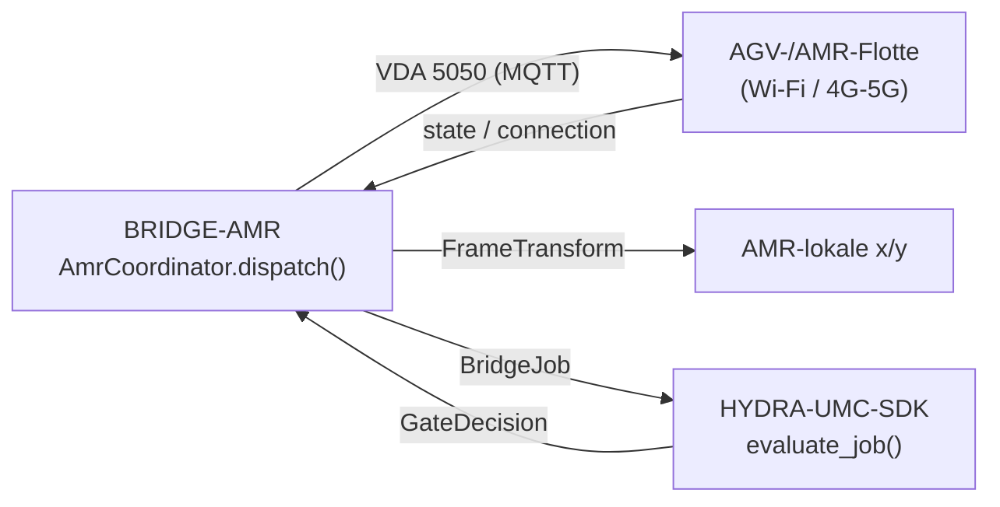

<!-- =============================================================================
HYDRA-UMC-BRIDGE-AMR - AMR/AGV coordination bridge
Copyright (C) JuanenRac (Electro Hobby 3D) <electrohobby3d@gmail.com>
GPL-3.0-or-later - see LICENSE
============================================================================= -->

<p align="center">
  
</p>

# 🚚 HYDRA-UMC-BRIDGE-AMR

<p align="center"><a href="README.md">🇺🇸 English</a> | <a href="README_spa.md">🇪🇸 Español</a> | <a href="README_fra.md">🇫🇷 Français</a> | <a href="README_ita.md">🇮🇹 Italiano</a> | 🇩🇪 <b>Deutsch</b> | <a href="README_zho.md">🇨🇳 简体中文</a> | <a href="README_jpn.md">🇯🇵 日本語</a> | <a href="README_por.md">🇵🇹 Português</a></p>

### 🔗 Abhängigkeitsfreie Koordinationsgrenze zwischen HYDRA-UMC und AGV-/AMR-Flotten

<p align="center">
  
  
  
  
  
  
</p>

---

> **Ehrlichkeitscheck - was heute wirklich läuft:** die Koordinatenrahmen-Transformation und das Job-Gate (`coordinator.py` mit `AmrCoordinator`/`FrameTransform`, das jeden Dispatch durch das echte `evaluate_job()` von `HYDRA-UMC-SDK` leitet) sowie die VDA-5050-Nachrichtenform-/Topic-Logik (`mqtt_transport.py` mit `Vda5050Publisher`) sind real und durch 110 bestehende Unit-Tests abgedeckt (`python tools/build_test.py` - `test_coordinator.py`, `test_mqtt_transport.py`, plus `test_vda5050_emulator.py`, das die Bridge gegen einen protokolltreuen, von Hand geschriebenen VDA-5050-AGV-Emulator laufen lässt, keinen echten im Produktionsbetrieb). Nichts davon wurde gegen einen echten MQTT-Broker, einen echten `paho-mqtt`-Client oder einen physischen AMR/Flottenmanager getestet - `test_mqtt_transport.py`s eigener `FakeMqttClient` ersetzt `paho-mqtt` vollständig (die echte Bibliothek muss für das Bestehen dieser Tests nicht einmal installiert sein), und es gibt noch keinen echten `run`-Befehl, weil noch kein reales Flottenmanager-Transportprotokoll ausgewählt oder validiert wurde. Siehe „Aktueller Status & Nächste Schritte" weiter unten, das dies bereits klar sagt, sowie `CHANGELOG.md` für das, was bisher genau ausgeliefert wurde.

> **Stand von Sicherheit (Safety) und Security:** Dieses Ökosystem ist kein zertifiziertes Sicherheitssystem. Es gibt noch keinen Hardware-E-STOP-Pfad, keine von der Firmware durchgesetzten Grenzen oder Verriegelungen und keinen verifizierten Bewegungsbefehl; Firmware-Images werden mit CRC-32 und einer Ed25519-Signatur geprüft, und ein Release-Build verweigert die veröffentlichten Entwicklungsschlüssel (die Werkzeugköpfe und Erweiterungsplatinen hinter dem Relais laufen noch mit URTC-Bootloadern, die statt einer Signatur ein HMAC-SHA256 mit gemeinsamem Schlüssel verwenden); TLS und gegenseitiges TLS sind optional und standardmäßig aus; noch keine eigene Platine wurde bestückt oder getestet. Lesen Sie die [Sicherheitsbasis](https://github.com/JuanenRac/HYDRA-UMC-DOCS/blob/main/docs/SECURITY_BASELINE.md) und das [Bedrohungsmodell](https://github.com/JuanenRac/HYDRA-UMC-DOCS/blob/main/docs/THREAT_MODEL.md), bevor Sie sich für die Sicherheit einer Person auf eine Aussage hier verlassen.

---

## 📋 Auf einen Blick

| | |
|---|---|
| Version | `0.1.5` |
| Reifegrad | Funktionsfähig |
| Tests | 110 (`python tools/build_test.py`) |
| Technik | Python / VDA 5050 (subset) / MQTT / HYDRA-UMC-SDK |
| Auf echter Hardware | Nur simuliert: gegen Emulatoren, Attrappen oder Simulatoren getestet; für diese Version ist kein Lauf auf echter Hardware vermerkt |

**Springe zu:** [Überblick](#-überblick) · [Architektur](#-architektur) · [Funktionen](#-funktionen) · [Sicherheit und Schutz](#-sicherheit-und-schutz) · [Schnittstellen](#-schnittstellen) · [Konfiguration](#-konfiguration) · [Schnellstart](#-schnellstart) · [Tests](#-tests) · [Fehlerbehebung](#-fehlerbehebung) · [Struktur des Repositorys](#-struktur-des-repositorys) · [Verwandte Projekte](#-verwandte-projekte)

## 🚦 Projektstatus

Jede Zeile ist ein Teil dieses Repositorys, und die Ampel sagt, wie weit er heute ist. Sie beruht auf dem, was das Repository zeigen kann (Tests, Builds, Läufe), nicht auf dem, was geplant ist.

🟢 Fertig und überprüft · 🟡 Funktioniert, mit bekannten Grenzen · 🟠 Teilweise fertig oder noch nicht überprüft · 🔴 Nicht gemacht oder funktioniert nicht

| Bereich | Stand | Was das hier bedeutet |
|---|---|---|
| Software | 🟡 | Funktioniert für seinen Hauptzweck; die Ehrlichkeitsprüfung oben nennt, was noch fehlt |
| Tests | 🟢 | 110 automatische Tests, bei jeder Änderung ausgeführt |
| Echte Hardware | 🟠 | Nur simuliert: gegen Emulatoren, Attrappen oder Simulatoren getestet; für diese Version ist kein Lauf auf echter Hardware vermerkt |
| Dokumentation | 🟢 | README in acht Sprachen, bei jeder Änderung gegen das Manifest geprüft |

## 🎯 Überblick

**HYDRA-UMC-BRIDGE-AMR** ist die bidirektionale, High-Level-Koordinationsgrenze zwischen HYDRA-UMC und einer AGV-/AMR-Flotte (autonomer mobiler Roboter), erreichbar über Wi-Fi oder eine Mobilfunkverbindung (4G/5G). Sie tut genau zwei echte Dinge, bevor ein Auftrag einen AMR erreicht: Sie löst eine Koordinate aus dem Fabrik-Koordinatensystem mittels einer echten, von Hand nachprüfbaren 2D-Starrkörpertransformation in das eigene lokale Koordinatensystem dieses spezifischen AMR auf und bildet eine Auftragsphase auf eine minimale, an VDA 5050 angelehnte Order-Aktion ab. Sie hat keine eigene Navigations-, Lokalisierungs- oder Hindernisvermeidungslogik und kann HYDRA-UMC-SERVER, MCU-Grenzen, Watchdogs oder den E-STOP nicht umgehen.

Sie gehört zur Familie **Mobile & Autonomous Bridges** neben `HYDRA-UMC-BRIDGE-DROIDS` und `HYDRA-UMC-BRIDGE-UAV` und teilt denselben `HYDRA-UMC-SDK`-Auftrags- und Sicherheitsvertrag wie die stationären **External Automation Bridges** (CNC, LASER, OPENPNP, PRINTER3D, ROS2) — sodass keine Brücke, ob mobil oder stationär, ihre eigene Definition von "sicher zum Arbeiten" erfindet.

## 🧩 Rolle in HYDRA-UMC

**HYDRA-UMC-BRIDGE-AMR** koordiniert eine AGV- oder AMR-Flotte mit einer Roboterzelle. Er macht aus einem geprüften Zellenauftrag einen VDA-5050-Auftrag (nie rohe Bewegung) und liest die Nachrichten `state` und `connection` des Fahrzeugs zurück, damit das Tor weiß, ob es einen Auftrag annehmen kann.

Jeder Bridge spricht den gemeinsamen Sicherheitsvertrag von `HYDRA-UMC-SDK`: Ein Auftrag wird nur angenommen, wenn das gemeinsame Tor `evaluate_job()` zustimmt, und das Tor schließt im Zweifel. Das Elternprojekt ist `HYDRA-UMC-SERVER`; dieser Bridge ruft es nicht auf, er antwortet über MQTT und `HYDRA-UMC-MQTT-BROKER` dem, der die Zelle steuert.

## 🏛️ Architektur

<p align="center">
  
</p>

<details>
<summary>Textversion des Diagramms (Mermaid)</summary>



</details>

**Warum es so gebaut ist**

* **Warum eine echte Koordinatensystem-Transformation hier lebt und nicht nur ein Durchreichen.** Die eigenen Zellkoordinaten von HYDRA-UMC und die lokale Karte eines gegebenen AMR teilen selten Ursprung oder Ausrichtung — die eingefügte Architektur-Notiz, von der dieses Projekt ausging, benennt das explizit ("Fabrikkarten-Koordinaten auf die eigene lokale Karte des Roboters abbilden"). `FrameTransform` ist die echte, von Hand verifizierte Mathematik, die diese Lücke schließt, gehalten als reine Trigonometrie ohne Flottenmanager-Abhängigkeit, sodass sie überall testbar ist.
* **Warum das Order-Aktions-Vokabular an VDA 5050 angelehnt ist.** VDA 5050 ist der echte, offene, herstellerneutrale Standard für Flottenintegration, den mehrere kommerzielle AMR-Flotten (und eine wachsende Zahl von Open-Source-Stacks) bereits sprechen — die eigenen Aktionen dieses Repos nach seinem echten Vokabular zu benennen (`CANCEL_ORDER`, knoten-/aktionsförmige Bewegung) bedeutet, dass ein künftiger echter VDA-5050-Adapter natürlich passt statt als nachträglich angeflanschte Übersetzungsschicht.
* **Warum `AmrCoordinator.dispatch()` trotzdem jeden Auftrag durch das gemeinsame `evaluate_job()`-Gatter leitet.** Ein AMR ist nur ein weiterer Client desselben `bridge_contract`, den CNC, LASER, OPENPNP, PRINTER3D, ROS2 und DROIDS verwenden — er erhält keine besondere Umgehung der IDLE/READY-Logik, die jede andere Brücke und HYDRA-UMC-SERVER durchsetzen.
* **Warum `CANCEL_ORDER` während eines Fehlers anforderbar bleibt.** Die Anforderung der produktiven Phase des Gatters (`IDLE` + `READY`) wird bewusst nicht in derselben Weise auf eine Abbruchanfrage angewendet — ein Bediener muss immer den aktuellen Auftrag eines AMR abbrechen können, selbst mitten in einem Fehler.
* **Warum es in diesem Repository noch keinen herstellerspezifischen Flottenmanager-Adapter gibt.** (Der VDA-5050-MQTT-Publisher existiert, siehe oben.) Sich vor der Auswahl und dem Test einer echten Flotte auf das echte REST-/WebSocket-Protokoll eines bestimmten AMR festzulegen, würde riskieren, Annahmen einzubauen, die dieser lokale, abhängigkeitsfreie Kern nicht verifizieren kann.
* **Wie das in den Rest des Ökosystems passt.** BRIDGE-AMR sitzt zwischen einer echten AMR-Flotte und `HYDRA-UMC-SDK` → `HYDRA-UMC-SERVER` → MCU-Sicherheit — es ist eine Koordinationsgrenze, niemals ein Navigations- oder Motorsteuerungsknoten, und es kann HYDRA-UMC-SERVER, MCU-Grenzen, Watchdogs oder den E-STOP nicht umgehen.

## ✨ Funktionen

* 🧾 **Offizielle VDA-5050-Schemas und ein konfigurierbares Halten:** Die Tests prüfen jede vom Bridge gebaute Nachricht gegen die offiziellen JSON-Schemas von VDA 5050 2.0.0 (`order` und `instantActions`, mitgeliefert in `tests/vda5050_schemas`); eine Sofortaktion trägt jetzt `actionName` neben `actionType`, weil das offizielle instantActions-Schema es verlangt. `AmrCoordinator(abort_action=AmrCoordinator.START_PAUSE)` lässt die Abbruchphase das Fahrzeug mit `startPause` halten, statt seinen Auftrag mit `cancelOrder` zu verwerfen (Standard); beides wird immer weitergeleitet. `MOVE_TO_HOME` geht durch dieselbe Schranke wie jede Bewegung. `AmrCoordinator.resume()` sendet `stopPause` nur bei einer Zelle in READY und einem als pausiert gelesenen Fahrzeug, und `abort_action=AmrCoordinator.ABORT_BOTH` sendet `cancelOrder` und danach `startPause`. *(implementiert)*
* ✅ **Echte, von Hand nachprüfbare Koordinatensystem-Transformation:** `FrameTransform` bildet eine Koordinate `(x, y)` aus dem Fabrik-Koordinatensystem auf das eigene lokale Koordinatensystem eines bestimmten AMR ab, gegeben dessen echten Ursprung/Ausrichtung auf dem Fabrikboden — verifiziert mit einem Identitätsfall, einer reinen Translation, einer 90-Grad-Rotation der Ausrichtung und einem echten Hin- und Rücktransformationstest. *(implementiert, getestet in `tests/test_coordinator.py`)*
* ✅ **Echtes, an VDA 5050 angelehntes Order-Aktions-Vokabular:** `MOVE_TO_STAGING`, `PICK_LOAD`, `MOVE_TO_DESTINATION`, `DROP_LOAD`, `MOVE_TO_HOME` werden auf dem echten VDA-5050-Topic `order` veröffentlicht (eingereiht, Teil einer Route); `CANCEL_ORDER` wird auf dem echten, getrennten Topic `instantActions` veröffentlicht (sofort, umgeht die Auftragswarteschlange) - entspricht dem echten Aktionsnamen `cancelOrder` von VDA 5050 UND seinem echten Kanal, geprüft gegen die [offiziellen Schemas](https://github.com/VDA5050/VDA5050/tree/main/json_schemas). *(implementiert)*
* ✅ **Echte Koordinatenvalidierung pro Aktion:** eine Bewegungsaktion ohne `x`/`y` oder mit einem nicht-numerischen Wert wird lokal abgelehnt, bevor die Transformation überhaupt läuft. *(implementiert, getestet)*
* ✅ **Echtes gemeinsames Sicherheitsgatter:** jeder über `AmrCoordinator.dispatch()` versendete Auftrag wird durch `evaluate_job()` aus dem `bridge_contract` von `HYDRA-UMC-SDK` bewertet, demselben Gatter, das jede Schwesterbrücke und HYDRA-UMC-SERVER verwenden; eine produktive Phase erfordert eine externe Maschine im Zustand `IDLE` und eine `READY`-HYDRA-UMC-Zelle, während `CANCEL_ORDER` auch während eines Fehlers anforderbar bleibt. *(implementiert)*
* ✅ **Ausfallsicheres Phasenrouting und statische Evidenz:** eine unbekannte zukünftige SDK-Phase wird abgelehnt. `inspect_order_plan.py` gibt den statischen Order-Plan des Schemas `1.0` aus, ohne einen Transport zu öffnen. *(implementiert, getestet)*
* ✅ **Echter VDA-5050-MQTT-Publisher:** `Vda5050Publisher` aus `mqtt_transport.py` sendet einen bereits gegatterten Dispatch als echte, schemakonforme Nachricht auf dem korrekten echten Topic (`{interfaceName}/{majorVersion}/{manufacturer}/{serialNumber}/{order|instantActions}`) - ein abgelehnter Dispatch erreicht das Netzwerk niemals. *(implementiert, getestet in `tests/test_mqtt_transport.py`)*
* ✅ **Nicht-mutierender Build/Test:** `build-test.bat`/`.sh` kompilieren den Quellcode und führen deterministische Unit-Tests aus, ohne Version oder CHANGELOG zu ändern. *(implementiert, siehe Build und Veröffentlichung unten)*
* 🔜 **Herstellerspezifischer REST-/WebSocket-Adapter für Flottenmanager** (für eine Flottenplattform, die nicht VDA-5050-nativ ist) — wird erst eingeführt, nachdem diese Plattform ausgewählt und getestet wurde. *(geplant)*
* ✅ **Beobachteter Maschinenzustand und Auftrags-IDs, die einen Neustart überstehen:** `AmrCoordinator.dispatch()` nimmt den Zustand an, den der Flottenmanager für das Fahrzeug gemeldet hat und den das gemeinsame Tor statt des im Auftrag stehenden `machine_state` verwendet (eine Nachricht, die jeder am Broker veröffentlichen kann); `Vda5050Publisher` gibt jedem Auftrag eine `orderId` mit eigenem Token, damit ein Neustart, der `headerId` wieder von vorn zählt, die ID eines früheren Auftrags nicht wiederverwendet (VDA 5050 lehnt das ab). *(implementiert, getestet in `tests/test_observed_and_order_ids.py`)*
* ✅ **VDA-5050-Namen auf dem Draht, ein Client, den der Broker akzeptiert, und ein Beobachter, der zuhört:** die internen `CANCEL_ORDER` / `PICK_LOAD` / `DROP_LOAD` gehen als die groß-/kleinschreibungsabhängigen VDA-5050-Aktionstypen `cancelOrder` / `pick` / `drop` hinaus (zuvor ging `CANCEL_ORDER` unverändert hinaus, was ein AGV nicht als Abbruch erkennt), und eine Fahrt besteht nur aus ihrem Zielknoten, ohne erfundenen Aktionstyp; `actionId` und `nodeId` tragen wie die `orderId` das Sitzungs-Token; `header_id` und `timestamp_iso` können entfallen (der Publisher zählt pro Topic und setzt die UTC-Zeit) und werden geprüft, wenn sie angegeben sind; eine überlaufende Koordinate, eine nicht endliche Zahl oder ein Punkt außerhalb von `FrameTransform.bounds` wird abgelehnt (`allow_nan=False`). `open_mqtt_client()` nimmt eine `client_id` (der Broker authentifiziert über deren Präfix), nutzt die Callback-API v2 und wartet auf die Antwort des Brokers, statt einen Client zurückzugeben, der nicht veröffentlichen kann; mit einem `Vda5050Observer` abonniert er die Topics `state` und `connection` des AGV und leitet daraus den vom Gate verwendeten Maschinenzustand ab (OFFLINE bei veraltet, nicht ONLINE oder nicht im Modus AUTOMATIC; sonst SAFE_STOP, FAULT, HOLDING, RUNNING oder IDLE). *(implementiert, mit Attrappen und dem Emulator getestet; nie gegen ein echtes AGV oder einen echten Flottenmanager ausgeführt, und eine Route, die am Knoten des AGV beginnt (zwei Knoten und eine Kante, wofür der Anlagengraph nötig ist), wird noch NICHT gebaut, ein echtes AGV wird diese Aufträge mit nur einem Zielknoten also ablehnen)*

## 🔒 Sicherheit und Schutz

| Bedrohung | Abwehr | Wo |
|---|---|---|
| Ein Auftrag für eine Zelle oder Maschine, die nicht sicher ist | Jeder Auftrag läuft durch das gemeinsame Tor `evaluate_job()` des SDK, das im Zweifel schließt; der Bridge hat keine eigene Annahmelogik | SDK `bridge_contract` |
| Überlange oder unbegrenzte Auftragsdaten | Höchstens 32 Parameter, Schlüssel bis 64 Zeichen, Werte bis 1024, Bezeichner bis 128 (`MAX_PARAMETERS`, `MAX_PARAMETER_KEY_CHARS`, `MAX_PARAMETER_VALUE_CHARS`, `MAX_IDENTIFIER_CHARS`) | SDK `bridge_contract` |
| Ein wiederholter oder erneut gesendeter Befehl | Ein `IdempotencyStore` merkt sich jeden Schlüssel 24 Stunden und höchstens 10 000 Einträge; eine Wiederholung bekommt die erste Antwort, statt neu bewertet zu werden | SDK `job_intake` |
| Ein roher Bewegungsbefehl an ein Fahrzeug | Der Koordinator setzt einen Auftrag nur in einen AMR-lokalen Befehl um; `simulated_amr.TRANSITIONS` sagt, welche Aktion aus welchem Zustand erlaubt ist (z. B. `MOVE_TO_STAGING` nur aus `IDLE`) | `coordinator.py`, `simulated_amr.py` |
| Eine fehlerhafte VDA-5050-Nachricht | Jede vom Publisher gebaute Nachricht `order` und `instantActions` wird in den Tests gegen die offiziellen JSON-Schemas von VDA 5050 2.0.0 geprüft, unverändert übernommen | `tests/test_vda5050_schemas.py` |
| Ein Fahrzeug, das keinen Auftrag annehmen kann | Ein abgelehnter Versand erreicht nie das Netz; der Beobachter behandelt ein fehlendes oder altes (über 90 Sekunden) `state` oder `connection` als nicht bereit | `mqtt_transport.py`, `observer.py` |

**Was er nie tut:** er sendet nie rohe Bewegung und lief nie gegen ein echtes Fahrzeug oder Flottenmanagement.

## 🔌 Schnittstellen

Die VDA-5050-Topics sind `{interface_name}/{major_version}/{manufacturer}/{serial_number}/{channel}` (`Vda5050Target.topic()`), zum Beispiel `vda5050/v2/acme/agv-01/order`.

| Topic oder Route | Was es trägt |
|---|---|
| `order`, `instantActions` | werden veröffentlicht; jedes hat einen eigenen `header_id`-Zähler und einen UTC-Zeitstempel |
| `state`, `connection` | vom `Vda5050Observer` beobachtet; das Abonnement wird nach jeder Wiederverbindung erneuert |

Die Bibliothek: `AmrCoordinator`, `FrameTransform`, `Vda5050Publisher`, `Vda5050Target`, `Vda5050Observer`, `SimulatedAmr`, `open_mqtt_client()`. Die Standard-Client-ID ist `hydra-umc-bridge-amr`.

## ⚙️ Konfiguration

| Variable | Standard | Was sie festlegt |
|---|---|---|
| `HYDRA_MQTT_USERNAME` | keiner | Der MQTT-Benutzername; der Broker bindet ihn an ein Client-ID-Präfix |
| `HYDRA_MQTT_PASSWORD` | keiner | Das Passwort; nur zusammen mit dem Benutzernamen gültig |
| `HYDRA_MQTT_PASSWORD_FILE` | keiner | Das Passwort aus einer Datei (Docker- oder systemd-Secret); wird ignoriert, wenn `HYDRA_MQTT_PASSWORD` gesetzt ist |
| `HYDRA_MQTT_TLS_CA` | keiner | Die CA-Datei, die das Zertifikat des Brokers signiert hat: Die Verbindung ist TLS und das Zertifikat wird geprüft |
| `HYDRA_MQTT_TLS` | aus | `1` schaltet TLS ein, geprüft gegen die vertrauenswürdigen CAs des Systems |
| `HYDRA_MQTT_TLS_CERT` / `HYDRA_MQTT_TLS_KEY` | keiner | Das Clientzertifikat und sein Schlüssel für einen Broker mit gegenseitigem TLS; beide sind nötig |
| `HYDRA_UMC_AMR_MAX_STATE_BYTES` | keiner (keine Obergrenze) | Die größte `state`- oder `connection`-Nachricht in Bytes, die der Beobachter auswertet; eine größere wird wie jede unlesbare Nachricht ignoriert |

Es gibt keine Konfigurationsdatei: Broker, `interface_name`, `major_version`, `manufacturer`, `serial_number` und die Abbruchaktion (`cancelOrder`, `startPause` oder beide) sind Argumente der Konstruktoren.

## 🚀 Schnellstart

Benötigt Python 3.11 oder neuer. Die Tests und die Build-Skripte erwarten `HYDRA-UMC-SDK` neben diesem Repository (`../HYDRA-UMC-SDK`) oder über `HYDRA_UMC_SDK_ROOT` angegeben.

Ohne Hardware ausprobieren (das prüft den ganzen Bridge gegen seine Emulatoren und Attrappen):

```bash
py -3 tools/build_test.py          # Windows
python3 tools/build_test.py         # Linux, macOS
```

Den Dienst starten (es gibt kein Konsolenskript: Der Dienst ist das `run_forever()` des MQTT-Transports, das du aus deinem eigenen Startcode aufrufst):

```python
from hydra_umc_bridge_amr import AmrCoordinator, FrameTransform, Vda5050Publisher, Vda5050Target, open_mqtt_client
client = open_mqtt_client("192.168.0.180")        # connects; the credentials come from HYDRA_MQTT_*
target = Vda5050Target("vda5050", "v2", "acme", "agv-01")
dispatch = AmrCoordinator().dispatch(job, cell_state, FrameTransform(map_id="hall", origin_x=0.0, origin_y=0.0, heading_rad=0.0))
Vda5050Publisher().publish(client, target, None, None, dispatch)   # a rejected dispatch is never sent
```

Benutzername, Passwort und TLS-Dateien kommen aus den Variablen `HYDRA_MQTT_*` (siehe Konfiguration); der Code oben braucht keine eigenen Zugangsdaten.

## 🧪 Tests

110 automatische `unittest`-Fälle laufen mit `python tools/build_test.py` (das kompiliert auch jedes Modul). Die Tests brauchen weder Hardware noch Netz noch optionale Pakete: Die, die `paho-mqtt`, `pyserial` oder eine Herstellerbibliothek bräuchten, nutzen einen Ersatz oder werden übersprungen, wenn das Paket fehlt.

| Testdatei | Tests | Was sie abdeckt |
|---|---|---|
| `test_coordinator.py`, `test_observed_and_order_ids.py`, `test_edge_cases.py` | - | Auftrag-zu-Befehl-Abbildung, die starre Koordinatentransformation, IDs, Randfälle |
| `test_vda5050_schemas.py` | - | jede Nachricht gegen die offiziellen VDA-5050-2.0.0-Schemas geprüft |
| `test_vda5050_emulator.py`, `vda5050_emulator.py` | - | der echte Koordinator und Publisher gegen ein formgetreues VDA-5050-Fahrzeug am MQTT-Bus |
| `test_mqtt_transport.py`, `test_mqtt_environment.py`, `test_hardening.py`, `test_simulated_amr.py` | - | Publisher gegen einen Schein-MQTT-Client, Umgebungs-Zugangsdaten, feindliche Eingaben, die Zustandstabelle |

Die CI führt `HYDRA_UMC_CI=1 python tools/ci_validate.py` aus; das prüft das Manifest, die Dokumente, die acht READMEs und die Bilder und führt die Tests mit einem SDK-Checkout aus.

## 🏗️ Build und Veröffentlichung

Erfordert Python 3.11+. `tools/build_test.py` erwartet, dass `HYDRA-UMC-SDK` als Schwesterverzeichnis (`../HYDRA-UMC-SDK`) ausgecheckt oder über die Umgebungsvariable `HYDRA_UMC_SDK_ROOT` angegeben ist.

```bash
# Windows
build-test.bat      # nur Validierung — keine Versions-/CHANGELOG-Änderung
build.bat            # Validiert und baut (Bauen ändert nie die Version)

# Linux/macOS
bash build-test.sh
bash build.sh
```

`build-test` kompiliert jedes Modul unter `src/` mit `py_compile` und führt die vollständige, unter `tests/` entdeckte `unittest`-Suite aus (jede Datei `test_*.py` - 110 Tests) — deterministisch, ohne echte AMR-Verbindung, ohne Netzwerk und ohne Versions-/CHANGELOG-Änderung. `build` führt zuerst dieselbe Validierung aus und ruft nur bei Erfolg `tools/bump_version.py` auf, um die Version in `pyproject.toml`, `hydra-umc.project.json` und `CHANGELOG.md` zu synchronisieren. Es gibt noch keinen echten Hardware-`run`-Befehl — dafür sind ein validierter Transportadapter für den Flottenmanager und eine echte AMR-Flotte erforderlich.

## 🩺 Fehlerbehebung

| Du siehst | Weil | Tu |
|---|---|---|
| `ModuleNotFoundError: hydra_umc_sdk` | Das SDK ist nicht installiert oder liegt nicht neben diesem Repository | `HYDRA-UMC-SDK` neben dieses Repository klonen oder `HYDRA_UMC_SDK_ROOT` setzen |
| `paho-mqtt is not installed` | Der MQTT-Client ist ein optionales Extra | `pip install ".[mqtt]"` (braucht `paho-mqtt` ab 2.1, unter 3) |
| `password was given without a username` | MQTT-Zugangsdaten brauchen beide Teile | Setze auch `HYDRA_MQTT_USERNAME`, nicht nur das Passwort |
| `could not reach the MQTT broker after N attempts` | Der Broker ist aus, die Adresse falsch oder der Port geschlossen | Starte `HYDRA-UMC-MQTT-BROKER` und prüfe Host und Port des Transports (5 Versuche im Abstand von 2 Sekunden); ein TLS-Handshake-Fehler wird nicht wiederholt |
| `the MQTT broker refused the connection` | Der Broker hat die Zugangsdaten abgelehnt (oder nicht rechtzeitig geantwortet) | Prüfe `HYDRA_MQTT_USERNAME` und das Passwort; die Client-ID muss mit dem Präfix beginnen, das der Broker an die Zugangsdaten gebunden hat |
| `"allowed": false` + `reason` | Das gemeinsame Tor oder eine Sperre hat den Befehl abgelehnt | Lies `reason` und behebe die Ursache; nicht blind wiederholen |

## 📂 Struktur des Repositorys

<p align="center">
  
</p>

<details>
<summary>Textversion des Baums</summary>

```text
HYDRA-UMC-BRIDGE-AMR/
├── src/hydra_umc_bridge_amr/
│   ├── coordinator.py             setzt einen Auftrag in einen AMR-lokalen Befehl um, nie rohe Bewegung; FrameTransform
│   ├── mqtt_transport.py          VDA-5050-Publisher und der MQTT-Client
│   ├── observer.py                macht aus `state` und `connection` des AGV einen Maschinenzustand
│   └── simulated_amr.py           Tabelle, welche Aktion aus welchem Zustand erlaubt ist
├── tests/                         110 Tests, mit einem VDA-5050-Emulator und den offiziellen Schemas
├── docs/                          Bridge-Leitfaden
├── tools/                         Build- und Testläufer, Versionserhöhung, CI-Prüfer, README- und Bildgeneratoren samt Prüfungen
├── images/                        Banner und die Bilder der README
├── .github/                       CI-Workflow und Issue-Vorlagen
├── pyproject.toml                 Paketmetadaten und Abhängigkeiten
├── hydra-umc.project.json         Manifest: Version, Reifegrad, Familie
├── CHANGELOG.md                   was sich in jeder Version geändert hat
├── build.sh build.bat             Build-Skripte (ändern die Version nie)
├── build-test.sh build-test.bat   Build-Skripte (ändern die Version nie)
├── test.sh test.bat               führen die Tests aus
└── SECURITY.md SUPPORT.md CONTRIBUTING.md CODE_OF_CONDUCT.md LICENSE LICENSE.md
```

</details>

## 🗺️ Roadmap und bekannte Grenzen

**Bekannte Grenzen heute**

**Heute real:** Version `0.1.5`, funktionsfähig als abhängigkeitsfreier Koordinationskern (`AmrCoordinator`) mit einer echten, von Hand verifizierten Koordinatensystem-Transformation (`FrameTransform`), ausfallsicherem Phasenrouting, einem statischen `plan-only`-Order-Schema mit der echten VDA-5050-Kanaltrennung order/instantActions, einem echten VDA-5050-MQTT-Publisher (`Vda5050Publisher`) sowie nicht-mutierenden Build-Test-Skripten, die in CI mit SDK-Checkout eingebunden sind.

**Integrationsgrenze:** diese Brücke ist ausschließlich eine Koordinationsgrenze — sie ist kein Navigations- oder Motorsteuerungsknoten und kann HYDRA-UMC-SERVER, MCU-Grenzen, Watchdogs oder den E-STOP nicht umgehen; jeder versendete Auftrag durchläuft weiterhin dasselbe gemeinsame Gatter, das jede Schwesterbrücke verwendet.

**Noch offen:** es wurde noch kein echter Transport eines Flottenmanagers (VDA 5050, herstellerspezifisches REST/WebSocket) und kein physischer AMR validiert — ein echter Adapter wird erst eingeführt, nachdem eine bestimmte Flottenplattform ausgewählt und getestet wurde.

## 🌍 Sprachen

Diese README und die Dokumente des Repositorys gibt es in acht Sprachen: Englisch, Spanisch, Deutsch, Französisch, Italienisch, Japanisch, Chinesisch und Portugiesisch (Portugal). Sie entstehen gemeinsam, und die CI prüft, dass die acht Dateien dieselben Abschnitte und dieselben Links haben. Dieses Repository hat weder eine eigene Oberfläche noch einen eigenen Meldungskatalog, es gibt also keine Oberflächentexte zu übersetzen.

## 🔗 Verwandte Projekte

Dieses Projekt ist Teil des HYDRA-UMC-Robotik-Ökosystems desselben Autors (JuanenRac / Electro Hobby 3D). Gut zu wissen, da eine Anfrage eigentlich eines dieser Projekte betreffen könnte statt dieses Repositorys.

**Übergeordnetes Projekt**
- **[HYDRA-UMC-SERVER](https://github.com/JuanenRac/HYDRA-UMC-SERVER)** — das reale Headless-Backend (REST/WebSocket), mit dem jeder Steuerungsclient tatsächlich spricht; die authentifizierte Ökosystemgrenze, an die diese Bridge berichtet, sobald jeder Befehl die eigene lokale Sicherheitsschranke dieser Bridge durchlaufen hat.

**Geschwisterprojekte** — sprechen ebenfalls mit der eigenen API von HYDRA-UMC-SERVER, jeweils als eigener Client
- **[HYDRA-UMC-STUDIO](https://github.com/JuanenRac/HYDRA-UMC-STUDIO)** — Web-Steuerungs-Dashboard mit Echtzeit-3D-Visualisierung mehrerer Roboter.
- **[HYDRA-UMC-SUITE](https://github.com/JuanenRac/HYDRA-UMC-SUITE)** — Desktop-Schwarmleitstand (PySide6) für mehrere Server gleichzeitig, verpackt als eigenständige ausführbare Datei.
- **[HYDRA-UMC-ANDROID-CONTROL](https://github.com/JuanenRac/HYDRA-UMC-ANDROID-CONTROL)** — native Android-Steuerungs-App mit biometrischem Login und einer gekoppelten Wear-OS-Begleit-App.
- **[HYDRA-UMC-IOS-CONTROL](https://github.com/JuanenRac/HYDRA-UMC-IOS-CONTROL)** — iOS/iPadOS-Steuerungs-App (Flutter) mit Echtzeit-WebSocket-Synchronisierung.
- **[HYDRA-UMC-DSI](https://github.com/JuanenRac/HYDRA-UMC-DSI)** — native Touch-UI für das eingebaute 7"-DSI-Touchscreen, direkt auf dem CM5 eingebettet.
- **[HYDRA-UMC-BRIDGE-CNC](https://github.com/JuanenRac/HYDRA-UMC-BRIDGE-CNC)** — High-Level-Koordinator für CNC-Zellen mit GRBL-Status-/Steuerbyte-Zugriff (nur gegen einen Emulator getestet).
- **[HYDRA-UMC-BRIDGE-DROIDS](https://github.com/JuanenRac/HYDRA-UMC-BRIDGE-DROIDS)** — Koordinationsschranke für laufende/humanoide Droiden, mit einem Boston-Dynamics-Spot-Befehlssender (nur gegen einen Emulator getestet) — eine von 3 mobilen Flotten-Bridges des Ökosystems.
- **[HYDRA-UMC-BRIDGE-LASER](https://github.com/JuanenRac/HYDRA-UMC-BRIDGE-LASER)** — Koordinator für Laserzellen, liest 3 Schlüssel-/Gehäuse-/Verriegelungs-GPIO-Signale (nur gegen einen simulierten Chip getestet; kann keinen Laser scharfschalten oder auslösen).
- **[HYDRA-UMC-BRIDGE-OPENPNP](https://github.com/JuanenRac/HYDRA-UMC-BRIDGE-OPENPNP)** — sicherer High-Level-Koordinator für den Leiterplattenfluss von OpenPnP Pick-and-Place.
- **[HYDRA-UMC-BRIDGE-PRINTER3D](https://github.com/JuanenRac/HYDRA-UMC-BRIDGE-PRINTER3D)** — sichere Koordinationsschranke für Moonraker/Klipper-3D-Drucker, mit echten gesicherten Job-Befehlen.
- **[HYDRA-UMC-BRIDGE-ROS2](https://github.com/JuanenRac/HYDRA-UMC-BRIDGE-ROS2)** — Koordinator mit einem träge importierten rclpy-ROS-2-Transport (noch nicht gegen eine ROS-2-Installation ausgeführt).
- **[HYDRA-UMC-BRIDGE-UAV](https://github.com/JuanenRac/HYDRA-UMC-BRIDGE-UAV)** — Koordinationsschranke für kameraausgestattete UAVs, mit einem MAVLink-Befehlssender (nur gegen einen Emulator getestet) — eine von 3 mobilen Flotten-Bridges des Ökosystems.

**Direkt verwandt**
- **[HYDRA-UMC-SDK](https://github.com/JuanenRac/HYDRA-UMC-SDK)** — der gemeinsame JSON-Schema-Vertrag und die Software-Auftragsschranke, gegen die jede Bridge ihre Befehle validiert (keine zertifizierte Sicherheitsfunktion).
- **[HYDRA-UMC-CONNECTOR-HUB](https://github.com/JuanenRac/HYDRA-UMC-CONNECTOR-HUB)** — deklaratives Adapter-Manifest-Register und Validator für Konnektoren externer Maschinen; erweitert die eigene Vertragsidee des SDK auf externe Maschinen, ohne die Industrie-Gateway-Projekte zu ersetzen.
- **[HYDRA-UMC-MQTT-BROKER](https://github.com/JuanenRac/HYDRA-UMC-MQTT-BROKER)** — der `Vda5050Publisher` von `mqtt_transport.py` sendet jeden bereits gesicherten Dispatch als echte, spezifikationskonforme VDA-5050-`order`/`instantActions`-Nachricht — anders als das eigene `hydra/bridges/<name>/...`-Topic-Schema der übrigen Bridges nutzt diese direkt das echte Topic-Format von VDA 5050.

**Ebenfalls Teil des Ökosystems**

*Kern-Hardware & Plattform*
- **[HYDRA-UMC](https://github.com/JuanenRac/HYDRA-UMC)** — der Entwurf des Motherboards des Roboterarms: CM5-Host + Dual-Core-STM32H745, gedacht zur Koordination von bis zu 8 Werkzeugarmen über CAN-OTA/SPI-OTA (Firmware in einer frühen Phase; noch keine bestückte Platine).
- **[HYDRA-UMC-OS](https://github.com/JuanenRac/HYDRA-UMC-OS)** — reproduzierbare Raspberry-Pi-OS-Produktschicht für den CM5: schreibgeschützter Agent, validierte Konfiguration/Profile, WiFi-Ersteinrichtung.

*Kern-Backend & Clients*
- **[HYDRA-UMC-EDITOR-URDF](https://github.com/JuanenRac/HYDRA-UMC-EDITOR-URDF)** — grafischer Desktop-URDF-Ersteller/-Editor, der fertige Modelle in STUDIOs eigenen Katalog überträgt.
- **[HYDRA-UMC-EDITOR-STL](https://github.com/JuanenRac/HYDRA-UMC-EDITOR-STL)** — Desktop-STL-Modelleditor, der echte Teile im selben Modellkatalog transformiert/ersetzt/entfernt/hinzufügt, den auch HYDRA-UMC-EDITOR-URDF bearbeitet.

*URTC-Werkzeugplattform*
- **[URTC](https://github.com/JuanenRac/URTC)** — Firmware für die physische Universal-Robot-Tool-Controller-Platine, 25+ Werkzeugprofile über CAN-Bus.
- **[URTC-FLASHER](https://github.com/JuanenRac/URTC-FLASHER)** — Desktop-GUI-Flash-Tool für URTC-Platinen, CAN-OTA plus Full-Chip-SWD/JTAG.
- **[URTC-TESTER](https://github.com/JuanenRac/URTC-TESTER)** — Desktop-Live-CAN-Bus-Diagnosetool für URTC-Platinen, ein Panel pro Werkzeugprofil.
- **[URTC-WEB-STUDIO](https://github.com/JuanenRac/URTC-WEB-STUDIO)** — browserbasierte Alternative zu URTC-TESTER über die Web-Serial-API, ohne lokale Installation.
- **[URTC-GATEWAY](https://github.com/JuanenRac/URTC-GATEWAY)** — Gateway vor dem CAN-Bus von URTC: Liste erlaubter Kennungen, Ratenbegrenzung und Sitzungsschlüssel; Software auf dem Computer getestet, noch nicht an einem echten Bus.

*Vision-KI-Knoten (Hailo-8)*
- **[HYDRA-UMC-VISION-NODE](https://github.com/JuanenRac/HYDRA-UMC-VISION-NODE)** — Integrationsknoten für die Hailo-8-Vision-Pipeline, mit einer echten stufenweisen Hardware-Bereitschaftsprüfung.
- **[HYDRA-UMC-DETECTION-HEF](https://github.com/JuanenRac/HYDRA-UMC-DETECTION-HEF)** — echte Registry für kompilierte Modelle mit Hailo-Architektur-/Prüfsummen-Safe-Load-Verifizierung.
- **[HYDRA-UMC-VISION-STREAMER](https://github.com/JuanenRac/HYDRA-UMC-VISION-STREAMER)** — echter GStreamer-Pipeline- + MediaMTX-Konfigurationsgenerator mit einer echten HailoRT-Integrationsschranke.
- **[HYDRA-UMC-VISUAL-SERVOING-API](https://github.com/JuanenRac/HYDRA-UMC-VISUAL-SERVOING-API)** — Position-Based-Visual-Servoing-Korrekturgesetz mit Freigabe abhängig vom Zonenstatus; noch keine Posenschätzung per Kamera.
- **[HYDRA-UMC-SAFETY-ZONES](https://github.com/JuanenRac/HYDRA-UMC-SAFETY-ZONES)** — v0-Logik für Zonenverletzung, Kalibrierungsaktualität und E-STOP-Anforderung, die Objektpositionen aus einer Datei nimmt; kein Detektor speist sie, und noch kein physischer E-STOP ist angeschlossen.

*Kognitiver KI-Knoten (Hailo-10)*
- **[HYDRA-UMC-COGNITIVE-NODE](https://github.com/JuanenRac/HYDRA-UMC-COGNITIVE-NODE)** — Integrationsknoten für die Hailo-10-Cognitive-Pipeline (LLM-/VLA-/Sprach-Orchestrierung).
- **[HYDRA-UMC-VLA-ENGINE](https://github.com/JuanenRac/HYDRA-UMC-VLA-ENGINE)** — echte Aktions-Token-Kodierung/-Dekodierung und Trajektoriengenerierung für ein Vision-Language-Action-Modell.
- **[HYDRA-UMC-VOICE-UI](https://github.com/JuanenRac/HYDRA-UMC-VOICE-UI)** — echtes Sprach-Frontend (VAD + Intent-Parser) mit einem begrenzten, bestätigungsgesicherten Watch-Relay.
- **[HYDRA-UMC-SEMANTIC-PLANNER](https://github.com/JuanenRac/HYDRA-UMC-SEMANTIC-PLANNER)** — echte regelbasierte Aufgabenzerlegung und semantische Fehlerbehebung über MCU-Fehlercodes.
- **[HYDRA-UMC-DOCS-QA](https://github.com/JuanenRac/HYDRA-UMC-DOCS-QA)** — echte, nur auf der Standardbibliothek basierende TF-IDF-Dokumentensuche über die eigenen Markdown-Dokumente dieses Ökosystems.
- **[HYDRA-UMC-LOCAL-TECHNICIAN](https://github.com/JuanenRac/HYDRA-UMC-LOCAL-TECHNICIAN)** — lokaler, richtlinien-gesteuerter KI-Wartungstechniker für das Ökosystem selbst - beobachtet, diagnostiziert und schlägt Korrekturen vor; die zwei höchsten Risikostufen sind absichtlich noch nicht implementiert.

*Orchestrierung & Schwarm*
- **[HYDRA-UMC-ORCHESTRATOR](https://github.com/JuanenRac/HYDRA-UMC-ORCHESTRATOR)** — Integrationsknoten mit einem echten gRPC/Protobuf-Health-Report-Vertrag und einer Missions-Zustandsmaschine.
- **[HYDRA-UMC-JOB-DISPATCHER](https://github.com/JuanenRac/HYDRA-UMC-JOB-DISPATCHER)** — echte prioritätsbasierte Job-Queue mit Deduplizierung, über eine echte HTTP-API.
- **[HYDRA-UMC-NODE-HEALING](https://github.com/JuanenRac/HYDRA-UMC-NODE-HEALING)** — echter gRPC-basierter Flotten-Health-Watchdog mit Retry/Backoff und Identitäts-Mismatch-Erkennung.
- **[HYDRA-UMC-PATH-PLANNER-3D](https://github.com/JuanenRac/HYDRA-UMC-PATH-PLANNER-3D)** — echter RRT-basierter 3D-Pfadplaner mit echter Hindernis-/Arbeitsraum-Kollisionsvalidierung.
- **[HYDRA-UMC-SWARM-SYNC](https://github.com/JuanenRac/HYDRA-UMC-SWARM-SYNC)** — echte CRDT-LWW-Element-Map-Zustandssynchronisation, eigenschaftsgetestet auf Multi-Zellen-Konvergenz.

*Digitaler Zwilling & Simulation*
- **[HYDRA-UMC-TWIN](https://github.com/JuanenRac/HYDRA-UMC-TWIN)** — Integrationsknoten für die Digital-Twin-Engine, mit einem echten Versionskompatibilitäts-Sync-Vertrag.
- **[HYDRA-UMC-HIL-BRIDGE](https://github.com/JuanenRac/HYDRA-UMC-HIL-BRIDGE)** — Hardware-in-the-Loop-Router mit einer Software-Kollisionsverriegelung zwischen Simulation und echter Hardware (ohne echte Hardware getestet).
- **[HYDRA-UMC-PHYSICS-REPLICA](https://github.com/JuanenRac/HYDRA-UMC-PHYSICS-REPLICA)** — echte Vorwärtskinematik und Gelenkgrenzenvalidierung über eine echte URDF-Teilmenge.
- **[HYDRA-UMC-SYNTHETIC-DATA-GEN](https://github.com/JuanenRac/HYDRA-UMC-SYNTHETIC-DATA-GEN)** — echter prozeduraler 2D-Szenengenerator mit YOLO/COCO-Annotationsexport.

*Daten & Analytik*
- **[HYDRA-UMC-DATALAKE](https://github.com/JuanenRac/HYDRA-UMC-DATALAKE)** — echter sqlite3-gestützter Zeitreihenspeicher mit einer echten Ingest-/Abfrage-HTTP-API.
- **[HYDRA-UMC-ANOMALY-DETECTOR](https://github.com/JuanenRac/HYDRA-UMC-ANOMALY-DETECTOR)** — echter FFT- + statistischer Basislinien-Anomaliedetektor mit Drift-Überwachung.
- **[HYDRA-UMC-PRODUCTION-REPORTS](https://github.com/JuanenRac/HYDRA-UMC-PRODUCTION-REPORTS)** — echte OEE-/Verfügbarkeitsberechnung über den DATALAKE-Verlauf, mit reproduzierbarem CSV-Export.
- **[HYDRA-UMC-TELEMETRY-COLLECTOR](https://github.com/JuanenRac/HYDRA-UMC-TELEMETRY-COLLECTOR)** — echte CAN/WebSocket-Ingestion-Pipeline in DATALAKE, mit Sequenz-Deduplizierung.

*Industrie-Gateway*
- **[HYDRA-UMC-GATEWAY-INDUSTRIAL](https://github.com/JuanenRac/HYDRA-UMC-GATEWAY-INDUSTRIAL)** — Integrationsknoten, der zu Industrieprotokollen weiterleitet, mit einer echten Befehls-Allowlist-/Backpressure-Schicht.
- **[HYDRA-UMC-OPCUA-SERVER](https://github.com/JuanenRac/HYDRA-UMC-OPCUA-SERVER)** — echter OPC-UA-Adressraum, verifiziert mit einer echten Binärprotokoll-Client-Session.
- **[HYDRA-UMC-MTCONNECT-ADAPTER](https://github.com/JuanenRac/HYDRA-UMC-MTCONNECT-ADAPTER)** — echte MTConnect-`/probe`- und `/current`-XML-Endpunkte mit Degraded-Mode-Ausgabe.

*Ergänzende Tools & Ökosystembetrieb*
- **[HYDRA-UMC-DASHBOARD-AI](https://github.com/JuanenRac/HYDRA-UMC-DASHBOARD-AI)** — Smart-Summaries- und Anomaly-Highlighting-Panels über DATALAKE/ANOMALY-DETECTOR, mit einem ehrlichen statistischen Fallback.
- **[HYDRA-UMC-TOOL-CLI](https://github.com/JuanenRac/HYDRA-UMC-TOOL-CLI)** — Flotten-CLI mit einem echten, stabilen Exit-Code-Vertrag, ein echter Live-Client der eigenen API von HYDRA-UMC-SERVER.
- **[HYDRA-UMC-WATCH](https://github.com/JuanenRac/HYDRA-UMC-WATCH)** — WearOS-Begleit-App mit haptischen Alarmmustern und einem Sprach-Relay zum gekoppelten Telefon (noch nicht auf einer physischen Uhr ausgeführt).
- **[URTC-SMART-RACK](https://github.com/JuanenRac/URTC-SMART-RACK)** — Firmware für ein Platinenmontagegestell mit echter Werkzeug-ID-Dekodierung und Smart-Idle-Vorheizlogik.
- **[URTC-VISION-TOOL](https://github.com/JuanenRac/URTC-VISION-TOOL)** — Firmware plus ein echter Python-Vision-Begleiter für einen Thermal-/RGB-Inspektionswerkzeugkopf.
- **[HYDRA-UMC-UPDATER](https://github.com/JuanenRac/HYDRA-UMC-UPDATER)** — administratives Desktop-Tool, das jedes Repository in diesem Ökosystem entdeckt, klont und aktualisiert.
- **[HYDRA-UMC-OS-REBUILDER](https://github.com/JuanenRac/HYDRA-UMC-OS-REBUILDER)** — Windows/Linux-Desktop-Tool, das ein flashbereites CM5-Image baut, vorgeladen mit den aktuellsten Versionen des Ökosystems, mit Ersteinrichtungs-Konfiguration für WLAN/Benutzer/SSH im Stil von Raspberry Pi Imager.
- **[HYDRA-UMC-OPS-AGENT](https://github.com/JuanenRac/HYDRA-UMC-OPS-AGENT)** — Wartungsvorfall-Koordinator: eine Edge-Rolle mit niedrigem Privileg sammelt einen bereinigten Inventar-/Gesundheits-Snapshot, eine Control-Plane-Rolle rendert ihn schreibgeschützt und bittet einen KI-Anbieter um einen Diagnosevorschlag - wendet nie einen Patch an und stellt nie etwas bereit.
- **[HYDRA-UMC-DEV-SERVER](https://github.com/JuanenRac/HYDRA-UMC-DEV-SERVER)** — reproduzierbarer Entwicklungshost (Raspberry Pi 5 / CM5), der den Quellcode des Ökosystems vorhält und begrenzte Build-/Test-Aufgaben über eine dauerhafte Warteschlange ausführt; eine dedizierte Entwicklerrolle, ausdrücklich kein operativer CM5.

## 📚 Dokumentation

Hier steht mehr:

* [docs/BRIDGE_GUIDE.md](docs/BRIDGE_GUIDE.md) - Umfang, die VDA-5050-Nachrichten, Bezugssysteme, Skripte
* [Sicherheitsgrundlage des Ökosystems](https://github.com/JuanenRac/HYDRA-UMC-DOCS/blob/main/docs/SECURITY_BASELINE.md)
* [Bedrohungsmodell des Ökosystems](https://github.com/JuanenRac/HYDRA-UMC-DOCS/blob/main/docs/THREAT_MODEL.md)
* [Änderungsprotokoll dieses Repositorys](CHANGELOG.md)
* [Lizenz dieses Repositorys](LICENSE.md)

## 🤝 Mitwirken und Community

* Führe vor einem Pull Request `HYDRA_UMC_CI=1 py -3 tools/ci_validate.py` (oder `HYDRA_UMC_CI=1 python3 tools/ci_validate.py`) aus: Es muss `CI_VALIDATION=PASS` ausgeben. Führe dafür nicht `build.sh` oder `build.bat` aus; Bauen ist keine Prüfung.
* Die acht READMEs entstehen aus einer einzigen Quelle in HYDRA-UMC-DOCS; bearbeite sie nicht von Hand. Ändere die Quelle und schreibe sie mit `tools/make_readmes.py` neu.
* Behaupte in einer README nichts, was nicht gelaufen ist: Schreibe „simuliert“ oder „nicht auf Hardware erprobt“, wo das stimmt.
* Siehe [CONTRIBUTING.md](CONTRIBUTING.md), den [Verhaltenskodex](CODE_OF_CONDUCT.md), [SECURITY.md](SECURITY.md) und [SUPPORT.md](SUPPORT.md).

## 👤 AUTOR

**JuanenRac (Electro Hobby 3D)** · electrohobby3d@gmail.com

## 📜 LIZENZ

GPL-3.0-or-later - [LICENSE](LICENSE).
