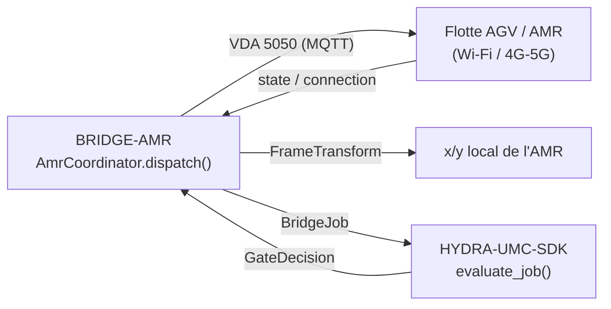

<!-- =============================================================================
HYDRA-UMC-BRIDGE-AMR - AMR/AGV coordination bridge
Copyright (C) JuanenRac (Electro Hobby 3D) <electrohobby3d@gmail.com>
GPL-3.0-or-later - see LICENSE
============================================================================= -->

<p align="center">
  
</p>

# 🚚 HYDRA-UMC-BRIDGE-AMR

<p align="center"><a href="README.md">🇺🇸 English</a> | <a href="README_spa.md">🇪🇸 Español</a> | 🇫🇷 <b>Français</b> | <a href="README_ita.md">🇮🇹 Italiano</a> | <a href="README_deu.md">🇩🇪 Deutsch</a> | <a href="README_zho.md">🇨🇳 简体中文</a> | <a href="README_jpn.md">🇯🇵 日本語</a> | <a href="README_por.md">🇵🇹 Português</a></p>

### 🔗 Frontière de coordination sans dépendance entre HYDRA-UMC et les flottes AGV/AMR

<p align="center">
  
  
  
  
  
  
</p>

---

> **Vérification d'honnêteté - ce qui fonctionne réellement aujourd'hui :** la transformation de repère de coordonnées et la porte de validation des tâches (`coordinator.py` avec `AmrCoordinator`/`FrameTransform`, faisant passer chaque envoi par le propre `evaluate_job()` de `HYDRA-UMC-SDK`) ainsi que la logique de forme de message/topic VDA 5050 (`mqtt_transport.py` avec `Vda5050Publisher`) sont réelles et couvertes par 145 tests unitaires qui passent (`python tools/build_test.py` - `test_coordinator.py`, `test_mqtt_transport.py`, plus `test_vda5050_emulator.py` qui fait tourner le bridge contre un émulateur d'AGV VDA 5050 fidèle au protocole mais écrit à la main, pas un véritable AGV en production). Rien de tout cela n'a été testé contre un vrai broker MQTT, un vrai client `paho-mqtt`, ou un AMR/gestionnaire de flotte physique - le `FakeMqttClient` propre à `test_mqtt_transport.py` remplace entièrement `paho-mqtt` (la vraie bibliothèque n'a même pas besoin d'être installée pour que ces tests passent), et il n'existe pas encore de commande `run` en direct car aucun transport réel de gestionnaire de flotte n'a été choisi ni validé. Voir « Feuille de route et limites connues » ci-dessous, qui le dit déjà clairement, et `CHANGELOG.md` pour ce qui a été exactement livré jusqu'à présent. Son client MQTT a aussi été exécuté contre un vrai HYDRA-UMC-MQTT-BROKER sur une machine de développement (`tests/test_broker_integration.py`, ignoré si aucun broker n'est installé) : un ordre publié par son intermédiaire, l'état et la connexion retenus du véhicule et son dernier testament suivis par l'observateur, et le retour après l'arrêt puis le redémarrage du broker.

> **État de la sûreté et de la cybersécurité :** cet écosystème n'est pas un système de sécurité certifié. Il n'existe pas encore de chaîne d'E-STOP matérielle, ni de limites ou de verrouillages imposés par le firmware, ni de commande de mouvement vérifiée ; les images de firmware sont contrôlées par CRC-32 et une signature Ed25519, et une compilation de version refuse les clés de développement publiées (les têtes d'outil et les cartes d'extension derrière le relais utilisent encore les chargeurs d'URTC, qui prennent un HMAC-SHA256 à clé partagée au lieu d'une signature) ; TLS et TLS mutuel sont optionnels et désactivés par défaut ; aucune carte propre n'a encore été assemblée ni testée. Lisez la [base de sécurité](https://github.com/JuanenRac/HYDRA-UMC-DOCS/blob/main/docs/SECURITY_BASELINE.md) et le [modèle de menaces](https://github.com/JuanenRac/HYDRA-UMC-DOCS/blob/main/docs/THREAT_MODEL.md) avant de vous fier à une affirmation d'ici pour la sécurité d'une personne.

---

## 📋 En un coup d'œil

| | |
|---|---|
| Version | `0.1.5` |
| Maturité | Fonctionnel |
| Tests | 145 (`python tools/build_test.py`) |
| Technologie | Python / VDA 5050 (subset) / MQTT / HYDRA-UMC-SDK |
| Sur matériel réel | Simulé seulement : testé avec des émulateurs, des doubles de test ou des simulateurs ; aucune exécution sur du matériel réel n'est consignée pour cette version |

**Aller à :** [Présentation](#-présentation) · [Architecture](#-architecture) · [Fonctionnalités](#-fonctionnalités) · [Sécurité et protection](#-sécurité-et-protection) · [Interfaces](#-interfaces) · [Configuration](#-configuration) · [Démarrage rapide](#-démarrage-rapide) · [Tests](#-tests) · [Dépannage](#-dépannage) · [Structure du dépôt](#-structure-du-dépôt) · [Projets liés](#-projets-liés)

## 🚦 État du projet

Chaque ligne est une partie de ce dépôt et le feu dit où elle en est aujourd'hui. Elle est écrite d'après ce que le dépôt peut montrer (tests, compilations, exécutions), pas d'après ce qui est prévu.

🟢 Fait et vérifié · 🟡 Fonctionne, avec des limites connues · 🟠 À moitié fait ou pas encore vérifié · 🔴 Pas fait ou ne fonctionne pas

| Domaine | État | Ce que cela veut dire ici |
|---|---|---|
| Logiciel | 🟡 | Fonctionne pour son usage principal ; la vérification d'honnêteté ci-dessus liste ce qui manque encore |
| Tests | 🟢 | 145 tests automatiques, exécutés à chaque modification |
| Matériel réel | 🟠 | Simulé seulement : testé avec des émulateurs, des doubles de test ou des simulateurs ; aucune exécution sur du matériel réel n'est consignée pour cette version |
| Documentation | 🟢 | README en huit langues, vérifié par rapport au manifeste à chaque modification |

## 🎯 Présentation

**HYDRA-UMC-BRIDGE-AMR** est la frontière de coordination bidirectionnelle et haut niveau entre HYDRA-UMC et une flotte AGV/AMR (robot mobile autonome), accessible par Wi-Fi ou une liaison cellulaire (4G/5G). Elle fait exactement deux choses réelles avant qu'une tâche n'atteigne un AMR : résoudre une coordonnée du repère usine vers le repère local propre de cet AMR au moyen d'une transformation rigide 2D réelle et vérifiable à la main, et mapper une phase de tâche vers une action d'ordre minimale inspirée de VDA 5050. Elle n'a aucune logique propre de navigation, de localisation ni d'évitement d'obstacles, et elle ne peut pas contourner HYDRA-UMC-SERVER, les limites du MCU, les watchdogs ou l'E-STOP.

Il appartient à la famille **Mobile & Autonomous Bridges**, aux côtés de `HYDRA-UMC-BRIDGE-DROIDS` et `HYDRA-UMC-BRIDGE-UAV`, et partage le même contrat de tâches et de sécurité `HYDRA-UMC-SDK` que les **External Automation Bridges** stationnaires (CNC, LASER, OPENPNP, PRINTER3D, ROS2).

## 🧩 Rôle dans HYDRA-UMC

**HYDRA-UMC-BRIDGE-AMR** coordonne une flotte d'AGV ou d'AMR avec une cellule de robots. Il transforme un travail de cellule validé en ordre VDA 5050 (jamais de mouvement brut) et relit les messages `state` et `connection` du véhicule, pour que la porte sache s'il peut prendre un ordre.

Chaque bridge parle le contrat de sécurité partagé de `HYDRA-UMC-SDK` : un travail n'est accepté que si la porte partagée `evaluate_job()` le permet, et cette porte échoue en position fermée. Le projet parent est `HYDRA-UMC-SERVER` ; ce bridge ne l'appelle pas, il répond en MQTT, via `HYDRA-UMC-MQTT-BROKER`, à celui qui commande la cellule.

## 🏛️ Architecture

<p align="center">
  
</p>

<details>
<summary>Version texte du diagramme (Mermaid)</summary>



</details>

**Pourquoi il est construit ainsi**

* **Pourquoi une transformation réelle de repère de coordonnées vit ici, et pas seulement un simple relais.** Les coordonnées propres de la cellule HYDRA-UMC et la carte locale d'un AMR donné partagent rarement une origine ou un cap — la note d'architecture collée dont ce projet est parti le signale explicitement (« mapper les coordonnées de la carte usine vers la carte locale propre du robot »). `FrameTransform` est la mathématique réelle, vérifiée à la main, qui comble cet écart, maintenue comme de la trigonométrie pure sans dépendance à un gestionnaire de flotte, afin d'être testable partout.
* **Pourquoi le vocabulaire d'actions d'ordre est calqué sur VDA 5050.** VDA 5050 est le standard réel, ouvert et neutre vis-à-vis des constructeurs pour l'intégration de flottes que plusieurs flottes AMR commerciales (et un nombre croissant de piles logicielles open source) parlent déjà — nommer les actions propres de ce dépôt d'après ce vocabulaire réel (`CANCEL_ORDER`, mouvement en forme de nœud/action) signifie qu'un futur adaptateur VDA 5050 réel s'intégrera naturellement, plutôt que de nécessiter une couche de traduction ajoutée après coup.
* **Pourquoi `AmrCoordinator.dispatch()` fait quand même passer chaque tâche par le portail partagé `evaluate_job()`.** Un AMR n'est qu'un client de plus du même `bridge_contract` utilisé par CNC, LASER, OPENPNP, PRINTER3D, ROS2 et DROIDS — il ne bénéficie d'aucun contournement spécial de la logique IDLE/READY appliquée par tous les autres ponts et par HYDRA-UMC-SERVER.
* **Pourquoi `CANCEL_ORDER` reste demandable pendant un défaut.** L'exigence de phase productive du portail (`IDLE` + `READY`) n'est délibérément pas appliquée de la même manière à une demande d'abandon — un opérateur doit toujours pouvoir annuler l'ordre en cours d'un AMR, même en plein défaut.
* **Pourquoi il n'y a pas encore d'adaptateur propre à un fabricant pour le gestionnaire de flotte dans ce dépôt.** (Le publieur MQTT VDA 5050 existe, voir ci-dessus.) S'engager sur le protocole REST/WebSocket réel d'un AMR donné avant qu'une flotte réelle ne soit sélectionnée et testée risquerait d'intégrer des hypothèses que ce noyau local sans dépendance ne peut pas vérifier.
* **Comment cela s'intègre dans le reste de l'écosystème.** BRIDGE-AMR se situe entre une flotte AMR réelle et `HYDRA-UMC-SDK` → `HYDRA-UMC-SERVER` → sécurité MCU : c'est une frontière de coordination, jamais un nœud de navigation ou de contrôle moteur, et elle ne peut pas contourner HYDRA-UMC-SERVER, les limites du MCU, les watchdogs ou l'E-STOP.

## ✨ Fonctionnalités

* 🧾 **Schémas VDA 5050 officiels et maintien configurable :** les tests valident chaque message construit par le pont contre les schémas JSON officiels de VDA 5050 2.0.0 (`order` et `instantActions`, fournis dans `tests/vda5050_schemas`) ; une action instantanée porte désormais `actionName` à côté de `actionType`, car le schéma officiel instantActions l'exige. `AmrCoordinator(abort_action=AmrCoordinator.START_PAUSE)` fait que la phase d'arrêt maintient le véhicule avec `startPause` au lieu d'abandonner son ordre avec `cancelOrder` (le défaut) ; les deux sont toujours transmises. `MOVE_TO_HOME` passe par la même porte que tout mouvement. `AmrCoordinator.resume()` n'envoie `stopPause` que pour une cellule READY et un véhicule lu comme en pause, et `abort_action=AmrCoordinator.ABORT_BOTH` envoie `cancelOrder` puis `startPause`. *(implémenté)*
* ✅ **Transformation réelle de repère de coordonnées, vérifiable à la main :** `FrameTransform` mappe une coordonnée `(x, y)` du repère usine vers le repère local propre d'un AMR donné, à partir de l'origine et du cap réels de cet AMR sur le site — vérifiée par un cas identité, une translation pure, une rotation de cap de 90 degrés et un véritable test aller-retour. *(implémenté, testé dans `tests/test_coordinator.py`)*
* ✅ **Vocabulaire réel d'actions d'ordre inspiré de VDA 5050 :** `MOVE_TO_STAGING`, `PICK_LOAD`, `MOVE_TO_DESTINATION`, `DROP_LOAD`, `MOVE_TO_HOME` sont publiés sur le topic `order` réel de VDA 5050 (en file d'attente, partie d'une route) ; `CANCEL_ORDER` est publié sur le topic `instantActions` réel et distinct (immédiat, contourne la file d'ordres) - conforme au nom réel de l'action `cancelOrder` de VDA 5050 ET à son canal réel, vérifié avec les [schémas officiels](https://github.com/VDA5050/VDA5050/tree/main/json_schemas). *(implémenté)*
* ✅ **Validation réelle des coordonnées par action :** une action de déplacement à laquelle il manque `x`/`y`, ou qui en porte une non numérique, est rejetée localement avant même que la transformation ne s'exécute. *(implémenté, testé)*
* ✅ **Portail de sécurité partagé, réel :** chaque tâche envoyée via `AmrCoordinator.dispatch()` est évaluée par `evaluate_job()` du `bridge_contract` de `HYDRA-UMC-SDK`, le même portail utilisé par tous les ponts frères et HYDRA-UMC-SERVER ; une phase productive nécessite une machine externe `IDLE` et une cellule HYDRA-UMC `READY`, tandis que `CANCEL_ORDER` reste demandable pendant un défaut. *(implémenté)*
* ✅ **Routage de phases fermé et évidence statique :** une future phase SDK inconnue est refusée. `inspect_order_plan.py` émet le plan d'ordre statique de schéma `1.0` sans ouvrir aucun transport. *(implémenté, testé)*
* ✅ **Éditeur MQTT VDA 5050 réel :** `Vda5050Publisher` de `mqtt_transport.py` envoie une répartition déjà validée sous forme de message réel, conforme au schéma, sur le bon topic réel (`{interfaceName}/{majorVersion}/{manufacturer}/{serialNumber}/{order|instantActions}`) - une répartition rejetée n'atteint jamais le réseau. *(implémenté, testé dans `tests/test_mqtt_transport.py`)*
* ✅ **Build/test non mutant :** `build-test.bat`/`.sh` compilent le code source et exécutent des tests unitaires déterministes sans changer la version ni le CHANGELOG. *(implémenté, voir COMPILATION ET EXÉCUTION ci-dessous)*
* 🔜 **Adaptateur REST/WebSocket propre à un gestionnaire de flotte** (pour une plateforme de flotte qui n'est pas nativement VDA 5050) — introduit seulement après la sélection et le test de cette plateforme. *(prévu)*
* ✅ **État observé de la machine et identifiants d'ordre qui survivent à un redémarrage :** `AmrCoordinator.dispatch()` accepte l'état que le gestionnaire de flotte a rapporté pour le véhicule, que la porte partagée utilise à la place du `machine_state` écrit dans le travail (un message que n'importe qui sur le broker peut publier) ; `Vda5050Publisher` donne à chaque ordre un `orderId` avec un jeton propre, de sorte qu'un redémarrage qui recompte `headerId` depuis le début ne réutilise pas l'identifiant d'un ordre précédent (VDA 5050 le refuse). *(implémenté, testé dans `tests/test_observed_and_order_ids.py`)*
* ✅ **Noms VDA 5050 sur le fil, un client que le broker accepte et un observateur qui écoute :** les internes `CANCEL_ORDER` / `PICK_LOAD` / `DROP_LOAD` partent sous les types d'action VDA 5050, sensibles à la casse, `cancelOrder` / `pick` / `drop` (avant, `CANCEL_ORDER` partait tel quel, ce qu'un AGV ne reconnaît pas comme une annulation), et un déplacement n'est que son nœud de destination, sans type d'action inventé ; `actionId` et `nodeId` portent le jeton de session comme l'`orderId` ; `header_id` et `timestamp_iso` peuvent être omis (le publieur compte par topic et pose l'heure UTC) et sont validés quand ils sont fournis ; une coordonnée qui déborde, un nombre non fini ou un point hors de `FrameTransform.bounds` est refusé (`allow_nan=False`). `open_mqtt_client()` prend un `client_id` (le broker authentifie par son préfixe), utilise l'API de callbacks v2 et attend la réponse du broker au lieu de renvoyer un client qui ne peut pas publier ; avec un `Vda5050Observer`, il s'abonne aux topics `state` et `connection` de l'AGV et en déduit l'état de machine utilisé par la porte (OFFLINE si périmé, non ONLINE ou pas en mode AUTOMATIC ; sinon SAFE_STOP, FAULT, HOLDING, RUNNING ou IDLE). *(implémenté, testé avec des doublures et l'émulateur ; jamais exécuté contre un vrai AGV ni un vrai gestionnaire de flotte, et un trajet qui part du nœud où se trouve l'AGV (deux nœuds et une arête, ce qui demande le graphe de l'usine) n'est PAS encore construit, un vrai AGV refusera donc ces ordres à un seul nœud de destination)*
* ✅ **Suit l'arrêt global (désactivé par défaut):** avec `HYDRA_UMC_AMR_GLOBAL_STOP=1`, le bridge lit l'annonce retenue du serveur sur `hydra/swarm/safety/estop` ; tant qu'elle dit `SAFE_STOP`, ou est illisible, il refuse avec un motif : tout ordre qui déplace le véhicule (l'annulation et la pause passent). Les arrêts et les requêtes en lecture seule continuent de fonctionner et seul `READY` met fin au refus. *(implémenté, testé contre un vrai broker ; jamais exécuté avec un vrai serveur)*

## 🔒 Sécurité et protection

| Menace | Défense | Où |
|---|---|---|
| Un travail pour une cellule ou une machine qui n'est pas en état sûr | Chaque travail passe par la porte partagée `evaluate_job()` du SDK, qui échoue en position fermée ; le bridge n'a aucune logique propre d'acceptation | SDK `bridge_contract` |
| Données de travail démesurées | Au plus 32 paramètres, clés jusqu'à 64 caractères, valeurs jusqu'à 1024, identifiants jusqu'à 128 (`MAX_PARAMETERS`, `MAX_PARAMETER_KEY_CHARS`, `MAX_PARAMETER_VALUE_CHARS`, `MAX_IDENTIFIER_CHARS`) | SDK `bridge_contract` |
| Un ordre répété ou rejoué | Un `IdempotencyStore` retient chaque clé 24 heures et au plus 10 000 entrées ; une répétition reçoit la première réponse au lieu d'être réévaluée | SDK `job_intake` |
| Un ordre de mouvement brut envoyé à un véhicule | Le coordinateur ne transforme un travail qu'en ordre local AMR ; `simulated_amr.TRANSITIONS` dit quelle action est légale depuis quel état (par exemple `MOVE_TO_STAGING` seulement depuis `IDLE`) | `coordinator.py`, `simulated_amr.py` |
| Un message VDA 5050 mal formé | Chaque message `order` et `instantActions` construit par l'éditeur est validé dans les tests contre les schémas JSON officiels de VDA 5050 2.0.0, copiés sans changement | `tests/test_vda5050_schemas.py` |
| Un véhicule qui ne peut pas prendre d'ordre | Un envoi refusé n'atteint jamais le réseau ; l'observateur traite un `state` ou `connection` absent ou ancien (plus de 90 secondes) comme non prêt | `mqtt_transport.py`, `observer.py` |

**Ce qu'il ne fait jamais :** il n'envoie jamais de mouvement brut et n'a jamais tourné contre un véhicule ni un gestionnaire de flotte réels.

## 🔌 Interfaces

Les topics VDA 5050 sont `{interface_name}/{major_version}/{manufacturer}/{serial_number}/{channel}` (`Vda5050Target.topic()`), par exemple `vda5050/v2/acme/agv-01/order`.

| Topic ou route | Ce qu'il porte |
|---|---|
| `order`, `instantActions` | publiés ; chacun a son compteur `header_id` et un horodatage UTC |
| `state`, `connection` | observés par `Vda5050Observer` ; l'abonnement est renouvelé après chaque reconnexion |

La bibliothèque : `AmrCoordinator`, `FrameTransform`, `Vda5050Publisher`, `Vda5050Target`, `Vda5050Observer`, `SimulatedAmr`, `open_mqtt_client()`. L'identifiant client MQTT par défaut est `hydra-umc-bridge-amr`.

## ⚙️ Configuration

| Variable | Par défaut | Ce qu'elle définit |
|---|---|---|
| `HYDRA_MQTT_USERNAME` | aucun | Le nom d'utilisateur MQTT ; le broker le lie à un préfixe d'identifiant client |
| `HYDRA_MQTT_PASSWORD` | aucun | Le mot de passe ; valable seulement avec le nom d'utilisateur |
| `HYDRA_MQTT_PASSWORD_FILE` | aucun | Le mot de passe lu dans un fichier (secret Docker ou systemd) ; ignoré si `HYDRA_MQTT_PASSWORD` est défini |
| `HYDRA_MQTT_TLS_CA` | aucun | Le fichier de l'AC qui a signé le certificat du broker : la connexion est en TLS et le certificat est vérifié |
| `HYDRA_MQTT_TLS` | désactivé | `1` active TLS, vérifié avec les AC de confiance du système |
| `HYDRA_MQTT_TLS_CERT` / `HYDRA_MQTT_TLS_KEY` | aucun | Le certificat client et sa clé pour un broker qui exige du TLS mutuel ; les deux sont requis |
| `HYDRA_UMC_AMR_GLOBAL_STOP` | désactivé | `1` suit l'arrêt global du serveur : tant que la dernière annonce du sujet retenu `hydra/swarm/safety/estop` dit `SAFE_STOP` (ou est illisible), le bridge refuse avec un motif : tout ordre qui déplace le véhicule (l'annulation et la pause passent) ; seul `READY` y met fin. `HYDRA_UMC_AMR_GLOBAL_STOP_TOPIC` change le sujet et `HYDRA_UMC_AMR_GLOBAL_STOP_STRICT=1` refuse aussi tant que la première annonce n'est pas arrivée |
| `HYDRA_UMC_AMR_MAX_STATE_BYTES` | aucun (pas de plafond) | Le plus grand message `state` ou `connection`, en octets, que l'observateur analyse ; un message plus grand est ignoré comme tout message illisible |

Il n'y a pas de fichier de configuration : le broker, `interface_name`, `major_version`, `manufacturer`, `serial_number` et l'action d'abandon (`cancelOrder`, `startPause` ou les deux) sont des arguments des constructeurs.

## 🚀 Démarrage rapide

Nécessite Python 3.11 ou plus récent. Les tests et les scripts de build attendent `HYDRA-UMC-SDK` cloné à côté de ce dépôt (`../HYDRA-UMC-SDK`) ou indiqué par `HYDRA_UMC_SDK_ROOT`.

Essayez-le sans matériel (cela vérifie tout le bridge avec ses émulateurs et ses doubles de test) :

```bash
py -3 tools/build_test.py          # Windows
python3 tools/build_test.py         # Linux, macOS
```

Démarrer le service (il n'y a pas de script de console : le service est le `run_forever()` du transport MQTT, que vous appelez depuis votre propre code de démarrage) :

```python
from hydra_umc_bridge_amr import AmrCoordinator, FrameTransform, Vda5050Publisher, Vda5050Target, open_mqtt_client
client = open_mqtt_client("192.168.0.180")        # connects; the credentials come from HYDRA_MQTT_*
target = Vda5050Target("vda5050", "v2", "acme", "agv-01")
dispatch = AmrCoordinator().dispatch(job, cell_state, FrameTransform(map_id="hall", origin_x=0.0, origin_y=0.0, heading_rad=0.0))
Vda5050Publisher().publish(client, target, None, None, dispatch)   # a rejected dispatch is never sent
```

Le nom d'utilisateur, le mot de passe et les fichiers TLS viennent des variables `HYDRA_MQTT_*` (voir Configuration) ; le code ci-dessus n'a besoin d'aucun identifiant propre.

## 🧪 Tests

145 cas `unittest` automatiques s'exécutent avec `python tools/build_test.py` (qui compile aussi chaque module). Les tests n'ont besoin ni de matériel, ni de réseau, ni de paquet optionnel : ceux qui exigeraient `paho-mqtt`, `pyserial` ou une bibliothèque de fabricant utilisent un substitut ou sont ignorés si le paquet manque.

| Fichier de tests | Tests | Ce qu'il couvre |
|---|---|---|
| `test_coordinator.py`, `test_observed_and_order_ids.py`, `test_edge_cases.py` | - | passage du travail à l'ordre, transformation rigide de repère, identifiants, cas limites |
| `test_vda5050_schemas.py` | - | chaque message validé contre les schémas officiels VDA 5050 2.0.0 |
| `test_vda5050_emulator.py`, `vda5050_emulator.py` | - | le vrai coordinateur et éditeur contre un véhicule VDA 5050 au niveau des formes sur le bus MQTT |
| `test_mqtt_transport.py`, `test_mqtt_environment.py`, `test_hardening.py`, `test_simulated_amr.py` | - | éditeur contre un faux client MQTT, identifiants d'environnement, entrées hostiles, la table d'états |

La CI exécute `HYDRA_UMC_CI=1 python tools/ci_validate.py`, qui vérifie le manifeste, les documents, les huit README et les images, et lance les tests avec une copie du SDK.

## 🏗️ Compilation et publication

Nécessite Python 3.11+. `tools/build_test.py` attend que `HYDRA-UMC-SDK` soit cloné en tant que répertoire frère (`../HYDRA-UMC-SDK`) ou indiqué via la variable d'environnement `HYDRA_UMC_SDK_ROOT`.

```bash
# Windows
build-test.bat      # validation uniquement — pas de changement de version/CHANGELOG
build.bat            # Valide et compile (compiler ne change jamais la version)

# Linux/macOS
bash build-test.sh
bash build.sh
```

`build-test` compile chaque module sous `src/` avec `py_compile` et exécute la suite complète `unittest` découverte sous `tests/` (tous les fichiers `test_*.py` - 145 tests) — de manière déterministe, sans connexion réelle à un AMR, sans réseau et sans changement de version/CHANGELOG. `build` exécute d'abord cette même validation et, seulement en cas de succès, appelle `tools/bump_version.py` pour synchroniser la version dans `pyproject.toml`, `hydra-umc.project.json` et `CHANGELOG.md`. Il n'existe pas encore de commande `run` avec matériel réel — cela nécessite un adaptateur de transport de gestionnaire de flotte validé et une flotte/AMR réelle.

## 🩺 Dépannage

| Vous voyez | Parce que | Faites |
|---|---|---|
| `ModuleNotFoundError: hydra_umc_sdk` | Le SDK n'est ni installé ni à côté de ce dépôt | Clonez `HYDRA-UMC-SDK` à côté de ce dépôt ou définissez `HYDRA_UMC_SDK_ROOT` |
| `paho-mqtt is not installed` | Le client MQTT est un extra optionnel | `pip install ".[mqtt]"` (il faut `paho-mqtt` 2.1 ou plus, avant 3) |
| `password was given without a username` | Les identifiants MQTT exigent les deux parties | Définissez aussi `HYDRA_MQTT_USERNAME`, pas seulement le mot de passe |
| `could not reach the MQTT broker after N attempts` | Le broker est arrêté, l'adresse est fausse ou le port est fermé | Démarrez `HYDRA-UMC-MQTT-BROKER` et vérifiez l'hôte et le port donnés au transport (5 essais à 2 secondes d'écart) ; un échec de la poignée de main TLS n'est pas réessayé |
| `the MQTT broker refused the connection` | Le broker a refusé l'identifiant (ou n'a pas répondu à temps) | Vérifiez `HYDRA_MQTT_USERNAME` et le mot de passe ; l'identifiant client doit commencer par le préfixe que le broker a lié à l'identifiant |
| `"allowed": false` + `reason` | La porte partagée ou une garde a refusé l'ordre | Lisez `reason` et corrigez la cause ; ne réessayez pas à l'aveugle |

## 📂 Structure du dépôt

<p align="center">
  
</p>

<details>
<summary>Version texte de l'arborescence</summary>

```text
HYDRA-UMC-BRIDGE-AMR/
├── src/hydra_umc_bridge_amr/
│   ├── coordinator.py             transforme un travail en ordre local AMR, jamais de mouvement brut ; FrameTransform
│   ├── mqtt_transport.py          éditeur VDA 5050 et client MQTT
│   ├── observer.py                transforme `state` et `connection` de l'AGV en état de machine
│   └── simulated_amr.py           table des actions légales depuis chaque état
├── tests/                         110 tests, avec un émulateur VDA 5050 et les schémas officiels
├── docs/                          guide du bridge
├── tools/                         exécuteur de build et de tests, montée de version, validateur CI, générateurs et vérifications des README et des images
├── images/                        bannière et images du README
├── .github/                       workflow CI et modèles de tickets
├── pyproject.toml                 métadonnées du paquet et dépendances
├── hydra-umc.project.json         manifeste : version, maturité, famille
├── CHANGELOG.md                   ce qui a changé à chaque version
├── build.sh build.bat             scripts de build (ils ne changent jamais la version)
├── build-test.sh build-test.bat   scripts de build (ils ne changent jamais la version)
├── test.sh test.bat               lancent les tests
└── SECURITY.md SUPPORT.md CONTRIBUTING.md CODE_OF_CONDUCT.md LICENSE LICENSE.md
```

</details>

## 🗺️ Feuille de route et limites connues

**Limites connues aujourd'hui**

**Réel aujourd'hui :** version `0.1.5`, fonctionnel en tant que noyau de coordination sans dépendance (`AmrCoordinator`) avec une transformation réelle de repère de coordonnées vérifiée à la main (`FrameTransform`), un routage de phases fermé, un schéma d'ordre statique `plan-only` avec la véritable séparation de canaux order/instantActions de VDA 5050, un éditeur MQTT VDA 5050 réel (`Vda5050Publisher`), et des scripts build-test non mutants intégrés en CI avec un checkout du SDK.

**Frontière d'intégration :** ce pont n'est qu'une frontière de coordination — ce n'est pas un nœud de navigation ni de contrôle moteur, et il ne peut pas contourner HYDRA-UMC-SERVER, les limites du MCU, les watchdogs ou l'E-STOP ; chaque tâche envoyée passe toujours par le même portail partagé utilisé par tous les ponts frères.

**Encore à venir :** aucun transport réel de gestionnaire de flotte (VDA 5050, REST/WebSocket propre à un constructeur) ni AMR physique n'a encore été validé — un adaptateur réel sera introduit seulement après la sélection et le test d'une plateforme de flotte spécifique.

## 🌍 Langues

Ce README et les documents du dépôt existent en huit langues : anglais, espagnol, allemand, français, italien, japonais, chinois et portugais (Portugal). Ils sont écrits ensemble et la CI vérifie que les huit fichiers ont les mêmes sections et les mêmes liens. Ce dépôt n'a ni écran ni catalogue de messages propre, il n'y a donc aucune chaîne d'interface à traduire.

## 🔗 Projets liés

Ce projet fait partie de l'écosystème robotique HYDRA-UMC du même auteur (JuanenRac / Electro Hobby 3D). Bon à savoir, car une demande pourrait en réalité concerner l'un de ceux-ci plutôt que ce dépôt.

**Projet Parent**
- **[HYDRA-UMC-SERVER](https://github.com/JuanenRac/HYDRA-UMC-SERVER)** — le vrai backend headless (REST/WebSocket) auquel parle réellement chaque client de contrôle ; la frontière authentifiée de l'écosystème à laquelle ce bridge rend compte une fois chaque commande passée par la propre barrière de sécurité locale de ce bridge.

**Projets Frères** — parlent également à la propre API de HYDRA-UMC-SERVER, chacun en tant que son propre client
- **[HYDRA-UMC-STUDIO](https://github.com/JuanenRac/HYDRA-UMC-STUDIO)** — tableau de bord de contrôle web avec visualisation 3D multi-robot en temps réel.
- **[HYDRA-UMC-SUITE](https://github.com/JuanenRac/HYDRA-UMC-SUITE)** — centre de commande d'essaim de bureau (PySide6) pour plusieurs serveurs à la fois, empaqueté en exécutable autonome.
- **[HYDRA-UMC-ANDROID-CONTROL](https://github.com/JuanenRac/HYDRA-UMC-ANDROID-CONTROL)** — application de contrôle Android native avec connexion biométrique et un compagnon Wear OS jumelé.
- **[HYDRA-UMC-IOS-CONTROL](https://github.com/JuanenRac/HYDRA-UMC-IOS-CONTROL)** — application de contrôle iOS/iPadOS (Flutter) avec synchronisation WebSocket en temps réel.
- **[HYDRA-UMC-DSI](https://github.com/JuanenRac/HYDRA-UMC-DSI)** — interface tactile native pour l'écran tactile DSI 7" embarqué, intégrée directement sur le CM5.
- **[HYDRA-UMC-BRIDGE-CNC](https://github.com/JuanenRac/HYDRA-UMC-BRIDGE-CNC)** — coordinateur haut niveau pour cellules CNC avec accès au statut/octets de contrôle GRBL (testé uniquement contre un émulateur).
- **[HYDRA-UMC-BRIDGE-DROIDS](https://github.com/JuanenRac/HYDRA-UMC-BRIDGE-DROIDS)** — frontière de coordination pour droïdes à pattes/humanoïdes, avec un émetteur de commandes Boston Dynamics Spot (testé uniquement contre un émulateur) — l'un des 3 bridges de flotte mobile de l'écosystème.
- **[HYDRA-UMC-BRIDGE-LASER](https://github.com/JuanenRac/HYDRA-UMC-BRIDGE-LASER)** — coordinateur de cellules laser lisant 3 signaux GPIO de clé/enceinte/verrouillage (testé uniquement contre une puce simulée ; il ne peut ni armer ni tirer un laser).
- **[HYDRA-UMC-BRIDGE-OPENPNP](https://github.com/JuanenRac/HYDRA-UMC-BRIDGE-OPENPNP)** — coordinateur haut niveau sûr pour le flux de cartes du pick-and-place OpenPnP.
- **[HYDRA-UMC-BRIDGE-PRINTER3D](https://github.com/JuanenRac/HYDRA-UMC-BRIDGE-PRINTER3D)** — frontière de coordination sûre pour imprimantes 3D Moonraker/Klipper, avec de vraies commandes de tâche contrôlées.
- **[HYDRA-UMC-BRIDGE-ROS2](https://github.com/JuanenRac/HYDRA-UMC-BRIDGE-ROS2)** — coordinateur avec un transport ROS 2 rclpy à importation paresseuse (pas encore exécuté contre une installation ROS 2).
- **[HYDRA-UMC-BRIDGE-UAV](https://github.com/JuanenRac/HYDRA-UMC-BRIDGE-UAV)** — frontière de coordination pour UAV équipés de caméra, avec un émetteur de commandes MAVLink (testé uniquement contre un émulateur) — l'un des 3 bridges de flotte mobile de l'écosystème.

**Directement Liés**
- **[HYDRA-UMC-SDK](https://github.com/JuanenRac/HYDRA-UMC-SDK)** — le contrat JSON-Schema partagé et la barrière logicielle de contrôle des jobs contre laquelle chaque bridge valide ses commandes (pas une fonction de sécurité certifiée).
- **[HYDRA-UMC-CONNECTOR-HUB](https://github.com/JuanenRac/HYDRA-UMC-CONNECTOR-HUB)** — registre déclaratif et validateur de manifestes d'adaptateur pour les connecteurs de machines externes ; étend la propre idée de contrat du SDK aux machines externes sans remplacer les projets de passerelle industrielle.
- **[HYDRA-UMC-MQTT-BROKER](https://github.com/JuanenRac/HYDRA-UMC-MQTT-BROKER)** — le `Vda5050Publisher` de `mqtt_transport.py` envoie chaque dispatch déjà validé comme un vrai message VDA 5050 `order`/`instantActions` conforme à la spécification — contrairement au schéma de topics `hydra/bridges/<nom>/...` propre aux autres bridges, celui-ci utilise directement la vraie forme de topic de VDA 5050.

**Fait Également Partie de l'Écosystème**

*Matériel & Plateforme de Base*
- **[HYDRA-UMC](https://github.com/JuanenRac/HYDRA-UMC)** — la conception de la carte mère du bras robotique : hôte CM5 + coprocesseur STM32H745 double cœur, destinée à coordonner jusqu'à 8 bras-outils via CAN-OTA/SPI-OTA (firmware à un stade précoce ; aucune carte assemblée pour l'instant).
- **[HYDRA-UMC-OS](https://github.com/JuanenRac/HYDRA-UMC-OS)** — couche produit reproductible sur Raspberry Pi OS pour le CM5 : agent en lecture seule, config/profils validés, provisionnement WiFi de premier contact.

*Backend Central & Clients*
- **[HYDRA-UMC-EDITOR-URDF](https://github.com/JuanenRac/HYDRA-UMC-EDITOR-URDF)** — créateur/éditeur graphique de bureau pour URDF qui envoie les modèles terminés vers le propre catalogue de STUDIO.
- **[HYDRA-UMC-EDITOR-STL](https://github.com/JuanenRac/HYDRA-UMC-EDITOR-STL)** — éditeur de bureau de modèles STL, transformant/remplaçant/retirant/ajoutant de vraies pièces dans le même catalogue de modèles qu'édite aussi HYDRA-UMC-EDITOR-URDF.

*Plateforme d'Outils URTC*
- **[URTC](https://github.com/JuanenRac/URTC)** — firmware pour la carte physique Universal Robot Tool Controller, plus de 25 profils d'outil sur bus CAN.
- **[URTC-FLASHER](https://github.com/JuanenRac/URTC-FLASHER)** — outil de bureau à interface graphique pour flasher les cartes URTC, CAN-OTA plus SWD/JTAG puce complète.
- **[URTC-TESTER](https://github.com/JuanenRac/URTC-TESTER)** — outil de bureau de diagnostic CAN-bus en direct pour cartes URTC, un panneau par profil d'outil.
- **[URTC-WEB-STUDIO](https://github.com/JuanenRac/URTC-WEB-STUDIO)** — alternative basée navigateur à URTC-TESTER via la Web Serial API, sans installation locale.
- **[URTC-GATEWAY](https://github.com/JuanenRac/URTC-GATEWAY)** — passerelle devant le bus CAN d'URTC : liste d'identifiants autorisés, limite de débit et clé de session ; logiciel testé sur ordinateur, pas encore sur un bus réel.

*Nœud IA de Vision (Hailo-8)*
- **[HYDRA-UMC-VISION-NODE](https://github.com/JuanenRac/HYDRA-UMC-VISION-NODE)** — hub d'intégration pour le pipeline de vision Hailo-8, avec une vraie vérification de disponibilité matérielle par étape.
- **[HYDRA-UMC-DETECTION-HEF](https://github.com/JuanenRac/HYDRA-UMC-DETECTION-HEF)** — registre réel de modèles compilés avec vérification de chargement sécurisé par architecture Hailo/checksum.
- **[HYDRA-UMC-VISION-STREAMER](https://github.com/JuanenRac/HYDRA-UMC-VISION-STREAMER)** — générateur réel de pipeline GStreamer + config MediaMTX, avec une vraie frontière d'intégration HailoRT.
- **[HYDRA-UMC-VISUAL-SERVOING-API](https://github.com/JuanenRac/HYDRA-UMC-VISUAL-SERVOING-API)** — loi de correction Position-Based Visual Servoing avec autorisation conditionnée à l'état de zone ; pas encore d'estimation de pose par caméra.
- **[HYDRA-UMC-SAFETY-ZONES](https://github.com/JuanenRac/HYDRA-UMC-SAFETY-ZONES)** — logique v0 de violation de zone, de fraîcheur de calibration et de demande d'E-STOP qui lit les positions d'objets dans un fichier ; aucun détecteur ne l'alimente et aucun E-STOP physique n'y est encore relié.

*Nœud IA Cognitif (Hailo-10)*
- **[HYDRA-UMC-COGNITIVE-NODE](https://github.com/JuanenRac/HYDRA-UMC-COGNITIVE-NODE)** — hub d'intégration pour le pipeline cognitif Hailo-10 (orchestration LLM/VLA/voix).
- **[HYDRA-UMC-VLA-ENGINE](https://github.com/JuanenRac/HYDRA-UMC-VLA-ENGINE)** — vrai encodage/décodage de jetons d'action et génération de trajectoire pour un modèle Vision-Language-Action.
- **[HYDRA-UMC-VOICE-UI](https://github.com/JuanenRac/HYDRA-UMC-VOICE-UI)** — vrai front-end vocal (VAD + analyseur d'intention) avec un relais Watch borné et soumis à confirmation.
- **[HYDRA-UMC-SEMANTIC-PLANNER](https://github.com/JuanenRac/HYDRA-UMC-SEMANTIC-PLANNER)** — vraie décomposition de tâches basée sur des règles et récupération sémantique d'erreurs sur les codes d'erreur MCU.
- **[HYDRA-UMC-DOCS-QA](https://github.com/JuanenRac/HYDRA-UMC-DOCS-QA)** — vraie recherche documentaire TF-IDF (bibliothèque standard uniquement) sur les propres documents Markdown de cet écosystème.
- **[HYDRA-UMC-LOCAL-TECHNICIAN](https://github.com/JuanenRac/HYDRA-UMC-LOCAL-TECHNICIAN)** — technicien de maintenance IA local et à portes de politique pour l'écosystème lui-même - observe, diagnostique et propose des corrections ; les deux niveaux de risque les plus élevés ne sont délibérément pas encore implémentés.

*Orchestration & Essaim*
- **[HYDRA-UMC-ORCHESTRATOR](https://github.com/JuanenRac/HYDRA-UMC-ORCHESTRATOR)** — hub d'intégration avec un vrai contrat de rapport de santé gRPC/Protobuf et une machine à états de mission.
- **[HYDRA-UMC-JOB-DISPATCHER](https://github.com/JuanenRac/HYDRA-UMC-JOB-DISPATCHER)** — vraie file de tâches basée sur la priorité avec déduplication, via une vraie API HTTP.
- **[HYDRA-UMC-NODE-HEALING](https://github.com/JuanenRac/HYDRA-UMC-NODE-HEALING)** — vrai chien de garde de santé de flotte basé sur gRPC, avec retry/backoff et détection d'incohérence d'identité.
- **[HYDRA-UMC-PATH-PLANNER-3D](https://github.com/JuanenRac/HYDRA-UMC-PATH-PLANNER-3D)** — vrai planificateur de trajectoire 3D basé sur RRT, avec vraie validation des collisions obstacle/espace de travail.
- **[HYDRA-UMC-SWARM-SYNC](https://github.com/JuanenRac/HYDRA-UMC-SWARM-SYNC)** — vraie synchronisation d'état CRDT LWW-Element-Map, testée par propriétés pour la convergence multi-cellule.

*Jumeau Numérique & Simulation*
- **[HYDRA-UMC-TWIN](https://github.com/JuanenRac/HYDRA-UMC-TWIN)** — hub d'intégration pour le moteur de jumeau numérique, avec un vrai contrat de synchronisation par compatibilité de version.
- **[HYDRA-UMC-HIL-BRIDGE](https://github.com/JuanenRac/HYDRA-UMC-HIL-BRIDGE)** — routeur hardware-in-the-loop avec un verrouillage logiciel de collision entre simulation et matériel réel (testé sans matériel réel).
- **[HYDRA-UMC-PHYSICS-REPLICA](https://github.com/JuanenRac/HYDRA-UMC-PHYSICS-REPLICA)** — vraie cinématique directe et validation des limites articulaires sur un vrai sous-ensemble URDF.
- **[HYDRA-UMC-SYNTHETIC-DATA-GEN](https://github.com/JuanenRac/HYDRA-UMC-SYNTHETIC-DATA-GEN)** — vrai générateur procédural de scènes 2D avec export d'annotations YOLO/COCO.

*Données & Analytique*
- **[HYDRA-UMC-DATALAKE](https://github.com/JuanenRac/HYDRA-UMC-DATALAKE)** — vrai magasin de séries temporelles basé sur sqlite3, avec une vraie API HTTP d'ingestion/requête.
- **[HYDRA-UMC-ANOMALY-DETECTOR](https://github.com/JuanenRac/HYDRA-UMC-ANOMALY-DETECTOR)** — vrai détecteur d'anomalies FFT + ligne de base statistique, avec surveillance de dérive.
- **[HYDRA-UMC-PRODUCTION-REPORTS](https://github.com/JuanenRac/HYDRA-UMC-PRODUCTION-REPORTS)** — vrai calcul OEE/disponibilité sur l'historique de DATALAKE, avec export CSV reproductible.
- **[HYDRA-UMC-TELEMETRY-COLLECTOR](https://github.com/JuanenRac/HYDRA-UMC-TELEMETRY-COLLECTOR)** — vrai pipeline d'ingestion CAN/WebSocket vers DATALAKE, avec déduplication par séquence.

*Passerelle Industrielle*
- **[HYDRA-UMC-GATEWAY-INDUSTRIAL](https://github.com/JuanenRac/HYDRA-UMC-GATEWAY-INDUSTRIAL)** — hub d'intégration relayant vers les protocoles industriels, avec une vraie couche de liste blanche de commandes/contre-pression.
- **[HYDRA-UMC-OPCUA-SERVER](https://github.com/JuanenRac/HYDRA-UMC-OPCUA-SERVER)** — vrai espace d'adressage OPC-UA, vérifié avec une vraie session client du protocole binaire.
- **[HYDRA-UMC-MTCONNECT-ADAPTER](https://github.com/JuanenRac/HYDRA-UMC-MTCONNECT-ADAPTER)** — vrais points de terminaison XML MTConnect `/probe` et `/current`, avec sortie en mode dégradé.

*Outils Complémentaires & Opérations de l'Écosystème*
- **[HYDRA-UMC-DASHBOARD-AI](https://github.com/JuanenRac/HYDRA-UMC-DASHBOARD-AI)** — panneaux Smart Summaries et Anomaly Highlighting sur DATALAKE/ANOMALY-DETECTOR, avec un repli statistique honnête.
- **[HYDRA-UMC-TOOL-CLI](https://github.com/JuanenRac/HYDRA-UMC-TOOL-CLI)** — CLI de flotte avec un vrai contrat de codes de sortie stable, un vrai client en direct de la propre API de HYDRA-UMC-SERVER.
- **[HYDRA-UMC-WATCH](https://github.com/JuanenRac/HYDRA-UMC-WATCH)** — application compagnon WearOS avec des motifs d'alerte haptique et un relais vocal vers le téléphone jumelé (pas encore exécutée sur une montre physique).
- **[URTC-SMART-RACK](https://github.com/JuanenRac/URTC-SMART-RACK)** — firmware pour un rack de montage de cartes avec décodage réel d'ID d'outil et logique de préchauffage Smart Idle.
- **[URTC-VISION-TOOL](https://github.com/JuanenRac/URTC-VISION-TOOL)** — firmware plus un vrai compagnon de vision Python pour une tête d'outil d'inspection thermique/RGB.
- **[HYDRA-UMC-UPDATER](https://github.com/JuanenRac/HYDRA-UMC-UPDATER)** — outil administratif de bureau qui découvre, clone et met à jour chaque dépôt de cet écosystème.
- **[HYDRA-UMC-OS-REBUILDER](https://github.com/JuanenRac/HYDRA-UMC-OS-REBUILDER)** — outil de bureau Windows/Linux qui construit une image de la CM5 prête à graver, préchargée avec les versions les plus actuelles de l'écosystème, avec une configuration de premier démarrage Wi-Fi/utilisateur/SSH façon Raspberry Pi Imager.
- **[HYDRA-UMC-OPS-AGENT](https://github.com/JuanenRac/HYDRA-UMC-OPS-AGENT)** — coordinateur d'incidents de maintenance : un rôle edge à faible privilège collecte un instantané d'inventaire/santé assaini, un rôle control-plane le rend en lecture seule et demande à un fournisseur d'IA de suggérer un diagnostic - n'applique jamais de correctif ni ne déploie rien.
- **[HYDRA-UMC-DEV-SERVER](https://github.com/JuanenRac/HYDRA-UMC-DEV-SERVER)** — hôte de développement reproductible (Raspberry Pi 5 / CM5) qui héberge le code source de l'écosystème et exécute des tâches de compilation/test délimitées via une file d'attente durable ; un rôle de développement dédié, explicitement distinct d'un CM5 opérationnel.

## 📚 Documentation

Où lire la suite :

* [docs/BRIDGE_GUIDE.md](docs/BRIDGE_GUIDE.md) - périmètre, messages VDA 5050, repères, scripts
* [Base de sécurité de l'écosystème](https://github.com/JuanenRac/HYDRA-UMC-DOCS/blob/main/docs/SECURITY_BASELINE.md)
* [Modèle de menaces de l'écosystème](https://github.com/JuanenRac/HYDRA-UMC-DOCS/blob/main/docs/THREAT_MODEL.md)
* [Journal des modifications de ce dépôt](CHANGELOG.md)
* [Licence de ce dépôt](LICENSE.md)

## 🤝 Contribuer et communauté

* Avant une pull request, exécutez `HYDRA_UMC_CI=1 py -3 tools/ci_validate.py` (ou `HYDRA_UMC_CI=1 python3 tools/ci_validate.py`) : il doit afficher `CI_VALIDATION=PASS`. N'exécutez pas `build.sh` ni `build.bat` pour cette vérification ; compiler n'est pas vérifier.
* Les huit README sont écrits à partir d'une source unique dans HYDRA-UMC-DOCS ; ne les modifiez pas à la main. Changez la source et réécrivez-les avec `tools/make_readmes.py`.
* N'affirmez pas dans un README ce qui n'a pas tourné : écrivez « simulé » ou « non essayé sur matériel » quand c'est la vérité.
* Voir [CONTRIBUTING.md](CONTRIBUTING.md), le [code de conduite](CODE_OF_CONDUCT.md), [SECURITY.md](SECURITY.md) et [SUPPORT.md](SUPPORT.md).

## 👤 AUTEUR

**JuanenRac (Electro Hobby 3D)** · electrohobby3d@gmail.com

## 📜 LICENCE

GPL-3.0-or-later - [LICENSE](LICENSE).
