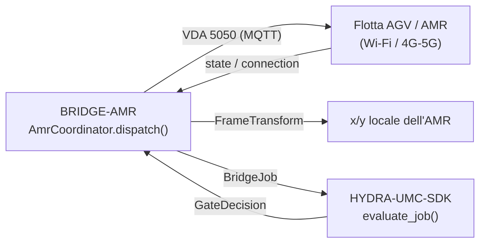

<!-- =============================================================================
HYDRA-UMC-BRIDGE-AMR - AMR/AGV coordination bridge
Copyright (C) JuanenRac (Electro Hobby 3D) <electrohobby3d@gmail.com>
GPL-3.0-or-later - see LICENSE
============================================================================= -->

<p align="center">
  
</p>

# 🚚 HYDRA-UMC-BRIDGE-AMR

<p align="center"><a href="README.md">🇺🇸 English</a> | <a href="README_spa.md">🇪🇸 Español</a> | <a href="README_fra.md">🇫🇷 Français</a> | 🇮🇹 <b>Italiano</b> | <a href="README_deu.md">🇩🇪 Deutsch</a> | <a href="README_zho.md">🇨🇳 简体中文</a> | <a href="README_jpn.md">🇯🇵 日本語</a> | <a href="README_por.md">🇵🇹 Português</a></p>

### 🔗 Confine di coordinamento privo di dipendenze tra HYDRA-UMC e le flotte AGV/AMR

<p align="center">
  
  
  
  
  
  
</p>

---

> **Verifica di onestà - cosa funziona davvero oggi:** la trasformazione del sistema di coordinate e il gate dei lavori (`coordinator.py` con `AmrCoordinator`/`FrameTransform`, che fa passare ogni dispatch attraverso il vero `evaluate_job()` di `HYDRA-UMC-SDK`) e la logica di forma dei messaggi/topic VDA 5050 (`mqtt_transport.py` con `Vda5050Publisher`) sono reali e coperte da 122 test unitari superati (`python tools/build_test.py` - `test_coordinator.py`, `test_mqtt_transport.py`, più `test_vda5050_emulator.py` che esegue il bridge contro un emulatore AGV VDA 5050 fedele al protocollo ma scritto a mano, non uno reale in produzione). Nulla di tutto ciò è stato testato contro un vero broker MQTT, un vero client `paho-mqtt`, o un AMR/gestore di flotta fisico - il `FakeMqttClient` proprio di `test_mqtt_transport.py` sostituisce interamente `paho-mqtt` (la libreria reale non deve nemmeno essere installata perché questi test passino), e non esiste ancora un comando `run` dal vivo perché nessun trasporto reale per un gestore di flotta è stato scelto o validato. Vedi "Roadmap e limiti noti" qui sotto, che lo dice già chiaramente, e `CHANGELOG.md` per cosa è stato esattamente consegnato finora. Anche il suo client MQTT è stato eseguito contro un vero HYDRA-UMC-MQTT-BROKER su una macchina di sviluppo (`tests/test_broker_integration.py`, saltato se nessun broker è installato): un ordine pubblicato tramite esso, lo stato e la connessione trattenuti del veicolo e il suo last will seguiti dall'osservatore, e il ritorno dopo che il broker si è fermato ed è ripartito.

> **Stato di sicurezza (safety e security):** questo ecosistema non è un sistema di sicurezza certificato. Non esiste ancora un percorso E-STOP hardware, né limiti o interblocchi imposti dal firmware, né un comando di movimento verificato; le immagini firmware sono controllate con CRC-32 e una firma Ed25519, e una compilazione di rilascio rifiuta le chiavi di sviluppo pubblicate (le teste utensile e le schede di espansione dietro il relè usano ancora i bootloader di URTC, che accettano un HMAC-SHA256 a chiave condivisa invece di una firma); TLS e TLS reciproco sono opzionali e disattivati per impostazione predefinita; nessuna scheda propria è stata ancora assemblata o provata. Leggi la [base di sicurezza](https://github.com/JuanenRac/HYDRA-UMC-DOCS/blob/main/docs/SECURITY_BASELINE.md) e il [modello delle minacce](https://github.com/JuanenRac/HYDRA-UMC-DOCS/blob/main/docs/THREAT_MODEL.md) prima di fidarti di qualsiasi affermazione qui per la sicurezza di una persona.

---

## 📋 In breve

| | |
|---|---|
| Versione | `0.1.5` |
| Maturità | Funzionale |
| Test | 122 (`python tools/build_test.py`) |
| Tecnologia | Python / VDA 5050 (subset) / MQTT / HYDRA-UMC-SDK |
| Su hardware reale | Solo simulato: provato con emulatori, test double o simulatori; per questa versione non risulta alcuna esecuzione su hardware reale |

**Vai a:** [Panoramica](#-panoramica) · [Architettura](#-architettura) · [Funzionalità](#-funzionalità) · [Sicurezza e protezione](#-sicurezza-e-protezione) · [Interfacce](#-interfacce) · [Configurazione](#-configurazione) · [Avvio rapido](#-avvio-rapido) · [Test](#-test) · [Risoluzione dei problemi](#-risoluzione-dei-problemi) · [Struttura del repository](#-struttura-del-repository) · [Progetti correlati](#-progetti-correlati)

## 🚦 Stato del progetto

Ogni riga è una parte di questo repository e il semaforo dice a che punto è oggi. È scritta in base a ciò che il repository può mostrare (test, compilazioni, esecuzioni), non a ciò che è previsto.

🟢 Fatto e verificato · 🟡 Funziona, con limiti noti · 🟠 Fatto a metà o non ancora verificato · 🔴 Non fatto o non funzionante

| Area | Stato | Cosa significa qui |
|---|---|---|
| Software | 🟡 | Funziona per il suo scopo principale; la verifica di onestà qui sopra elenca ciò che manca ancora |
| Test | 🟢 | 122 test automatici, eseguiti a ogni modifica |
| Hardware reale | 🟠 | Solo simulato: provato con emulatori, test double o simulatori; per questa versione non risulta alcuna esecuzione su hardware reale |
| Documentazione | 🟢 | README in otto lingue, verificato rispetto al manifesto a ogni modifica |

## 🎯 Panoramica

**HYDRA-UMC-BRIDGE-AMR** è il confine di coordinamento bidirezionale e di alto livello tra HYDRA-UMC e una flotta AGV/AMR (robot mobile autonomo), raggiungibile via Wi-Fi o un collegamento cellulare (4G/5G). Fa esattamente due cose reali prima che un lavoro raggiunga un AMR: risolve una coordinata del sistema di riferimento di fabbrica nel sistema di riferimento locale proprio di quello specifico AMR tramite una trasformazione rigida 2D reale e verificabile a mano, e mappa una fase di lavoro su un'azione d'ordine minima ispirata a VDA 5050. Non ha alcuna logica propria di navigazione, localizzazione o evitamento ostacoli, e non può aggirare HYDRA-UMC-SERVER, i limiti dell'MCU, i watchdog o l'E-STOP.

Appartiene alla famiglia **Mobile & Autonomous Bridges** insieme a `HYDRA-UMC-BRIDGE-DROIDS` e `HYDRA-UMC-BRIDGE-UAV`, e condivide lo stesso contratto di lavoro e sicurezza `HYDRA-UMC-SDK` degli **External Automation Bridges** stazionari (CNC, LASER, OPENPNP, PRINTER3D, ROS2) - così nessun ponte, mobile o stazionario, inventa una propria definizione di "sicuro per lavorare".

## 🧩 Ruolo in HYDRA-UMC

**HYDRA-UMC-BRIDGE-AMR** coordina una flotta di AGV o AMR con una cella di robot. Trasforma un lavoro di cella già validato in un ordine VDA 5050 (mai movimento grezzo) e rilegge i messaggi `state` e `connection` del veicolo, così la porta sa se può accettare un ordine.

Ogni bridge parla il contratto di sicurezza condiviso di `HYDRA-UMC-SDK`: un lavoro viene accettato solo se la porta condivisa `evaluate_job()` lo permette, e quella porta fallisce chiusa. Il progetto padre è `HYDRA-UMC-SERVER`; questo bridge non lo chiama, risponde via MQTT, attraverso `HYDRA-UMC-MQTT-BROKER`, a chi comanda la cella.

## 🏛️ Architettura

<p align="center">
  
</p>

<details>
<summary>Versione testuale del diagramma (Mermaid)</summary>



</details>

**Perché è fatto così**

* **Perché qui vive una trasformazione reale di sistema di riferimento, e non un semplice passaggio diretto.** Le coordinate proprie della cella HYDRA-UMC e la mappa locale di un dato AMR raramente condividono origine o orientamento - la nota di architettura incollata da cui è partito questo progetto lo segnala esplicitamente ("mappare le coordinate della mappa di fabbrica sulla mappa locale propria del robot"). `FrameTransform` è la matematica reale, verificata a mano, che colma questo divario, mantenuta come pura trigonometria senza alcuna dipendenza dal gestore di flotta, così da essere testabile ovunque.
* **Perché il vocabolario di azioni d'ordine è modellato su VDA 5050.** VDA 5050 è lo standard reale, aperto e neutrale rispetto al produttore per l'integrazione di flotte già parlato da diverse flotte AMR commerciali (e da un numero crescente di stack open source) - nominare le azioni proprie di questo repository secondo il suo vocabolario reale (`CANCEL_ORDER`, movimento con forma nodo/azione) significa che un futuro adattatore VDA 5050 reale si inserirà in modo naturale invece di richiedere uno strato di traduzione aggiunto in seguito.
* **Perché `AmrCoordinator.dispatch()` incanala comunque ogni lavoro attraverso la porta condivisa `evaluate_job()`.** Un AMR è semplicemente un altro client dello stesso `bridge_contract` usato da CNC, LASER, OPENPNP, PRINTER3D, ROS2 e DROIDS - non ottiene alcun bypass speciale della logica IDLE/READY applicata da tutti gli altri ponti e da HYDRA-UMC-SERVER.
* **Perché `CANCEL_ORDER` resta richiedibile durante un guasto.** Il requisito di fase produttiva della porta (`IDLE` + `READY`) non viene deliberatamente applicato allo stesso modo a una richiesta di abort - un operatore deve sempre poter annullare l'ordine corrente di un AMR, anche in pieno guasto.
* **Perché in questo repository non c'è ancora un adattatore specifico di un produttore per il gestore di flotta.** (Il publisher MQTT VDA 5050 esiste, vedi sopra.) Vincolarsi al protocollo REST/WebSocket reale di un AMR specifico prima che una flotta reale sia selezionata e testata rischierebbe di incorporare ipotesi che questo nucleo locale privo di dipendenze non può verificare.
* **Come si inserisce nel resto dell'ecosistema.** BRIDGE-AMR si trova tra una flotta AMR reale e `HYDRA-UMC-SDK` → `HYDRA-UMC-SERVER` → sicurezza MCU - è un confine di coordinamento, mai un nodo di navigazione o di controllo motore, e non può aggirare HYDRA-UMC-SERVER, i limiti dell'MCU, i watchdog o l'E-STOP.

## ✨ Funzionalità

* 🧾 **Schemi VDA 5050 ufficiali e blocco configurabile:** i test validano ogni messaggio costruito dal bridge contro gli schemi JSON ufficiali di VDA 5050 2.0.0 (`order` e `instantActions`, inclusi in `tests/vda5050_schemas`); un'azione istantanea ora riporta `actionName` accanto a `actionType`, perché lo schema ufficiale instantActions lo richiede. `AmrCoordinator(abort_action=AmrCoordinator.START_PAUSE)` fa sì che la fase di abort trattenga il veicolo con `startPause` invece di scartare il suo ordine con `cancelOrder` (il predefinito); entrambe sono sempre inoltrate. `MOVE_TO_HOME` passa per la stessa porta di ogni movimento. `AmrCoordinator.resume()` invia `stopPause` solo con la cella in READY e un veicolo letto come in pausa, e `abort_action=AmrCoordinator.ABORT_BOTH` invia `cancelOrder` e poi `startPause`. *(implementato)*
* ✅ **Trasformazione reale di sistema di riferimento, verificabile a mano:** `FrameTransform` mappa una coordinata `(x, y)` del sistema di riferimento di fabbrica nel sistema di riferimento locale proprio di un AMR specifico, date l'origine e l'orientamento reali di quell'AMR sul pavimento di fabbrica - verificata con un caso identità, una traslazione pura, una rotazione di 90 gradi e un vero test di andata e ritorno. *(implementato, testato in `tests/test_coordinator.py`)*
* ✅ **Vocabolario reale di azioni d'ordine ispirato a VDA 5050:** `MOVE_TO_STAGING`, `PICK_LOAD`, `MOVE_TO_DESTINATION`, `DROP_LOAD`, `MOVE_TO_HOME` vengono pubblicati sul topic `order` reale di VDA 5050 (in coda, parte di un percorso); `CANCEL_ORDER` viene pubblicato sul topic `instantActions` reale e separato (immediato, salta la coda degli ordini) - corrisponde al nome reale dell'azione `cancelOrder` di VDA 5050 E al suo canale reale, verificato con gli [schemi ufficiali](https://github.com/VDA5050/VDA5050/tree/main/json_schemas). *(implementato)*
* ✅ **Validazione reale delle coordinate per azione:** un'azione di movimento a cui mancano `x`/`y`, o che ne porta uno non numerico, viene rifiutata localmente prima che la trasformazione venga mai eseguita. *(implementato, testato)*
* ✅ **Porta di sicurezza condivisa, reale:** ogni lavoro inviato tramite `AmrCoordinator.dispatch()` viene valutato da `evaluate_job()` del `bridge_contract` di `HYDRA-UMC-SDK`, la stessa porta usata da tutti i ponti fratelli e da HYDRA-UMC-SERVER; una fase produttiva richiede una macchina esterna `IDLE` e una cella HYDRA-UMC `READY`, mentre `CANCEL_ORDER` resta richiedibile durante un guasto. *(implementato)*
* ✅ **Instradamento delle fasi chiuso ed evidenza statica:** una futura fase SDK sconosciuta viene negata. `inspect_order_plan.py` emette il piano d'ordine statico di schema `1.0` senza aprire alcun trasporto. *(implementato, testato)*
* ✅ **Publisher MQTT VDA 5050 reale:** `Vda5050Publisher` di `mqtt_transport.py` invia un dispatch già validato come messaggio reale, conforme allo schema, sul topic reale corretto (`{interfaceName}/{majorVersion}/{manufacturer}/{serialNumber}/{order|instantActions}`) - un dispatch rifiutato non raggiunge mai la rete. *(implementato, testato in `tests/test_mqtt_transport.py`)*
* ✅ **Build/test non mutante:** `build-test.bat`/`.sh` compilano il codice sorgente ed eseguono test unitari deterministici senza cambiare versione o CHANGELOG. *(implementato, vedi Compilazione e rilascio più sotto)*
* 🔜 **Adattatore REST/WebSocket specifico di un gestore di flotta** (per una piattaforma di flotta non nativa VDA 5050) - introdotto solo dopo che quella piattaforma sarà selezionata e testata. *(pianificato)*
* ✅ **Stato osservato della macchina e id d'ordine che sopravvivono a un riavvio:** `AmrCoordinator.dispatch()` accetta lo stato che il gestore della flotta ha riferito per il veicolo, che la porta condivisa usa al posto del `machine_state` scritto nel lavoro (un messaggio che chiunque sul broker può pubblicare); `Vda5050Publisher` dà a ogni ordine un `orderId` con un token proprio, così che un riavvio che riconta `headerId` dall'inizio non riusi l'id di un ordine precedente (VDA 5050 lo rifiuta). *(implementato, testato in `tests/test_observed_and_order_ids.py`)*
* ✅ **Nomi VDA 5050 sul filo, un client che il broker accetta e un osservatore che ascolta:** gli interni `CANCEL_ORDER` / `PICK_LOAD` / `DROP_LOAD` escono come i tipi di azione VDA 5050, sensibili alle maiuscole, `cancelOrder` / `pick` / `drop` (prima `CANCEL_ORDER` usciva così com'era, e un AGV non lo riconosce come annullamento), e un movimento è solo il suo nodo di destinazione, senza un tipo di azione inventato; `actionId` e `nodeId` portano il token di sessione come l'`orderId`; `header_id` e `timestamp_iso` si possono omettere (il publisher conta per topic e mette l'ora UTC) e vengono validati quando sono dati; una coordinata che va in overflow, un numero non finito o un punto fuori da `FrameTransform.bounds` viene rifiutato (`allow_nan=False`). `open_mqtt_client()` accetta un `client_id` (il broker autentica dal suo prefisso), usa l'API di callback v2 e attende la risposta del broker invece di restituire un client che non può pubblicare; con un `Vda5050Observer` si sottoscrive ai topic `state` e `connection` dell'AGV e ne deriva lo stato macchina usato dalla porta (OFFLINE se vecchio, non ONLINE o non in modalità AUTOMATIC; altrimenti SAFE_STOP, FAULT, HOLDING, RUNNING o IDLE). *(implementato, testato con sostituti e con l'emulatore; mai eseguito contro un vero AGV né un vero gestore di flotta, e un percorso che parte dal nodo in cui si trova l'AGV (due nodi e un arco, che richiede il grafo dell'impianto) NON è ancora costruito, quindi un vero AGV rifiuterà questi ordini a un solo nodo di destinazione)*

## 🔒 Sicurezza e protezione

| Minaccia | Difesa | Dove |
|---|---|---|
| Un lavoro per una cella o macchina che non è in stato sicuro | Ogni lavoro passa dalla porta condivisa `evaluate_job()` dell'SDK, che fallisce chiusa; il bridge non ha una logica propria di accettazione | SDK `bridge_contract` |
| Dati di lavoro smisurati | Al massimo 32 parametri, chiavi fino a 64 caratteri, valori fino a 1024, identificatori fino a 128 (`MAX_PARAMETERS`, `MAX_PARAMETER_KEY_CHARS`, `MAX_PARAMETER_VALUE_CHARS`, `MAX_IDENTIFIER_CHARS`) | SDK `bridge_contract` |
| Un ordine ripetuto o rinviato | Un `IdempotencyStore` ricorda ogni chiave per 24 ore e al massimo 10 000 voci; una ripetizione riceve la prima risposta invece di essere valutata di nuovo | SDK `job_intake` |
| Un ordine di movimento grezzo inviato a un veicolo | Il coordinatore trasforma un lavoro solo in un ordine locale AMR; `simulated_amr.TRANSITIONS` dice quale azione è legale da quale stato (per esempio `MOVE_TO_STAGING` solo da `IDLE`) | `coordinator.py`, `simulated_amr.py` |
| Un messaggio VDA 5050 malformato | Ogni messaggio `order` e `instantActions` costruito dal publisher è validato nei test contro gli schemi JSON ufficiali di VDA 5050 2.0.0, copiati senza modifiche | `tests/test_vda5050_schemas.py` |
| Un veicolo che non può accettare un ordine | Un invio rifiutato non raggiunge mai la rete; l'osservatore tratta uno `state` o `connection` mancante o vecchio (oltre 90 secondi) come non pronto | `mqtt_transport.py`, `observer.py` |

**Cosa non fa mai:** non invia mai movimento grezzo e non ha mai girato contro un veicolo o un gestore di flotta reali.

## 🔌 Interfacce

I topic VDA 5050 sono `{interface_name}/{major_version}/{manufacturer}/{serial_number}/{channel}` (`Vda5050Target.topic()`), per esempio `vda5050/v2/acme/agv-01/order`.

| Topic o rotta | Cosa porta |
|---|---|
| `order`, `instantActions` | pubblicati; ognuno ha il proprio contatore `header_id` e un timestamp UTC |
| `state`, `connection` | osservati da `Vda5050Observer`; la sottoscrizione viene rinnovata a ogni riconnessione |

La libreria: `AmrCoordinator`, `FrameTransform`, `Vda5050Publisher`, `Vda5050Target`, `Vda5050Observer`, `SimulatedAmr`, `open_mqtt_client()`. L'ID client MQTT predefinito è `hydra-umc-bridge-amr`.

## ⚙️ Configurazione

| Variabile | Predefinito | Cosa imposta |
|---|---|---|
| `HYDRA_MQTT_USERNAME` | nessuno | Il nome utente MQTT; il broker lo lega a un prefisso di ID client |
| `HYDRA_MQTT_PASSWORD` | nessuno | La password; valida solo insieme al nome utente |
| `HYDRA_MQTT_PASSWORD_FILE` | nessuno | La password letta da un file (segreto Docker o systemd); ignorata se `HYDRA_MQTT_PASSWORD` è impostata |
| `HYDRA_MQTT_TLS_CA` | nessuno | Il file della CA che ha firmato il certificato del broker: la connessione è TLS e il certificato viene verificato |
| `HYDRA_MQTT_TLS` | disattivato | `1` attiva TLS, verificato con le CA fidate del sistema |
| `HYDRA_MQTT_TLS_CERT` / `HYDRA_MQTT_TLS_KEY` | nessuno | Il certificato client e la sua chiave per un broker che richiede TLS reciproco; servono entrambi |
| `HYDRA_UMC_AMR_MAX_STATE_BYTES` | nessuno (nessun limite) | Il messaggio `state` o `connection` più grande, in byte, che l'osservatore analizza; uno più grande viene ignorato come qualsiasi messaggio illeggibile |

Non c'è un file di configurazione: il broker, `interface_name`, `major_version`, `manufacturer`, `serial_number` e l'azione di interruzione (`cancelOrder`, `startPause` o entrambe) sono argomenti dei costruttori.

## 🚀 Avvio rapido

Richiede Python 3.11 o successivo. I test e gli script di build si aspettano `HYDRA-UMC-SDK` clonato accanto a questo repository (`../HYDRA-UMC-SDK`) o indicato con `HYDRA_UMC_SDK_ROOT`.

Provalo senza hardware (questo verifica tutto il bridge con i suoi emulatori e test double):

```bash
py -3 tools/build_test.py          # Windows
python3 tools/build_test.py         # Linux, macOS
```

Avviare il servizio (non c'è uno script da console: il servizio è il `run_forever()` del trasporto MQTT, che chiami dal tuo codice di avvio):

```python
from hydra_umc_bridge_amr import AmrCoordinator, FrameTransform, Vda5050Publisher, Vda5050Target, open_mqtt_client
client = open_mqtt_client("192.168.0.180")        # connects; the credentials come from HYDRA_MQTT_*
target = Vda5050Target("vda5050", "v2", "acme", "agv-01")
dispatch = AmrCoordinator().dispatch(job, cell_state, FrameTransform(map_id="hall", origin_x=0.0, origin_y=0.0, heading_rad=0.0))
Vda5050Publisher().publish(client, target, None, None, dispatch)   # a rejected dispatch is never sent
```

Nome utente, password e file TLS vengono dalle variabili `HYDRA_MQTT_*` (vedi Configurazione); il codice sopra non ha bisogno di credenziali proprie.

## 🧪 Test

122 casi `unittest` automatici si eseguono con `python tools/build_test.py` (che compila anche ogni modulo). I test non richiedono hardware, rete né pacchetti opzionali: quelli che richiederebbero `paho-mqtt`, `pyserial` o una libreria del produttore usano un sostituto o vengono saltati se il pacchetto manca.

| File di test | Test | Cosa copre |
|---|---|---|
| `test_coordinator.py`, `test_observed_and_order_ids.py`, `test_edge_cases.py` | - | passaggio da lavoro a ordine, trasformazione rigida di sistema, id, casi limite |
| `test_vda5050_schemas.py` | - | ogni messaggio validato contro gli schemi ufficiali VDA 5050 2.0.0 |
| `test_vda5050_emulator.py`, `vda5050_emulator.py` | - | il vero coordinatore e publisher contro un veicolo VDA 5050 a livello di forma sul bus MQTT |
| `test_mqtt_transport.py`, `test_mqtt_environment.py`, `test_hardening.py`, `test_simulated_amr.py` | - | publisher contro un client MQTT finto, credenziali d'ambiente, input ostili, la tabella degli stati |

La CI esegue `HYDRA_UMC_CI=1 python tools/ci_validate.py`, che controlla il manifesto, i documenti, gli otto README e le immagini, ed esegue i test con una copia dell'SDK.

## 🏗️ Compilazione e rilascio

Richiede Python 3.11+. `tools/build_test.py` si aspetta che `HYDRA-UMC-SDK` sia clonato come directory fratella (`../HYDRA-UMC-SDK`) o indicato tramite la variabile d'ambiente `HYDRA_UMC_SDK_ROOT`.

```bash
# Windows
build-test.bat      # solo validazione — nessun cambio di versione/CHANGELOG
build.bat            # valida e, se ha successo, aggiorna versione + CHANGELOG

# Linux/macOS
bash build-test.sh
bash build.sh
```

`build-test` compila ogni modulo sotto `src/` con `py_compile` ed esegue l'intera suite `unittest` individuata sotto `tests/` (tutti i file `test_*.py` - 122 test) - in modo deterministico, senza connessione reale a un AMR, senza rete e senza cambio di versione/CHANGELOG. `build` esegue prima quella stessa validazione e, solo in caso di successo, chiama `tools/bump_version.py` per sincronizzare la versione tra `pyproject.toml`, `hydra-umc.project.json` e `CHANGELOG.md`. Non esiste ancora un comando `run` con hardware reale - serve un adattatore di trasporto del gestore di flotta validato e un AMR/flotta reale.

## 🩺 Risoluzione dei problemi

| Vedi | Perché | Fai |
|---|---|---|
| `ModuleNotFoundError: hydra_umc_sdk` | L'SDK non è installato né accanto a questo repository | Clona `HYDRA-UMC-SDK` accanto a questo repository o imposta `HYDRA_UMC_SDK_ROOT` |
| `paho-mqtt is not installed` | Il client MQTT è un extra opzionale | `pip install ".[mqtt]"` (serve `paho-mqtt` 2.1 o successivo, inferiore a 3) |
| `password was given without a username` | Le credenziali MQTT richiedono entrambe le parti | Imposta anche `HYDRA_MQTT_USERNAME`, non solo la password |
| `could not reach the MQTT broker after N attempts` | Il broker è spento, l'indirizzo è sbagliato o la porta è chiusa | Avvia `HYDRA-UMC-MQTT-BROKER` e controlla host e porta dati al trasporto (5 tentativi a 2 secondi di distanza); un errore dell'handshake TLS non viene ritentato |
| `the MQTT broker refused the connection` | Il broker ha rifiutato la credenziale (o non ha risposto entro il tempo limite) | Controlla `HYDRA_MQTT_USERNAME` e la password; l'ID client deve iniziare con il prefisso che il broker ha legato alla credenziale |
| `"allowed": false` + `reason` | La porta condivisa o una guardia ha rifiutato l'ordine | Leggi `reason` e correggi la causa; non riprovare alla cieca |

## 📂 Struttura del repository

<p align="center">
  
</p>

<details>
<summary>Versione testuale dell'albero</summary>

```text
HYDRA-UMC-BRIDGE-AMR/
├── src/hydra_umc_bridge_amr/
│   ├── coordinator.py             trasforma un lavoro in un ordine locale AMR, mai movimento grezzo; FrameTransform
│   ├── mqtt_transport.py          publisher VDA 5050 e client MQTT
│   ├── observer.py                trasforma `state` e `connection` dell'AGV in uno stato macchina
│   └── simulated_amr.py           tabella di quale azione è legale da quale stato
├── tests/                         110 test, con un emulatore VDA 5050 e gli schemi ufficiali
├── docs/                          guida del bridge
├── tools/                         esecutore di build e test, aumento di versione, validatore CI, generatori e controlli di README e immagini
├── images/                        banner e immagini del README
├── .github/                       workflow CI e modelli di segnalazione
├── pyproject.toml                 metadati del pacchetto e dipendenze
├── hydra-umc.project.json         manifesto: versione, maturità, famiglia
├── CHANGELOG.md                   cosa è cambiato in ogni versione
├── build.sh build.bat             script di build (non cambiano mai la versione)
├── build-test.sh build-test.bat   script di build (non cambiano mai la versione)
├── test.sh test.bat               eseguono i test
└── SECURITY.md SUPPORT.md CONTRIBUTING.md CODE_OF_CONDUCT.md LICENSE LICENSE.md
```

</details>

## 🗺️ Roadmap e limiti noti

**Limiti noti oggi**

**Reale oggi:** versione `0.1.5`, funzionale come nucleo di coordinamento privo di dipendenze (`AmrCoordinator`) con una trasformazione reale di sistema di riferimento verificata a mano (`FrameTransform`), instradamento delle fasi chiuso, uno schema d'ordine statico `plan-only` con la vera separazione di canali order/instantActions di VDA 5050, un publisher MQTT VDA 5050 reale (`Vda5050Publisher`), e script build-test non mutanti collegati alla CI con un checkout dell'SDK.

**Confine di integrazione:** questo ponte è solo un confine di coordinamento - non è un nodo di navigazione né di controllo motore, e non può aggirare HYDRA-UMC-SERVER, i limiti dell'MCU, i watchdog o l'E-STOP; ogni lavoro inviato passa comunque attraverso la stessa porta condivisa usata da tutti i ponti fratelli.

**Ancora da fare:** nessun trasporto reale del gestore di flotta (VDA 5050, REST/WebSocket del produttore) né un AMR fisico è ancora stato validato - un adattatore reale sarà introdotto solo dopo che una piattaforma di flotta specifica sarà selezionata e testata.

## 🌍 Lingue

Questo README e i documenti del repository esistono in otto lingue: inglese, spagnolo, tedesco, francese, italiano, giapponese, cinese e portoghese (Portogallo). Sono scritti insieme e la CI verifica che gli otto file abbiano le stesse sezioni e gli stessi link. Questo repository non ha uno schermo né un catalogo di messaggi propri, quindi non ci sono stringhe di interfaccia da tradurre.

## 🔗 Progetti correlati

Questo progetto fa parte dell'ecosistema robotico HYDRA-UMC dello stesso autore (JuanenRac / Electro Hobby 3D). Vale la pena conoscerlo, poiché una richiesta potrebbe in realtà riguardare uno di questi invece di questo repository.

**Progetto Padre**
- **[HYDRA-UMC-SERVER](https://github.com/JuanenRac/HYDRA-UMC-SERVER)** — il vero backend headless (REST/WebSocket) con cui parla davvero ogni client di controllo; il confine autenticato dell'ecosistema a cui questo bridge riporta una volta che ogni comando ha superato la barriera di sicurezza locale di questo stesso bridge.

**Progetti Fratelli** — parlano anch'essi con la stessa API di HYDRA-UMC-SERVER, ciascuno come proprio client
- **[HYDRA-UMC-STUDIO](https://github.com/JuanenRac/HYDRA-UMC-STUDIO)** — dashboard di controllo web con visualizzazione 3D multi-robot in tempo reale.
- **[HYDRA-UMC-SUITE](https://github.com/JuanenRac/HYDRA-UMC-SUITE)** — centro di comando sciame desktop (PySide6) per più server contemporaneamente, pacchettizzato come eseguibile standalone.
- **[HYDRA-UMC-ANDROID-CONTROL](https://github.com/JuanenRac/HYDRA-UMC-ANDROID-CONTROL)** — app di controllo nativa per Android con login biometrico e un companion Wear OS abbinato.
- **[HYDRA-UMC-IOS-CONTROL](https://github.com/JuanenRac/HYDRA-UMC-IOS-CONTROL)** — app di controllo per iOS/iPadOS (Flutter) con sincronizzazione WebSocket in tempo reale.
- **[HYDRA-UMC-DSI](https://github.com/JuanenRac/HYDRA-UMC-DSI)** — interfaccia touch nativa per il touchscreen DSI da 7" a bordo, incorporata direttamente nel CM5.
- **[HYDRA-UMC-BRIDGE-CNC](https://github.com/JuanenRac/HYDRA-UMC-BRIDGE-CNC)** — coordinatore ad alto livello per celle CNC con accesso a stato/byte di controllo GRBL (testato solo contro un emulatore).
- **[HYDRA-UMC-BRIDGE-DROIDS](https://github.com/JuanenRac/HYDRA-UMC-BRIDGE-DROIDS)** — barriera di coordinamento per droidi con zampe/umanoidi, con un mittente di comandi per Boston Dynamics Spot (testato solo contro un emulatore) — uno dei 3 bridge per flotte mobili dell'ecosistema.
- **[HYDRA-UMC-BRIDGE-LASER](https://github.com/JuanenRac/HYDRA-UMC-BRIDGE-LASER)** — coordinatore per celle laser che legge 3 segnali GPIO di chiave/involucro/interblocco (testato solo contro un chip simulato; non può armare né far partire un laser).
- **[HYDRA-UMC-BRIDGE-OPENPNP](https://github.com/JuanenRac/HYDRA-UMC-BRIDGE-OPENPNP)** — coordinatore ad alto livello sicuro per il flusso schede del pick-and-place OpenPnP.
- **[HYDRA-UMC-BRIDGE-PRINTER3D](https://github.com/JuanenRac/HYDRA-UMC-BRIDGE-PRINTER3D)** — barriera di coordinamento sicura per stampanti 3D Moonraker/Klipper, con comandi di lavoro reali e controllati.
- **[HYDRA-UMC-BRIDGE-ROS2](https://github.com/JuanenRac/HYDRA-UMC-BRIDGE-ROS2)** — coordinatore con un trasporto ROS 2 rclpy importato in modo lazy (non ancora eseguito contro un'installazione ROS 2).
- **[HYDRA-UMC-BRIDGE-UAV](https://github.com/JuanenRac/HYDRA-UMC-BRIDGE-UAV)** — barriera di coordinamento per UAV dotati di fotocamera, con un mittente di comandi MAVLink (testato solo contro un emulatore) — uno dei 3 bridge per flotte mobili dell'ecosistema.

**Direttamente Correlati**
- **[HYDRA-UMC-SDK](https://github.com/JuanenRac/HYDRA-UMC-SDK)** — il contratto JSON-Schema condiviso e la barriera software di controllo dei job contro cui ogni bridge valida i propri comandi (non è una funzione di sicurezza certificata).
- **[HYDRA-UMC-CONNECTOR-HUB](https://github.com/JuanenRac/HYDRA-UMC-CONNECTOR-HUB)** — registro dichiarativo e validatore di manifesti adattatore per connettori di macchine esterne; estende la propria idea di contratto dell'SDK alle macchine esterne senza sostituire i progetti di gateway industriale.
- **[HYDRA-UMC-MQTT-BROKER](https://github.com/JuanenRac/HYDRA-UMC-MQTT-BROKER)** — il `Vda5050Publisher` di `mqtt_transport.py` invia ogni dispatch già validato come un vero messaggio VDA 5050 `order`/`instantActions` conforme alla specifica — a differenza dello schema di topic `hydra/bridges/<nome>/...` proprio degli altri bridge, questo usa direttamente la vera forma di topic di VDA 5050.

**Fa Anche Parte dell'Ecosistema**

*Hardware e Piattaforma di Base*
- **[HYDRA-UMC](https://github.com/JuanenRac/HYDRA-UMC)** — il progetto della scheda madre del braccio robotico: host CM5 + coprocessore STM32H745 dual-core, pensato per coordinare fino a 8 bracci utensile via CAN-OTA/SPI-OTA (firmware in fase iniziale; nessuna scheda assemblata per ora).
- **[HYDRA-UMC-OS](https://github.com/JuanenRac/HYDRA-UMC-OS)** — livello prodotto riproducibile su Raspberry Pi OS per il CM5: agente in sola lettura, config/profili validati, provisioning WiFi al primo contatto.

*Backend Centrale e Client*
- **[HYDRA-UMC-EDITOR-URDF](https://github.com/JuanenRac/HYDRA-UMC-EDITOR-URDF)** — creatore/editor grafico desktop di URDF che invia i modelli finiti al catalogo di STUDIO.
- **[HYDRA-UMC-EDITOR-STL](https://github.com/JuanenRac/HYDRA-UMC-EDITOR-STL)** — editor desktop di modelli STL, che trasforma/sostituisce/rimuove/aggiunge veri pezzi nello stesso catalogo di modelli modificato anche da HYDRA-UMC-EDITOR-URDF.

*Piattaforma Strumenti URTC*
- **[URTC](https://github.com/JuanenRac/URTC)** — firmware per la scheda fisica dell'Universal Robot Tool Controller, oltre 25 profili utensile su bus CAN.
- **[URTC-FLASHER](https://github.com/JuanenRac/URTC-FLASHER)** — strumento desktop con GUI per il flashing delle schede URTC, CAN-OTA più SWD/JTAG a chip intero.
- **[URTC-TESTER](https://github.com/JuanenRac/URTC-TESTER)** — strumento desktop di diagnostica CAN-bus dal vivo per schede URTC, un pannello per profilo utensile.
- **[URTC-WEB-STUDIO](https://github.com/JuanenRac/URTC-WEB-STUDIO)** — alternativa basata su browser a URTC-TESTER tramite la Web Serial API, senza installazione locale.
- **[URTC-GATEWAY](https://github.com/JuanenRac/URTC-GATEWAY)** — gateway davanti al bus CAN di URTC: elenco di identificatori consentiti, limite di frequenza e chiave di sessione; software provato su computer, non ancora su un bus reale.

*Nodo IA Visione (Hailo-8)*
- **[HYDRA-UMC-VISION-NODE](https://github.com/JuanenRac/HYDRA-UMC-VISION-NODE)** — hub di integrazione per la pipeline di visione Hailo-8, con un vero controllo di prontezza hardware per fase.
- **[HYDRA-UMC-DETECTION-HEF](https://github.com/JuanenRac/HYDRA-UMC-DETECTION-HEF)** — registro reale di modelli compilati con verifica di caricamento sicuro per architettura Hailo/checksum.
- **[HYDRA-UMC-VISION-STREAMER](https://github.com/JuanenRac/HYDRA-UMC-VISION-STREAMER)** — generatore reale di pipeline GStreamer + config MediaMTX, con una vera barriera di integrazione HailoRT.
- **[HYDRA-UMC-VISUAL-SERVOING-API](https://github.com/JuanenRac/HYDRA-UMC-VISUAL-SERVOING-API)** — legge di correzione Position-Based Visual Servoing con autorizzazione condizionata allo stato di zona; ancora nessuna stima di posa da telecamera.
- **[HYDRA-UMC-SAFETY-ZONES](https://github.com/JuanenRac/HYDRA-UMC-SAFETY-ZONES)** — logica v0 di violazione zona, freschezza di calibrazione e richiesta E-STOP che legge le posizioni degli oggetti da un file; nessun rilevatore la alimenta e nessun E-STOP fisico è ancora collegato.

*Nodo IA Cognitivo (Hailo-10)*
- **[HYDRA-UMC-COGNITIVE-NODE](https://github.com/JuanenRac/HYDRA-UMC-COGNITIVE-NODE)** — hub di integrazione per la pipeline cognitiva Hailo-10 (orchestrazione LLM/VLA/voce).
- **[HYDRA-UMC-VLA-ENGINE](https://github.com/JuanenRac/HYDRA-UMC-VLA-ENGINE)** — vera codifica/decodifica di token d'azione e generazione di traiettoria per un modello Vision-Language-Action.
- **[HYDRA-UMC-VOICE-UI](https://github.com/JuanenRac/HYDRA-UMC-VOICE-UI)** — vero front-end vocale (VAD + parser di intenti) con un relay verso Watch limitato e soggetto a conferma.
- **[HYDRA-UMC-SEMANTIC-PLANNER](https://github.com/JuanenRac/HYDRA-UMC-SEMANTIC-PLANNER)** — vera scomposizione dei task basata su regole e recupero semantico degli errori sui codici errore MCU.
- **[HYDRA-UMC-DOCS-QA](https://github.com/JuanenRac/HYDRA-UMC-DOCS-QA)** — vera ricerca documentale TF-IDF (solo libreria standard) sui documenti Markdown di questo ecosistema.
- **[HYDRA-UMC-LOCAL-TECHNICIAN](https://github.com/JuanenRac/HYDRA-UMC-LOCAL-TECHNICIAN)** — tecnico di manutenzione IA locale e con cancelli di policy per l'ecosistema stesso - osserva, diagnostica e propone correzioni; i due livelli di rischio più alti non sono deliberatamente ancora implementati.

*Orchestrazione e Sciame*
- **[HYDRA-UMC-ORCHESTRATOR](https://github.com/JuanenRac/HYDRA-UMC-ORCHESTRATOR)** — hub di integrazione con un vero contratto di health-report gRPC/Protobuf e una macchina a stati di missione.
- **[HYDRA-UMC-JOB-DISPATCHER](https://github.com/JuanenRac/HYDRA-UMC-JOB-DISPATCHER)** — vera coda di lavori basata su priorità con deduplicazione, su una vera API HTTP.
- **[HYDRA-UMC-NODE-HEALING](https://github.com/JuanenRac/HYDRA-UMC-NODE-HEALING)** — vero watchdog di salute della flotta basato su gRPC, con retry/backoff e rilevamento di discrepanza d'identità.
- **[HYDRA-UMC-PATH-PLANNER-3D](https://github.com/JuanenRac/HYDRA-UMC-PATH-PLANNER-3D)** — vero pianificatore di percorsi 3D basato su RRT, con vera validazione delle collisioni ostacolo/spazio di lavoro.
- **[HYDRA-UMC-SWARM-SYNC](https://github.com/JuanenRac/HYDRA-UMC-SWARM-SYNC)** — vera sincronizzazione di stato CRDT LWW-Element-Map, con property test per la convergenza multi-cella.

*Gemello Digitale e Simulazione*
- **[HYDRA-UMC-TWIN](https://github.com/JuanenRac/HYDRA-UMC-TWIN)** — hub di integrazione per il motore di gemello digitale, con un vero contratto di sincronizzazione per compatibilità di versione.
- **[HYDRA-UMC-HIL-BRIDGE](https://github.com/JuanenRac/HYDRA-UMC-HIL-BRIDGE)** — router hardware-in-the-loop con un interblocco software di collisione tra simulazione e hardware reale (testato senza hardware reale).
- **[HYDRA-UMC-PHYSICS-REPLICA](https://github.com/JuanenRac/HYDRA-UMC-PHYSICS-REPLICA)** — vera cinematica diretta e validazione dei limiti articolari su un vero sottoinsieme URDF.
- **[HYDRA-UMC-SYNTHETIC-DATA-GEN](https://github.com/JuanenRac/HYDRA-UMC-SYNTHETIC-DATA-GEN)** — vero generatore procedurale di scene 2D con esportazione di annotazioni YOLO/COCO.

*Dati e Analisi*
- **[HYDRA-UMC-DATALAKE](https://github.com/JuanenRac/HYDRA-UMC-DATALAKE)** — vero archivio di serie temporali basato su sqlite3, con una vera API HTTP di ingestione/query.
- **[HYDRA-UMC-ANOMALY-DETECTOR](https://github.com/JuanenRac/HYDRA-UMC-ANOMALY-DETECTOR)** — vero rilevatore di anomalie FFT + baseline statistica, con monitoraggio della deriva.
- **[HYDRA-UMC-PRODUCTION-REPORTS](https://github.com/JuanenRac/HYDRA-UMC-PRODUCTION-REPORTS)** — vero calcolo OEE/disponibilità sullo storico di DATALAKE, con esportazione CSV riproducibile.
- **[HYDRA-UMC-TELEMETRY-COLLECTOR](https://github.com/JuanenRac/HYDRA-UMC-TELEMETRY-COLLECTOR)** — vera pipeline di ingestione CAN/WebSocket verso DATALAKE, con deduplicazione per sequenza.

*Gateway Industriale*
- **[HYDRA-UMC-GATEWAY-INDUSTRIAL](https://github.com/JuanenRac/HYDRA-UMC-GATEWAY-INDUSTRIAL)** — hub di integrazione che inoltra ai protocolli industriali, con un vero livello di allowlist dei comandi/backpressure.
- **[HYDRA-UMC-OPCUA-SERVER](https://github.com/JuanenRac/HYDRA-UMC-OPCUA-SERVER)** — vero spazio di indirizzi OPC-UA, verificato con una vera sessione client del protocollo binario.
- **[HYDRA-UMC-MTCONNECT-ADAPTER](https://github.com/JuanenRac/HYDRA-UMC-MTCONNECT-ADAPTER)** — veri endpoint XML `/probe` e `/current` di MTConnect, con output in modalità degradata.

*Strumenti Complementari e Operazioni dell'Ecosistema*
- **[HYDRA-UMC-DASHBOARD-AI](https://github.com/JuanenRac/HYDRA-UMC-DASHBOARD-AI)** — pannelli Smart Summaries e Anomaly Highlighting su DATALAKE/ANOMALY-DETECTOR, con un fallback statistico onesto.
- **[HYDRA-UMC-TOOL-CLI](https://github.com/JuanenRac/HYDRA-UMC-TOOL-CLI)** — CLI di flotta con un vero e stabile contratto di exit-code, un client live reale della stessa API di HYDRA-UMC-SERVER.
- **[HYDRA-UMC-WATCH](https://github.com/JuanenRac/HYDRA-UMC-WATCH)** — app companion WearOS con schemi di avviso aptico e un relay vocale verso il telefono abbinato (non ancora eseguita su un orologio fisico).
- **[URTC-SMART-RACK](https://github.com/JuanenRac/URTC-SMART-RACK)** — firmware per un rack di montaggio schede con decodifica reale dell'ID utensile e logica di preriscaldamento Smart Idle.
- **[URTC-VISION-TOOL](https://github.com/JuanenRac/URTC-VISION-TOOL)** — firmware più un vero companion di visione Python per una testa utensile di ispezione termica/RGB.
- **[HYDRA-UMC-UPDATER](https://github.com/JuanenRac/HYDRA-UMC-UPDATER)** — strumento amministrativo desktop che scopre, clona e aggiorna ogni repository di questo ecosistema.
- **[HYDRA-UMC-OS-REBUILDER](https://github.com/JuanenRac/HYDRA-UMC-OS-REBUILDER)** — strumento desktop Windows/Linux che costruisce un'immagine della CM5 pronta da scrivere, precaricata con le versioni più aggiornate dell'ecosistema, con configurazione di primo avvio Wi-Fi/utente/SSH in stile Raspberry Pi Imager.
- **[HYDRA-UMC-OPS-AGENT](https://github.com/JuanenRac/HYDRA-UMC-OPS-AGENT)** — coordinatore di incidenti di manutenzione: un ruolo edge a basso privilegio raccoglie uno snapshot di inventario/salute sanificato, un ruolo control-plane lo rende in sola lettura e chiede a un provider di IA di suggerire una diagnosi - non applica mai una patch né distribuisce nulla.
- **[HYDRA-UMC-DEV-SERVER](https://github.com/JuanenRac/HYDRA-UMC-DEV-SERVER)** — host di sviluppo riproducibile (Raspberry Pi 5 / CM5) che conserva il codice sorgente dell'ecosistema ed esegue attività delimitate di build/test tramite una coda durevole; un ruolo di sviluppo dedicato, esplicitamente distinto da un CM5 operativo.

## 📚 Documentazione

Dove leggere di più:

* [docs/BRIDGE_GUIDE.md](docs/BRIDGE_GUIDE.md) - ambito, i messaggi VDA 5050, sistemi di riferimento, script
* [Base di sicurezza dell'ecosistema](https://github.com/JuanenRac/HYDRA-UMC-DOCS/blob/main/docs/SECURITY_BASELINE.md)
* [Modello delle minacce dell'ecosistema](https://github.com/JuanenRac/HYDRA-UMC-DOCS/blob/main/docs/THREAT_MODEL.md)
* [Registro delle modifiche di questo repository](CHANGELOG.md)
* [Licenza di questo repository](LICENSE.md)

## 🤝 Contribuire e comunità

* Prima di una pull request esegui `HYDRA_UMC_CI=1 py -3 tools/ci_validate.py` (oppure `HYDRA_UMC_CI=1 python3 tools/ci_validate.py`): deve stampare `CI_VALIDATION=PASS`. Non eseguire `build.sh` né `build.bat` per questa verifica; compilare non è verificare.
* I otto README sono scritti da un'unica fonte in HYDRA-UMC-DOCS; non modificarli a mano. Cambia la fonte e riscrivili con `tools/make_readmes.py`.
* Non affermare in un README ciò che non è stato eseguito: scrivi «simulato» o «non provato su hardware» quando è la verità.
* Vedi [CONTRIBUTING.md](CONTRIBUTING.md), il [codice di condotta](CODE_OF_CONDUCT.md), [SECURITY.md](SECURITY.md) e [SUPPORT.md](SUPPORT.md).

## 👤 AUTORE

**JuanenRac (Electro Hobby 3D)** · electrohobby3d@gmail.com

## 📜 LICENZA

GPL-3.0-or-later - [LICENSE](LICENSE).
