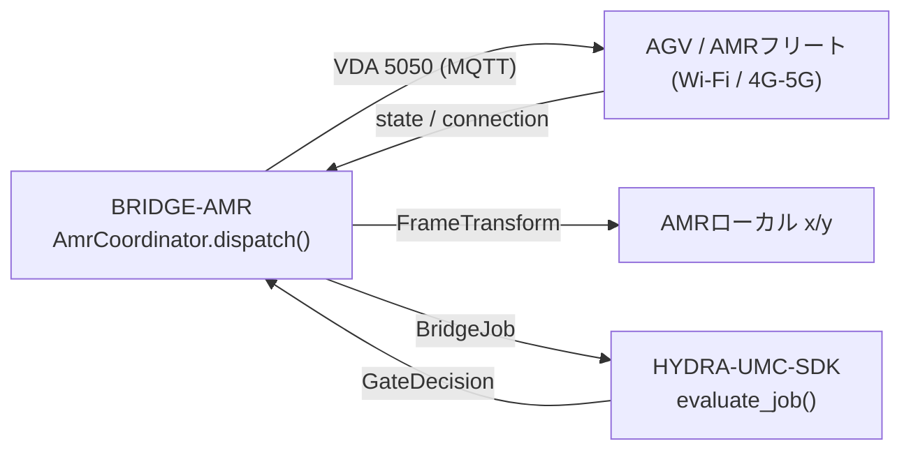

<!-- =============================================================================
HYDRA-UMC-BRIDGE-AMR - AMR/AGV coordination bridge
Copyright (C) JuanenRac (Electro Hobby 3D) <electrohobby3d@gmail.com>
GPL-3.0-or-later - see LICENSE
============================================================================= -->

<p align="center">
  
</p>

# 🚚 HYDRA-UMC-BRIDGE-AMR

<p align="center"><a href="README.md">🇺🇸 English</a> | <a href="README_spa.md">🇪🇸 Español</a> | <a href="README_fra.md">🇫🇷 Français</a> | <a href="README_ita.md">🇮🇹 Italiano</a> | <a href="README_deu.md">🇩🇪 Deutsch</a> | <a href="README_zho.md">🇨🇳 简体中文</a> | 🇯🇵 <b>日本語</b> | <a href="README_por.md">🇵🇹 Português</a></p>

### 🔗 HYDRA-UMCとAGV/AMRフリートとの間の依存関係なし連携境界

<p align="center">
  
  
  
  
  
  
</p>

---

> **誠実性チェック - 今日実際に動くもの:** 座標フレーム変換とジョブゲート（`coordinator.py` の `AmrCoordinator`/`FrameTransform`。すべてのディスパッチは `HYDRA-UMC-SDK` 自身の本物の `evaluate_job()` を通過する）、および VDA 5050 のメッセージ形式/トピックロジック（`mqtt_transport.py` の `Vda5050Publisher`）は本物であり、110件の通過するユニットテストで検証されている（`python tools/build_test.py` - `test_coordinator.py`、`test_mqtt_transport.py`、および実運用中の本物ではなくプロトコルに忠実な手書きの VDA 5050 AGV エミュレータに対してブリッジを動かす `test_vda5050_emulator.py`）。これらはいずれも、本物の MQTT ブローカー、本物の `paho-mqtt` クライアント、あるいは物理的な AMR・フリートマネージャーに対しては検証されていない - `test_mqtt_transport.py` 独自の `FakeMqttClient` が `paho-mqtt` を完全に置き換えており（本物のライブラリがインストールされていなくてもこれらのテストは通過する）、実際のフリートマネージャー用トランスポートがまだ選定・検証されていないため、実機向けの `run` コマンドもまだ存在しない。詳細は下記の「ロードマップと既知の制限」に既に明記されており、これまでに実際に出荷された内容は `CHANGELOG.md` を参照。

> **安全性とセキュリティの現状:** このエコシステムは認証された安全システムではありません。ハードウェアの E-STOP 経路、ファームウェアが強制する制限やインターロック、検証済みの動作コマンドはまだありません。ファームウェアイメージは CRC32 と共有鍵の HMAC-SHA256 で検査しており、非対称署名ではありません。TLS と相互 TLS は任意で、既定では無効です。独自基板はまだ実装も試験もされていません。ここに書かれた内容を人の安全のために頼る前に、[セキュリティベースライン](https://github.com/JuanenRac/HYDRA-UMC-DOCS/blob/main/docs/SECURITY_BASELINE.md)と[脅威モデル](https://github.com/JuanenRac/HYDRA-UMC-DOCS/blob/main/docs/THREAT_MODEL.md)をお読みください。

---

## 📋 ひと目で

| | |
|---|---|
| バージョン | `0.1.4` |
| 成熟度 | 機能する |
| テスト | 110 (`python tools/build_test.py`) |
| 技術 | Python / VDA 5050 (subset) / MQTT / HYDRA-UMC-SDK |
| 実機での確認 | シミュレーションのみ：エミュレーター、模擬部品、シミュレーターで試験済み。このバージョンについて実機での動作記録はありません |

**移動：** [概要](#-概要) · [アーキテクチャ](#-アーキテクチャ) · [機能](#-機能) · [セキュリティと安全](#-セキュリティと安全) · [インターフェース](#-インターフェース) · [設定](#-設定) · [クイックスタート](#-クイックスタート) · [テスト](#-テスト) · [トラブルシューティング](#-トラブルシューティング) · [リポジトリの構成](#-リポジトリの構成) · [関連プロジェクト](#-関連プロジェクト)

## 🚦 プロジェクトの状況

各行はこのリポジトリの一部分で、信号は今日どこまで進んでいるかを示します。計画ではなく、リポジトリが示せるもの（テスト、ビルド、実行）に基づいて書かれています。

🟢 完了・検証済み · 🟡 動作する（既知の制限あり） · 🟠 一部のみ、または未検証 · 🔴 未実装または動作しない

| 領域 | 状態 | ここでの意味 |
|---|---|---|
| ソフトウェア | 🟡 | 主な目的では動作します。足りない点は上の正直さの確認に書かれています |
| テスト | 🟢 | 自動テスト 110 件。変更のたびに実行されます |
| 実機 | 🟠 | シミュレーションのみ：エミュレーター、模擬部品、シミュレーターで試験済み。このバージョンについて実機での動作記録はありません |
| ドキュメント | 🟢 | 8 言語の README。変更のたびにマニフェストと照合されます |

## 🎯 概要

**HYDRA-UMC-BRIDGE-AMR** は、HYDRA-UMCとAGV/AMR(自律走行搬送ロボット)フリートとの間の双方向・高レベルの連携境界であり、Wi-Fi、またはセルラー(4G/5G)リンク経由で到達可能である。ジョブがAMRに到達する前に、実在する2つのことだけを行う —— 工場座標系上のある座標を、実在する手計算で検証可能な2D剛体変換によって、その特定のAMR自身のローカル座標系に解決すること、そしてジョブフェーズを、VDA 5050に着想を得た最小限のオーダーアクションにマッピングすることである。独自のナビゲーション、位置推定、障害物回避のロジックは持たず、HYDRA-UMC-SERVER、MCUの限界、ウォッチドッグ、E-STOPを迂回することはできない。

`HYDRA-UMC-BRIDGE-DROIDS` および `HYDRA-UMC-BRIDGE-UAV` とともに **Mobile & Autonomous Bridges** ファミリーに属し、静的な **External Automation Bridges**(CNC、LASER、OPENPNP、PRINTER3D、ROS2)と同じ `HYDRA-UMC-SDK` のジョブ・安全契約を共有している —— つまりモバイルであれ静的であれ、いずれのブリッジも独自の「作業に安全」という定義を勝手に作ることはない。

## 🧩 HYDRA-UMC での役割

**HYDRA-UMC-BRIDGE-AMR** は AGV/AMR 群とロボットセルを協調させます。ゲートを通ったセルのジョブを VDA 5050 の命令（生の動作は不可）に変換し、車両自身の `state` と `connection` を読み戻して、命令を受けられるかをゲートが判断できるようにします。

すべてのブリッジは `HYDRA-UMC-SDK` の共通の安全契約に従います。ジョブは共通の `evaluate_job()` ゲートが許可したときだけ受け付けられ、ゲートは安全側（閉）に倒れます。親プロジェクトは `HYDRA-UMC-SERVER` で、このブリッジはそれを呼び出さず、`HYDRA-UMC-MQTT-BROKER` 経由の MQTT でセルを指令する側に応答します。

## 🏛️ アーキテクチャ

<p align="center">
  
</p>

<details>
<summary>図のテキスト版（Mermaid）</summary>



</details>

**この作りにした理由**

* **なぜ単なるパススルーではなく、実在する座標系変換がここに存在するのか。** HYDRA-UMC自身のセル座標と、特定のAMRのローカルマップとは、原点や方位を共有していることはめったにない —— 本プロジェクトが出発点とした貼り付けられたアーキテクチャノートはこれを明示的に指摘している(「工場マップの座標をロボット自身のローカルマップにマッピングする」)。`FrameTransform` は、そのギャップを埋める実在する手検証済みの数学であり、フリートマネージャーへの依存を持たない純粋な三角関数として保たれているため、どこでもテスト可能である。
* **なぜオーダーアクション語彙はVDA 5050に沿って形作られているのか。** VDA 5050は、複数の商用AMRフリート(および増加しつつあるオープンソーススタック)がすでに話している、実在するオープンでベンダー中立なフリート連携標準である —— 本リポジトリ自身のアクションをその実在する語彙(`CANCEL_ORDER`、ノード/アクション形式の移動)にちなんで命名することで、将来の実在するVDA 5050アダプターは、後から取り付けられた変換レイヤーではなく、自然な適合となる。
* **なぜ `AmrCoordinator.dispatch()` はそれでも共有の `evaluate_job()` ゲートを通してすべてのジョブを流すのか。** AMRは、CNC、LASER、OPENPNP、PRINTER3D、ROS2、DROIDSが使うのと同じ `bridge_contract` の単なる別のクライアントに過ぎない —— 他のすべてのブリッジやHYDRA-UMC-SERVERが強制するIDLE/READYロジックを特別に迂回することはない。
* **なぜ `CANCEL_ORDER` は故障中でも要求可能なままなのか。** ゲートの生産フェーズ要件(`IDLE` + `READY`)は、中止リクエストには意図的に同じ方法で適用されない —— オペレーターは、故障の最中であっても、AMRの現在のオーダーを常にキャンセルできなければならない。
* **なぜベンダー固有のフリートマネージャー用アダプターがまだこのリポジトリにないのか。**(VDA 5050 MQTTパブリッシャーは上記のとおり存在する。) 特定のAMRの実際のREST/WebSocketプロトコルに、実際のフリートが選定・テストされる前にコミットすることは、この依存関係のないローカルコアが検証できない前提を組み込むリスクを伴う。
* **エコシステムの他部分とどう関係するか。** BRIDGE-AMRは実際のAMRフリートと `HYDRA-UMC-SDK` → `HYDRA-UMC-SERVER` → MCU安全との間に位置する —— 連携境界であり、ナビゲーションノードでもモーター制御ノードでも決してなく、HYDRA-UMC-SERVER、MCUの限界、ウォッチドッグ、E-STOPを迂回することはできない。

## ✨ 機能

* 🧾 **公式 VDA 5050 スキーマと設定可能なホールド：** テストは、ブリッジが組み立てるすべてのメッセージを VDA 5050 2.0.0 の公式 JSON スキーマ（`order` と `instantActions`、`tests/vda5050_schemas` に同梱）に対して検証します。公式の instantActions スキーマが求めるため、即時アクションは `actionType` に加えて `actionName` を持ちます。`AmrCoordinator(abort_action=AmrCoordinator.START_PAUSE)` を指定すると、中止フェーズは `cancelOrder`（既定）でオーダーを破棄する代わりに `startPause` で車両を保持します。どちらも常に転送されます。`MOVE_TO_HOME` は他の移動と同じゲートを通ります。 `AmrCoordinator.resume()` はセルが READY で、車両が一時停止として読み取られた場合にのみ `stopPause` を送り、`abort_action=AmrCoordinator.ABORT_BOTH` は `cancelOrder` に続けて `startPause` を送ります。 *(実装済み)*
* ✅ **実在する手計算で検証可能な座標系変換:** `FrameTransform` は、工場座標系の `(x, y)` を、そのAMR自身の実在する原点・方位を用いて特定のAMR自身のローカル座標系にマッピングする —— 単位変換ケース、純粋な並進、90度の方位回転、実在する往復テストによって検証済みである。*(実装済み、`tests/test_coordinator.py` でテスト済み)*
* ✅ **実在するVDA 5050に着想を得たオーダーアクション語彙:** `MOVE_TO_STAGING`, `PICK_LOAD`, `MOVE_TO_DESTINATION`, `DROP_LOAD`, `MOVE_TO_HOME` は本物の VDA 5050 `order` トピック(キューに入り、ルートの一部)に発行され、`CANCEL_ORDER` は別個の本物の `instantActions` トピック(即時、オーダーキューを迂回)に発行されます。VDA 5050 自身の `cancelOrder` アクション名とその実際のチャネルの両方に一致し、[公式スキーマ](https://github.com/VDA5050/VDA5050/tree/main/json_schemas)で確認済みです。*(実装済み)*
* ✅ **実在するアクションごとの座標検証:** `x`/`y` が欠けている、あるいは数値でない値を持つ移動アクションは、変換が実行される前にローカルで拒否される。*(実装済み、テスト済み)*
* ✅ **実在する共有安全ゲート:** `AmrCoordinator.dispatch()` を通じて送信されるすべてのジョブは、`HYDRA-UMC-SDK` の `bridge_contract` にある `evaluate_job()` によって評価される。これは他のすべての兄弟ブリッジとHYDRA-UMC-SERVERが使うのと同じゲートである。生産フェーズには外部機械が `IDLE` であり、HYDRA-UMCセルが `READY` であることが必要だが、`CANCEL_ORDER` は故障中でも要求可能なままである。*(実装済み)*
* ✅ **フェイルクローズのフェーズルーティングと静的エビデンス:** 未知の将来SDKフェーズは拒否される。`inspect_order_plan.py` はトランスポートを一切開かずに静的スキーマ `1.0` のオーダープランを出力する。*(実装・テスト済み)*
* ✅ **実際の VDA 5050 MQTT パブリッシャー:** `mqtt_transport.py` の `Vda5050Publisher` は、すでにゲートを通過したディスパッチを、正しい実際のトピック（`{interfaceName}/{majorVersion}/{manufacturer}/{serialNumber}/{order|instantActions}`）上で、実際の仕様準拠メッセージとして送信する —— 拒否されたディスパッチがネットワークに届くことは決してない。*(実装済み、`tests/test_mqtt_transport.py` でテスト済み)*
* ✅ **非破壊的なビルド/テスト:** `build-test.bat`/`.sh` はソースをコンパイルし、バージョンやCHANGELOGを変更せずに決定論的なユニットテストを実行する。*(実装済み、下記「ビルドとリリース」を参照)*
* 🔜 **ベンダー固有のフリートマネージャー REST/WebSocket アダプター**（VDA 5050 ネイティブではないフリートプラットフォーム向け） —— そのプラットフォームが選定・テストされた後にのみ導入される。*(計画中)*
* ✅ **観測した機器の状態と、再起動後も重複しないオーダー ID:** `AmrCoordinator.dispatch()` は、フリートマネージャーが車両について報告した状態を受け取り、共有ゲートはジョブに書かれた `machine_state`（ブローカー上の誰でも発行できるメッセージ）の代わりにそれを使います。`Vda5050Publisher` は各オーダーの `orderId` に固有のトークンを付けるので、`headerId` を最初から数え直す再起動でも以前のオーダーの ID を再利用しません（VDA 5050 はそれを拒否します）。*（実装済み、`tests/test_observed_and_order_ids.py` でテスト済み）*
* ✅ **ワイヤ上のVDA 5050の名前、ブローカーが受け入れるクライアント、聞き取るオブザーバー:** 内部名の `CANCEL_ORDER` / `PICK_LOAD` / `DROP_LOAD` は、大文字小文字を区別するVDA 5050のアクションタイプ `cancelOrder` / `pick` / `drop` として送られます(以前は `CANCEL_ORDER` がそのまま送られ、AGVはキャンセルとして認識しません)。移動は目的地ノードだけで、作り出したアクションタイプは付きません。`actionId` と `nodeId` は `orderId` と同様にセッショントークンを持ちます。`header_id` と `timestamp_iso` は省略でき(パブリッシャーがトピックごとに数え、UTCの時刻を付ける)、指定された場合は検証されます。オーバーフローする座標、有限でない数値、`FrameTransform.bounds` の外の点は拒否されます(`allow_nan=False`)。`open_mqtt_client()` は `client_id`(ブローカーはそのプレフィックスで認証)を受け取り、コールバックAPI v2を使い、発行できないクライアントを返す代わりにブローカーの応答を待ちます。`Vda5050Observer` を渡すとAGVの `state` と `connection` トピックを購読し、ゲートが使う機械状態を導きます(古い、ONLINEでない、AUTOMATICモードでない場合はOFFLINE。それ以外はSAFE_STOP、FAULT、HOLDING、RUNNING、IDLE)。*(実装済み、ダブルとエミュレーターでテスト済み。実際のAGVやフリートマネージャーでは未実行で、AGVが今いるノードから始まる経路(2つのノードと1本のエッジ、工場のグラフが必要)はまだ作られないため、実際のAGVはこの単一の目的地ノードの指示を拒否します)*

## 🔒 セキュリティと安全

| 脅威 | 防御 | 場所 |
|---|---|---|
| 安全でない状態のセルや機械へのジョブ | すべてのジョブは SDK の共通 `evaluate_job()` ゲートを通り、ゲートは安全側に倒れます。ブリッジ自身に受理・拒否のロジックはありません | SDK `bridge_contract` |
| 過大なジョブデータ | パラメーターは最大 32 個、キーは 64 文字、値は 1024 文字、識別子は 128 文字まで（`MAX_PARAMETERS`、`MAX_PARAMETER_KEY_CHARS`、`MAX_PARAMETER_VALUE_CHARS`、`MAX_IDENTIFIER_CHARS`） | SDK `bridge_contract` |
| 繰り返された、または再送された命令 | `IdempotencyStore` は各キーを 24 時間、最大 10 000 件まで記憶し、再送には再評価せず最初の応答を返します | SDK `job_intake` |
| 車両に送られる生の動作命令 | コーディネーターはジョブを AMR ローカルの命令にしか変換しません。`simulated_amr.TRANSITIONS` が、どの状態からどの動作が許されるかを定めます（例：`MOVE_TO_STAGING` は `IDLE` からのみ） | `coordinator.py`, `simulated_amr.py` |
| 不正な VDA 5050 メッセージ | パブリッシャーが作る `order` と `instantActions` の各メッセージは、変更せずに取り込んだ VDA 5050 2.0.0 公式 JSON スキーマに対してテストで検証されます | `tests/test_vda5050_schemas.py` |
| 命令を受けられない車両 | 拒否されたディスパッチはネットワークに出ません。オブザーバーは `state` や `connection` が無い、または 90 秒より古い場合を未準備として扱います | `mqtt_transport.py`, `observer.py` |

**絶対にしないこと：** 生の動作は送らず、実際の車両やフリート管理に対して動かしたことはありません。

## 🔌 インターフェース

VDA 5050 のトピックは `{interface_name}/{major_version}/{manufacturer}/{serial_number}/{channel}`（`Vda5050Target.topic()`）で、例は `vda5050/v2/acme/agv-01/order` です。

| トピックまたはルート | 内容 |
|---|---|
| `order`, `instantActions` | 発行されます。それぞれ独自の `header_id` カウンターと UTC のタイムスタンプを持ちます |
| `state`, `connection` | `Vda5050Observer` が監視し、再接続のたびに購読し直します |

ライブラリ：`AmrCoordinator`、`FrameTransform`、`Vda5050Publisher`、`Vda5050Target`、`Vda5050Observer`、`SimulatedAmr`、`open_mqtt_client()`。既定の MQTT クライアント ID は `hydra-umc-bridge-amr` です。

## ⚙️ 設定

| 変数 | 既定値 | 設定する内容 |
|---|---|---|
| `HYDRA_MQTT_USERNAME` | なし | MQTT のユーザー名。ブローカーはクライアント ID のプレフィックスに結び付けます |
| `HYDRA_MQTT_PASSWORD` | なし | パスワード。ユーザー名と一緒にのみ有効です |
| `HYDRA_MQTT_PASSWORD_FILE` | なし | ファイルから読むパスワード（Docker や systemd のシークレット）。`HYDRA_MQTT_PASSWORD` があれば無視されます |
| `HYDRA_MQTT_TLS_CA` | なし | ブローカーの証明書に署名した CA のファイル。接続は TLS になり、証明書が検証されます |
| `HYDRA_MQTT_TLS` | オフ | `1` で TLS を有効にし、システムの信頼する CA で検証します |
| `HYDRA_MQTT_TLS_CERT` / `HYDRA_MQTT_TLS_KEY` | なし | 相互 TLS を求めるブローカー用のクライアント証明書とその鍵。両方が必要です |

設定ファイルはありません。ブローカー、`interface_name`、`major_version`、`manufacturer`、`serial_number`、中止動作（`cancelOrder`、`startPause`、または両方）はコンストラクターの引数です。

## 🚀 クイックスタート

Python 3.11 以上が必要です。テストとビルドスクリプトは、このリポジトリの隣にある `HYDRA-UMC-SDK`（`../HYDRA-UMC-SDK`）、または `HYDRA_UMC_SDK_ROOT` で指定した場所を前提にします。

ハードウェアなしで試す（エミュレーターと模擬部品でブリッジ全体を確認します）：

```bash
py -3 tools/build_test.py          # Windows
python3 tools/build_test.py         # Linux, macOS
```

サービスを起動する（コンソールスクリプトはありません。サービスは MQTT トランスポートの `run_forever()` で、自分の起動コードから呼び出します）：

```python
from hydra_umc_bridge_amr import AmrCoordinator, FrameTransform, Vda5050Publisher, Vda5050Target, open_mqtt_client
client = open_mqtt_client("192.168.0.180")        # connects; the credentials come from HYDRA_MQTT_*
target = Vda5050Target("vda5050", "v2", "acme", "agv-01")
dispatch = AmrCoordinator().dispatch(job, cell_state, FrameTransform(map_id="hall", origin_x=0.0, origin_y=0.0, heading_rad=0.0))
Vda5050Publisher().publish(client, target, None, None, dispatch)   # a rejected dispatch is never sent
```

ユーザー名、パスワード、TLS ファイルは `HYDRA_MQTT_*` 変数から読まれます（設定を参照）。上のコード自体に認証情報は不要です。

## 🧪 テスト

`python tools/build_test.py` で自動 `unittest` 110 件を実行します（各モジュールのコンパイルも行います）。テストにハードウェア、ネットワーク、オプションのパッケージは不要で、`paho-mqtt`・`pyserial`・ベンダーのライブラリが必要なものは代用品を使うか、パッケージがなければスキップされます。

| テストファイル | テスト数 | 対象 |
|---|---|---|
| `test_coordinator.py`, `test_observed_and_order_ids.py`, `test_edge_cases.py` | - | ジョブから命令への変換、剛体座標変換、ID、境界ケース |
| `test_vda5050_schemas.py` | - | 全メッセージを公式 VDA 5050 2.0.0 スキーマで検証 |
| `test_vda5050_emulator.py`, `vda5050_emulator.py` | - | 実物のコーディネーターとパブリッシャーを、MQTT バス上の形式レベルの VDA 5050 車両と突き合わせ |
| `test_mqtt_transport.py`, `test_mqtt_environment.py`, `test_hardening.py`, `test_simulated_amr.py` | - | 偽の MQTT クライアントに対するパブリッシャー、環境の認証情報、悪意ある入力、状態表 |

CI は `HYDRA_UMC_CI=1 python tools/ci_validate.py` を実行し、マニフェスト、文書、8 つの README、図を検査し、SDK のチェックアウトを使ってテストを実行します。

## 🏗️ ビルドとリリース

Python 3.11以上が必要。`tools/build_test.py` は `HYDRA-UMC-SDK` が兄弟ディレクトリ(`../HYDRA-UMC-SDK`)としてチェックアウトされているか、環境変数 `HYDRA_UMC_SDK_ROOT` で指定されていることを期待する。

```bash
# Windows
build-test.bat      # 検証のみ —— バージョン/CHANGELOGの変更なし
build.bat            # 検証後、成功時にバージョン + CHANGELOG を更新

# Linux/macOS
bash build-test.sh
bash build.sh
```

`build-test` は `src/` 配下の各モジュールを `py_compile` でコンパイルし、`tests/` 配下で検出される `unittest` の全スイート(すべての `test_*.py` - 110件のテスト)を実行する —— 実際のAMR接続もネットワークもなく決定論的に動作し、バージョンやCHANGELOGを変更しない。`build` はまず同じ検証を実行し、成功した場合のみ `tools/bump_version.py` を呼び出して `pyproject.toml`、`hydra-umc.project.json`、`CHANGELOG.md` の間でバージョンを同期する。実際のハードウェア向け `run` コマンドはまだ存在しない —— それには検証済みのフリートマネージャー・トランスポートアダプターと実際のAMR/フリートが必要である。

## 🩺 トラブルシューティング

| 表示 | 原因 | 対処 |
|---|---|---|
| `ModuleNotFoundError: hydra_umc_sdk` | SDK がインストールされておらず、このリポジトリの隣にもありません | `HYDRA-UMC-SDK` をこのリポジトリの隣に置くか、`HYDRA_UMC_SDK_ROOT` を設定します |
| `paho-mqtt is not installed` | MQTT クライアントはオプションの追加パッケージです | `pip install ".[mqtt]"`（`paho-mqtt` 2.1 以上 3 未満が必要） |
| `password was given without a username` | MQTT の認証情報にはユーザー名とパスワードの両方が必要です | パスワードに加えて `HYDRA_MQTT_USERNAME` も設定します |
| `could not reach the MQTT broker after N attempts` | ブローカーが停止している、アドレスが違う、またはポートが閉じています | `HYDRA-UMC-MQTT-BROKER` を起動し、トランスポートに渡したホストとポートを確認します（2 秒間隔で 5 回試行。TLS ハンドシェイクの失敗は再試行しません） |
| `the MQTT broker refused the connection` | ブローカーが認証を拒否しました（または制限時間内に応答しませんでした） | `HYDRA_MQTT_USERNAME` とパスワードを確認します。クライアント ID はブローカーが認証情報に結び付けたプレフィックスで始まる必要があります |
| `"allowed": false` + `reason` | 共通ゲートまたはガードが命令を拒否しました | `reason` を読んで原因を直します。やみくもに再試行しないでください |

## 📂 リポジトリの構成

<p align="center">
  
</p>

<details>
<summary>ツリーのテキスト版</summary>

```text
HYDRA-UMC-BRIDGE-AMR/
├── src/hydra_umc_bridge_amr/
│   ├── coordinator.py             ジョブを AMR ローカルの命令に変換（生の動作は不可）、FrameTransform
│   ├── mqtt_transport.py          VDA 5050 の発行側と MQTT クライアント
│   ├── observer.py                AGV の `state` と `connection` を機械状態に変換
│   └── simulated_amr.py           どの状態からどの動作が許されるかの表
├── tests/                         110 件（VDA 5050 エミュレーターと公式スキーマ付き）
├── docs/                          ブリッジガイド
├── tools/                         ビルド・テスト実行、バージョン引き上げ、CI 検証、README と図の生成・検査
├── images/                        バナーと README の図
├── .github/                       CI ワークフローと Issue テンプレート
├── pyproject.toml                 パッケージのメタデータと依存関係
├── hydra-umc.project.json         マニフェスト：バージョン・成熟度・ファミリー
├── CHANGELOG.md                   各バージョンの変更点
├── build.sh build.bat             ビルドスクリプト（バージョンは変えません）
├── build-test.sh build-test.bat   ビルドスクリプト（バージョンは変えません）
├── test.sh test.bat               テストを実行
└── SECURITY.md SUPPORT.md CONTRIBUTING.md CODE_OF_CONDUCT.md LICENSE LICENSE.md
```

</details>

## 🗺️ ロードマップと既知の制限

**現時点の既知の制限**

**現時点で実在するもの:** バージョン `0.1.4`。実在する手検証済みの座標系変換(`FrameTransform`)、フェイルクローズのフェーズルーティング、VDA 5050 の実際の order/instantActions チャネル分割を備えた静的な `plan-only` オーダースキーマ、実際の VDA 5050 MQTT パブリッシャー(`Vda5050Publisher`)、SDKチェックアウトを伴いCIに組み込まれた非破壊的なbuild-testスクリプトを備える依存関係なしの連携コア(`AmrCoordinator`)として機能している。

**統合境界:** このブリッジは連携境界に過ぎない —— ナビゲーションノードでもモーター制御ノードでもなく、HYDRA-UMC-SERVER、MCUの限界、ウォッチドッグ、E-STOPを迂回することはできない。送信されるすべてのジョブは、依然としてすべての兄弟ブリッジが使う同じ共有ゲートを通過する。

**今後の課題:** 実際のフリートマネージャー・トランスポート(VDA 5050、ベンダーREST/WebSocket)も物理的なAMRもまだ一切検証されていない —— 実際のアダプターは、具体的なフリートプラットフォームが選定・テストされた後にのみ導入される。

## 🌍 言語

この README とリポジトリの文書は、英語・スペイン語・ドイツ語・フランス語・イタリア語・日本語・中国語・ポルトガル語（ポルトガル）の 8 言語で提供されています。8 つのファイルは同時に書かれ、同じ節と同じリンクを持つことを CI が確認します。 このリポジトリには独自の画面もメッセージカタログもないため、翻訳すべきインターフェース文字列はありません。

## 🔗 関連プロジェクト

本プロジェクトは、同じ作者(JuanenRac / Electro Hobby 3D)による HYDRA-UMC ロボティクスエコシステムの一部です。リクエストが実はこの中のどれかについてのものである可能性があるため、知っておく価値があります。

**親プロジェクト**
- **[HYDRA-UMC-SERVER](https://github.com/JuanenRac/HYDRA-UMC-SERVER)** — すべての制御クライアントが実際に通信する、本物のヘッドレスバックエンド(REST/WebSocket)。各コマンドがこのブリッジ自身のローカル安全ゲートを通過した後、本ブリッジが報告する認証済みエコシステム境界。

**兄弟プロジェクト** —— それぞれ独自のクライアントとして、同じく HYDRA-UMC-SERVER 自身の API と通信する
- **[HYDRA-UMC-STUDIO](https://github.com/JuanenRac/HYDRA-UMC-STUDIO)** — リアルタイムのマルチロボット 3D 可視化を備えたウェブ制御ダッシュボード。
- **[HYDRA-UMC-SUITE](https://github.com/JuanenRac/HYDRA-UMC-SUITE)** — 複数のサーバーを同時に扱えるデスクトップ(PySide6)スウォームコマンドセンター、スタンドアロン実行ファイルとしてパッケージ化。
- **[HYDRA-UMC-ANDROID-CONTROL](https://github.com/JuanenRac/HYDRA-UMC-ANDROID-CONTROL)** — 生体認証ログインとペアリングされた Wear OS コンパニオンを備えたネイティブ Android 制御アプリ。
- **[HYDRA-UMC-IOS-CONTROL](https://github.com/JuanenRac/HYDRA-UMC-IOS-CONTROL)** — リアルタイム WebSocket 同期を備えた iOS/iPadOS 制御アプリ(Flutter)。
- **[HYDRA-UMC-DSI](https://github.com/JuanenRac/HYDRA-UMC-DSI)** — 本体搭載の 7 インチ DSI タッチスクリーン向けネイティブタッチ UI、CM5 自体に組み込み。
- **[HYDRA-UMC-BRIDGE-CNC](https://github.com/JuanenRac/HYDRA-UMC-BRIDGE-CNC)** — GRBL ステータス/制御バイトへのアクセスを持つ、CNC セルの高レベルコーディネーター(エミュレーターに対してのみテスト済み)。
- **[HYDRA-UMC-BRIDGE-DROIDS](https://github.com/JuanenRac/HYDRA-UMC-BRIDGE-DROIDS)** — Boston Dynamics Spot コマンド送信機能を持つ、脚型/ヒューマノイドドロイドの調整境界(エミュレーターに対してのみテスト済み) — このエコシステムにおける 3 つのモバイルフリートブリッジのひとつ。
- **[HYDRA-UMC-BRIDGE-LASER](https://github.com/JuanenRac/HYDRA-UMC-BRIDGE-LASER)** — キー/筐体/インターロックの GPIO 信号 3 系統を読み取るレーザーセルのコーディネーター(模擬チップに対してのみテスト済み。レーザーの武装や発射はできない)。
- **[HYDRA-UMC-BRIDGE-OPENPNP](https://github.com/JuanenRac/HYDRA-UMC-BRIDGE-OPENPNP)** — OpenPnP ピックアンドプレースの基板フローを安全に統括する高レベルコーディネーター。
- **[HYDRA-UMC-BRIDGE-PRINTER3D](https://github.com/JuanenRac/HYDRA-UMC-BRIDGE-PRINTER3D)** — 実際にゲート制御されたジョブコマンドを持つ、Moonraker/Klipper 3D プリンター向けの安全な調整境界。
- **[HYDRA-UMC-BRIDGE-ROS2](https://github.com/JuanenRac/HYDRA-UMC-BRIDGE-ROS2)** — 遅延インポートの rclpy ROS 2 トランスポートを持つコーディネーター(ROS 2 環境ではまだ実行していない)。
- **[HYDRA-UMC-BRIDGE-UAV](https://github.com/JuanenRac/HYDRA-UMC-BRIDGE-UAV)** — MAVLink コマンド送信機能を持つ、カメラ搭載 UAV の調整境界(エミュレーターに対してのみテスト済み) — このエコシステムにおける 3 つのモバイルフリートブリッジのひとつ。

**直接関連**
- **[HYDRA-UMC-SDK](https://github.com/JuanenRac/HYDRA-UMC-SDK)** — すべてのブリッジが自身のコマンドを検証する共有 JSON-Schema 契約とソフトウェアのジョブゲート境界(認証済みの安全機能ではない)。
- **[HYDRA-UMC-CONNECTOR-HUB](https://github.com/JuanenRac/HYDRA-UMC-CONNECTOR-HUB)** — 外部マシン用コネクタのための宣言的アダプターマニフェストのレジストリとバリデーター。SDK 自身の契約という発想を外部マシンにまで拡張し、産業用ゲートウェイ系のプロジェクトを置き換えることはありません。
- **[HYDRA-UMC-MQTT-BROKER](https://github.com/JuanenRac/HYDRA-UMC-MQTT-BROKER)** — `mqtt_transport.py` の `Vda5050Publisher` は、ゲートを通過済みのディスパッチを実際の仕様準拠 VDA 5050 `order`/`instantActions` メッセージとして送信する——他のブリッジ自身の `hydra/bridges/<name>/...` トピック方式とは異なり、これは VDA 5050 自体の実際のトピック形式を直接使用する。

**エコシステムの他のプロジェクト**

*コアハードウェア&プラットフォーム*
- **[HYDRA-UMC](https://github.com/JuanenRac/HYDRA-UMC)** — ロボットアームのマザーボードの設計——CM5 ホスト + デュアルコア STM32H745、CAN-OTA/SPI-OTA 経由で最大 8 本のツールアームを統括することを目指す(ファームウェアは初期段階で、実装済みの基板はまだない)。
- **[HYDRA-UMC-OS](https://github.com/JuanenRac/HYDRA-UMC-OS)** — CM5 向けの再現可能な Raspberry Pi OS プロダクト層——読み取り専用エージェント、検証済み設定/プロファイル、WiFi 初回接続プロビジョニング。

*コアバックエンド&クライアント*
- **[HYDRA-UMC-EDITOR-URDF](https://github.com/JuanenRac/HYDRA-UMC-EDITOR-URDF)** — 完成したモデルを STUDIO 自身のカタログへ送信するデスクトップ用グラフィカル URDF 作成/編集ツール。
- **[HYDRA-UMC-EDITOR-STL](https://github.com/JuanenRac/HYDRA-UMC-EDITOR-STL)** — HYDRA-UMC-EDITOR-URDF も編集する同じモデルカタログ内で、実在するパーツを変換/置換/削除/追加するデスクトップ STL モデルエディタ。

*URTC ツールプラットフォーム*
- **[URTC](https://github.com/JuanenRac/URTC)** — 物理的な Universal Robot Tool Controller 基板向けファームウェア、CAN バス経由の 25 以上のツールプロファイル。
- **[URTC-FLASHER](https://github.com/JuanenRac/URTC-FLASHER)** — URTC 基板用のデスクトップ GUI 書き込みツール、CAN-OTA およびフルチップ SWD/JTAG。
- **[URTC-TESTER](https://github.com/JuanenRac/URTC-TESTER)** — URTC 基板向けのデスクトップ CAN バスライブ診断ツール、ツールプロファイルごとに 1 パネル。
- **[URTC-WEB-STUDIO](https://github.com/JuanenRac/URTC-WEB-STUDIO)** — Web Serial API を使ったブラウザベースの URTC-TESTER の代替、ローカルインストール不要。
- **[URTC-GATEWAY](https://github.com/JuanenRac/URTC-GATEWAY)** — URTC の CAN バスの前に置くゲートウェイ：許可する識別子のリスト、レート制限、セッション鍵。コンピューター上でテスト済みで、実際のバスではまだ試していません。

*ビジョン AI ノード(Hailo-8)*
- **[HYDRA-UMC-VISION-NODE](https://github.com/JuanenRac/HYDRA-UMC-VISION-NODE)** — Hailo-8 ビジョンパイプラインの統合ハブ、段階ごとの実際のハードウェア準備状況チェック付き。
- **[HYDRA-UMC-DETECTION-HEF](https://github.com/JuanenRac/HYDRA-UMC-DETECTION-HEF)** — Hailo アーキテクチャ/チェックサムによる安全読み込み検証を備えた、実際のコンパイル済みモデルレジストリ。
- **[HYDRA-UMC-VISION-STREAMER](https://github.com/JuanenRac/HYDRA-UMC-VISION-STREAMER)** — 実際の HailoRT 統合境界を持つ、実際の GStreamer パイプライン + MediaMTX 設定生成器。
- **[HYDRA-UMC-VISUAL-SERVOING-API](https://github.com/JuanenRac/HYDRA-UMC-VISUAL-SERVOING-API)** — ゾーン状態を条件に承認する Position-Based Visual Servoing 補正則。カメラによる姿勢推定はまだない。
- **[HYDRA-UMC-SAFETY-ZONES](https://github.com/JuanenRac/HYDRA-UMC-SAFETY-ZONES)** — ファイルから物体位置を受け取る、ゾーン侵入・キャリブレーション鮮度・E-STOP 要求の v0 ロジック。検出器は接続されておらず、物理 E-STOP もまだ配線されていない。

*コグニティブ AI ノード(Hailo-10)*
- **[HYDRA-UMC-COGNITIVE-NODE](https://github.com/JuanenRac/HYDRA-UMC-COGNITIVE-NODE)** — Hailo-10 コグニティブパイプライン(LLM/VLA/音声オーケストレーション)の統合ハブ。
- **[HYDRA-UMC-VLA-ENGINE](https://github.com/JuanenRac/HYDRA-UMC-VLA-ENGINE)** — Vision-Language-Action モデル向けの、実際のアクショントークンのエンコード/デコードと軌道生成。
- **[HYDRA-UMC-VOICE-UI](https://github.com/JuanenRac/HYDRA-UMC-VOICE-UI)** — 確認ゲート付きの限定的な Watch リレーを備えた、実際の音声フロントエンド(VAD + 意図解析)。
- **[HYDRA-UMC-SEMANTIC-PLANNER](https://github.com/JuanenRac/HYDRA-UMC-SEMANTIC-PLANNER)** — MCU エラーコードに対する、実際のルールベースのタスク分解と意味的エラー復旧。
- **[HYDRA-UMC-DOCS-QA](https://github.com/JuanenRac/HYDRA-UMC-DOCS-QA)** — このエコシステム自身の Markdown ドキュメントに対する、標準ライブラリのみの実際の TF-IDF 文書検索。
- **[HYDRA-UMC-LOCAL-TECHNICIAN](https://github.com/JuanenRac/HYDRA-UMC-LOCAL-TECHNICIAN)** — エコシステム自身のための、ローカルでポリシーゲート付きのAIメンテナンス技術者 — 観察、診断し、修正を提案する;最上位の2つのリスクレベルは意図的にまだ実装されていない。

*オーケストレーション&スウォーム*
- **[HYDRA-UMC-ORCHESTRATOR](https://github.com/JuanenRac/HYDRA-UMC-ORCHESTRATOR)** — 実際の gRPC/Protobuf ヘルスレポート契約とミッションステートマシンを持つ統合ハブ。
- **[HYDRA-UMC-JOB-DISPATCHER](https://github.com/JuanenRac/HYDRA-UMC-JOB-DISPATCHER)** — 実際の HTTP API 上に構築された、優先度ベースの実際のジョブキュー(重複排除付き)。
- **[HYDRA-UMC-NODE-HEALING](https://github.com/JuanenRac/HYDRA-UMC-NODE-HEALING)** — リトライ/バックオフとアイデンティティ不一致検出を備えた、実際の gRPC ベースのフリートヘルスウォッチドッグ。
- **[HYDRA-UMC-PATH-PLANNER-3D](https://github.com/JuanenRac/HYDRA-UMC-PATH-PLANNER-3D)** — 実際の障害物/ワークスペース衝突検証を備えた、実際の RRT ベースの 3D 経路プランナー。
- **[HYDRA-UMC-SWARM-SYNC](https://github.com/JuanenRac/HYDRA-UMC-SWARM-SYNC)** — 複数セルの収束についてプロパティテストされた、実際の CRDT LWW-Element-Map 状態同期。

*デジタルツイン&シミュレーション*
- **[HYDRA-UMC-TWIN](https://github.com/JuanenRac/HYDRA-UMC-TWIN)** — 実際のバージョン互換性同期契約を持つ、デジタルツインエンジンの統合ハブ。
- **[HYDRA-UMC-HIL-BRIDGE](https://github.com/JuanenRac/HYDRA-UMC-HIL-BRIDGE)** — シミュレーションと実機の間にソフトウェアの衝突インターロックを備えたハードウェア・イン・ザ・ループのルーター(実機なしでテスト済み)。
- **[HYDRA-UMC-PHYSICS-REPLICA](https://github.com/JuanenRac/HYDRA-UMC-PHYSICS-REPLICA)** — 実際の URDF サブセットに対する、実際の順運動学と関節限界検証。
- **[HYDRA-UMC-SYNTHETIC-DATA-GEN](https://github.com/JuanenRac/HYDRA-UMC-SYNTHETIC-DATA-GEN)** — YOLO/COCO アノテーションのエクスポート機能を持つ、実際のプロシージャル 2D シーンジェネレーター。

*データ&分析*
- **[HYDRA-UMC-DATALAKE](https://github.com/JuanenRac/HYDRA-UMC-DATALAKE)** — 実際の取り込み/クエリ HTTP API を備えた、実際の sqlite3 ベースの時系列ストア。
- **[HYDRA-UMC-ANOMALY-DETECTOR](https://github.com/JuanenRac/HYDRA-UMC-ANOMALY-DETECTOR)** — ドリフト監視を備えた、実際の FFT + 統計ベースラインによる異常検知器。
- **[HYDRA-UMC-PRODUCTION-REPORTS](https://github.com/JuanenRac/HYDRA-UMC-PRODUCTION-REPORTS)** — DATALAKE の履歴に対する実際の OEE/稼働率計算、再現可能な CSV エクスポート付き。
- **[HYDRA-UMC-TELEMETRY-COLLECTOR](https://github.com/JuanenRac/HYDRA-UMC-TELEMETRY-COLLECTOR)** — シーケンス重複排除機能を備えた、DATALAKE への実際の CAN/WebSocket 取り込みパイプライン。

*産業用ゲートウェイ*
- **[HYDRA-UMC-GATEWAY-INDUSTRIAL](https://github.com/JuanenRac/HYDRA-UMC-GATEWAY-INDUSTRIAL)** — 実際のコマンド許可リスト/バックプレッシャー層を持つ、産業用プロトコルへ中継する統合ハブ。
- **[HYDRA-UMC-OPCUA-SERVER](https://github.com/JuanenRac/HYDRA-UMC-OPCUA-SERVER)** — 実際のバイナリプロトコルクライアントセッションで検証された、実際の OPC-UA アドレス空間。
- **[HYDRA-UMC-MTCONNECT-ADAPTER](https://github.com/JuanenRac/HYDRA-UMC-MTCONNECT-ADAPTER)** — 縮退モード出力を備えた、実際の MTConnect `/probe` および `/current` XML エンドポイント。

*補完ツール&エコシステム運用*
- **[HYDRA-UMC-DASHBOARD-AI](https://github.com/JuanenRac/HYDRA-UMC-DASHBOARD-AI)** — 誠実な統計フォールバックを備えた、DATALAKE/ANOMALY-DETECTOR 上のスマートサマリーと異常ハイライトパネル。
- **[HYDRA-UMC-TOOL-CLI](https://github.com/JuanenRac/HYDRA-UMC-TOOL-CLI)** — 実際の安定した終了コード契約を持つフリート CLI、HYDRA-UMC-SERVER 自身の API の本物のライブクライアント。
- **[HYDRA-UMC-WATCH](https://github.com/JuanenRac/HYDRA-UMC-WATCH)** — 触覚アラートのパターンとペアリング済みスマートフォンへの音声リレーを備えた WearOS コンパニオンアプリ(物理的なウォッチではまだ実行していない)。
- **[URTC-SMART-RACK](https://github.com/JuanenRac/URTC-SMART-RACK)** — 実際の工具 ID デコードと Smart Idle 予熱ロジックを備えた、基板搭載ラック用ファームウェア。
- **[URTC-VISION-TOOL](https://github.com/JuanenRac/URTC-VISION-TOOL)** — サーマル/RGB 検査ツールヘッド向けの、ファームウェアと実際の Python ビジョンコンパニオン。
- **[HYDRA-UMC-UPDATER](https://github.com/JuanenRac/HYDRA-UMC-UPDATER)** — このエコシステム内のすべてのリポジトリを検出・クローン・更新する、管理用デスクトップツール。
- **[HYDRA-UMC-OS-REBUILDER](https://github.com/JuanenRac/HYDRA-UMC-OS-REBUILDER)** — エコシステムの最新バージョンをプリロードした、書き込み可能なCM5イメージを構築するWindows/Linuxデスクトップツール。Raspberry Pi Imager方式の初回起動Wi-Fi/ユーザー/SSH設定を備える。
- **[HYDRA-UMC-OPS-AGENT](https://github.com/JuanenRac/HYDRA-UMC-OPS-AGENT)** — 保守インシデントコーディネーター: 低権限のエッジ役割がサニタイズされたインベントリ/ヘルスのスナップショットを収集し、コントロールプレーン役割がそれを読み取り専用でレンダリングして AI プロバイダーに診断の提案を依頼します - パッチを適用することも、何かをデプロイすることも決してありません。
- **[HYDRA-UMC-DEV-SERVER](https://github.com/JuanenRac/HYDRA-UMC-DEV-SERVER)** — 再現可能な開発ホスト（Raspberry Pi 5 / CM5）。エコシステムのソースコードを保管し、永続キューのもとで境界の明確なビルド/テストタスクを実行する。運用中の CM5 とは明確に異なる、開発専用の役割。

## 📚 ドキュメント

さらに読むには：

* [docs/BRIDGE_GUIDE.md](docs/BRIDGE_GUIDE.md) - 範囲、VDA 5050 メッセージ、座標系、スクリプト
* [エコシステムのセキュリティ基準](https://github.com/JuanenRac/HYDRA-UMC-DOCS/blob/main/docs/SECURITY_BASELINE.md)
* [エコシステムの脅威モデル](https://github.com/JuanenRac/HYDRA-UMC-DOCS/blob/main/docs/THREAT_MODEL.md)
* [このリポジトリの変更履歴](CHANGELOG.md)
* [このリポジトリのライセンス](LICENSE.md)

## 🤝 コントリビュートとコミュニティ

* プルリクエストの前に `HYDRA_UMC_CI=1 py -3 tools/ci_validate.py`（または `HYDRA_UMC_CI=1 python3 tools/ci_validate.py`）を実行してください。`CI_VALIDATION=PASS` と表示される必要があります。この確認に `build.sh` や `build.bat` は使わないでください。ビルドは検査ではありません。
* 8 つの README は HYDRA-UMC-DOCS の 1 つのソースから書かれます。手で編集しないでください。ソースを変更し、`tools/make_readmes.py` で書き直します。
* 実行していないことを README に書かないでください。事実であれば「シミュレーションのみ」「実機では未確認」と書きます。
* [CONTRIBUTING.md](CONTRIBUTING.md)、[行動規範](CODE_OF_CONDUCT.md)、[SECURITY.md](SECURITY.md)、[SUPPORT.md](SUPPORT.md) を参照してください。

## 👤 作者

**JuanenRac (Electro Hobby 3D)** · electrohobby3d@gmail.com

## 📜 ライセンス

GPL-3.0-or-later - [LICENSE](LICENSE).
