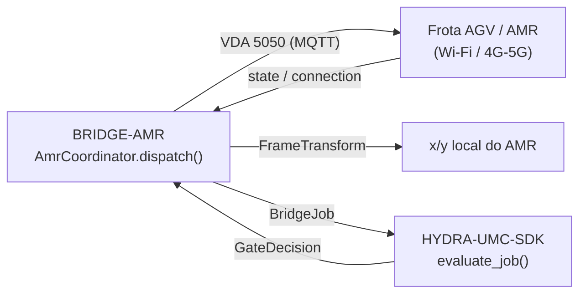

<!-- =============================================================================
HYDRA-UMC-BRIDGE-AMR - AMR/AGV coordination bridge
Copyright (C) JuanenRac (Electro Hobby 3D) <electrohobby3d@gmail.com>
GPL-3.0-or-later - see LICENSE
============================================================================= -->

<p align="center">
  
</p>

# 🚚 HYDRA-UMC-BRIDGE-AMR

<p align="center"><a href="README.md">🇺🇸 English</a> | <a href="README_spa.md">🇪🇸 Español</a> | <a href="README_fra.md">🇫🇷 Français</a> | <a href="README_ita.md">🇮🇹 Italiano</a> | <a href="README_deu.md">🇩🇪 Deutsch</a> | <a href="README_zho.md">🇨🇳 简体中文</a> | <a href="README_jpn.md">🇯🇵 日本語</a> | 🇵🇹 <b>Português</b></p>

### 🔗 Fronteira de coordenação sem dependências entre o HYDRA-UMC e frotas AGV/AMR

<p align="center">
  
  
  
  
  
  
</p>

---

> **Verificação de honestidade - o que realmente corre hoje:** a transformação de referenciais de coordenadas e a porta de trabalhos (o `AmrCoordinator`/`FrameTransform` de `coordinator.py`, que encaminha cada despacho pelo `evaluate_job()` do próprio `HYDRA-UMC-SDK`) e a lógica de formato de mensagem/tópicos do VDA 5050 (o `Vda5050Publisher` de `mqtt_transport.py`) são reais e estão cobertas por 110 testes unitários que passam (`python tools/build_test.py` - `test_coordinator.py`, `test_mqtt_transport.py`, mais `test_vda5050_emulator.py`, que executa o bridge contra um emulador de AGV VDA 5050 escrito à mão e fiel ao protocolo, não contra um real). Nada disto foi exercitado contra um broker MQTT real, um cliente `paho-mqtt` real ou um AMR/gestor de frota físico: o próprio `FakeMqttClient` de `test_mqtt_transport.py` substitui por completo o `paho-mqtt` (nem sequer é preciso ter a biblioteca real instalada para estes testes passarem), e ainda não há comando `run` vivo porque não se escolheu nem validou nenhum transporte real de gestor de frota. Ver «Roteiro e limites conhecidos» abaixo, que já o diz com clareza, e `CHANGELOG.md` para saber exatamente o que foi entregue até agora.

> **Estado de segurança (safety e security):** este ecossistema não é um sistema de segurança certificado. Ainda não existe um caminho de E-STOP por hardware, nem limites ou interlocks impostos pelo firmware, nem um comando de movimento verificado; as imagens de firmware são verificadas com CRC-32 e uma assinatura Ed25519, e uma compilação de versão recusa as chaves de desenvolvimento publicadas (as cabeças de ferramenta e as placas de expansão atrás do relé ainda usam os bootloaders do URTC, que aceitam um HMAC-SHA256 de chave partilhada em vez de uma assinatura); TLS e TLS mútuo são opcionais e estão desativados por defeito; nenhuma placa própria foi ainda montada ou testada. Leia a [base de segurança](https://github.com/JuanenRac/HYDRA-UMC-DOCS/blob/main/docs/SECURITY_BASELINE.md) e o [modelo de ameaças](https://github.com/JuanenRac/HYDRA-UMC-DOCS/blob/main/docs/THREAT_MODEL.md) antes de confiar em qualquer afirmação aqui para a segurança de uma pessoa.

---

## 📋 Num relance

| | |
|---|---|
| Versão | `0.1.5` |
| Maturidade | Funcional |
| Testes | 110 (`python tools/build_test.py`) |
| Tecnologia | Python / VDA 5050 (subset) / MQTT / HYDRA-UMC-SDK |
| Em hardware real | Só simulado: testado com emuladores, dublês de teste ou simuladores; não há registo de execução em hardware real para esta versão |

**Ir para:** [Visão geral](#-visão-geral) · [Arquitetura](#-arquitetura) · [Funcionalidades](#-funcionalidades) · [Segurança e proteção](#-segurança-e-proteção) · [Interfaces](#-interfaces) · [Configuração](#-configuração) · [Início rápido](#-início-rápido) · [Testes](#-testes) · [Resolução de problemas](#-resolução-de-problemas) · [Estrutura do repositório](#-estrutura-do-repositório) · [Projetos relacionados](#-projetos-relacionados)

## 🚦 Estado do projeto

Cada linha é uma parte deste repositório e a luz diz até onde chega hoje. É escrita com o que o repositório consegue demonstrar (testes, compilações, execuções), não com o que está previsto.

🟢 Feito e verificado · 🟡 Funciona, com limites conhecidos · 🟠 Feito a meio ou ainda por verificar · 🔴 Por fazer ou a não funcionar

| Área | Estado | O que significa aqui |
|---|---|---|
| Software | 🟡 | Funciona para o seu propósito principal; a verificação de honestidade acima lista o que ainda falta |
| Testes | 🟢 | 110 testes automáticos, executados a cada alteração |
| Hardware real | 🟠 | Só simulado: testado com emuladores, dublês de teste ou simuladores; não há registo de execução em hardware real para esta versão |
| Documentação | 🟢 | README em oito idiomas, verificado contra o manifesto a cada alteração |

## 🎯 Visão geral

O **HYDRA-UMC-BRIDGE-AMR** é a fronteira de coordenação bidirecional e de alto nível entre o HYDRA-UMC e uma frota de AGV/AMR (robôs móveis autónomos), acessível por Wi-Fi ou uma ligação celular (4G/5G). Faz exatamente duas coisas reais antes de um trabalho chegar a um AMR: resolve uma coordenada do referencial da fábrica no referencial local desse AMR concreto através de uma transformação rígida 2D real e verificável à mão, e associa uma fase do trabalho a uma ação de ordem mínima inspirada no VDA 5050. Não tem lógica própria de navegação, localização nem desvio de obstáculos e não pode contornar o HYDRA-UMC-SERVER, os limites do MCU, os watchdogs nem a paragem de emergência (E-STOP).

Pertence à família de **Bridges móveis e autónomos**, ao lado do `HYDRA-UMC-BRIDGE-DROIDS` e do `HYDRA-UMC-BRIDGE-UAV`, e partilha o mesmo contrato de trabalho e segurança do `HYDRA-UMC-SDK` que os **Bridges de automação externa** fixos (CNC, LASER, OPENPNP, PRINTER3D, ROS2), de modo que nenhum bridge, móvel ou fixo, inventa a sua própria definição de «seguro para trabalhar».

## 🧩 Papel no HYDRA-UMC

O **HYDRA-UMC-BRIDGE-AMR** coordena uma frota de AGV ou AMR com uma célula de robôs. Converte um trabalho de célula já validado numa ordem VDA 5050 (nunca movimento bruto) e lê de volta as mensagens `state` e `connection` do próprio veículo, para a porta saber se ele pode aceitar uma ordem.

Todos os bridges falam o contrato de segurança partilhado do `HYDRA-UMC-SDK`: um trabalho só é aceite quando a porta partilhada `evaluate_job()` o permite, e essa porta falha fechada. O projeto pai é o `HYDRA-UMC-SERVER`; este bridge não o chama, responde por MQTT, através do `HYDRA-UMC-MQTT-BROKER`, a quem comanda a célula.

## 🏛️ Arquitetura

<p align="center">
  
</p>

<details>
<summary>Versão em texto do diagrama (Mermaid)</summary>



</details>

**Porque é construído assim**

* **Porque aqui vive uma transformação real de referenciais e não apenas uma passagem direta.** As coordenadas da célula do HYDRA-UMC e o mapa local de um AMR qualquer raramente partilham origem ou orientação; a nota de arquitetura colada de que este projeto partiu di-lo expressamente («mapear coordenadas do mapa da fábrica para o mapa local do próprio robô»). `FrameTransform` é a matemática real e verificada à mão que fecha essa lacuna, mantida como trigonometria simples sem dependência de nenhum gestor de frota, de modo que se pode testar em qualquer lado.
* **Porque o vocabulário de ações de ordem tem a forma do VDA 5050.** O VDA 5050 é o padrão real, aberto e neutro quanto a fabricantes de integração de frotas que várias frotas comerciais de AMR (e um número crescente de pilhas de código aberto) já falam; dar às ações deste repositório os nomes do seu vocabulário real (`CANCEL_ORDER`, movimento em forma de nó/ação) faz de um futuro adaptador VDA 5050 real um encaixe natural e não uma camada de tradução acrescentada à pressa.
* **Porque `AmrCoordinator.dispatch()` continua a encaminhar cada trabalho pela porta partilhada `evaluate_job()`.** Um AMR é apenas mais um cliente do mesmo `bridge_contract` que usam o CNC, o LASER, o OPENPNP, o PRINTER3D, o ROS2 e o DROIDS: não tem nenhum atalho para contornar a lógica IDLE/READY que impõem todos os outros bridges e o HYDRA-UMC-SERVER.
* **Porque `CANCEL_ORDER` continua a poder pedir-se durante uma falha.** O requisito de fase produtiva da porta (`IDLE` + `READY`) não se aplica de propósito da mesma forma a um pedido de abortar: um operador tem de poder sempre cancelar a ordem atual de um AMR, mesmo a meio de uma falha.
* **Porque ainda não há neste repositório um adaptador específico de um fabricante para o gestor de frota.** (O publicador MQTT VDA 5050 existe, ver acima.) Comprometer-se com o protocolo REST/WebSocket real de um AMR antes de se escolher e testar uma frota real arriscaria fixar pressupostos que este núcleo local e sem dependências não consegue verificar.
* **Como se encaixa no resto do ecossistema.** O BRIDGE-AMR fica entre uma frota de AMR real e o `HYDRA-UMC-SDK` → `HYDRA-UMC-SERVER` → segurança do MCU: é uma fronteira de coordenação, nunca um nó de navegação nem de controlo de motores, e não pode contornar o HYDRA-UMC-SERVER, os limites do MCU, os watchdogs nem a paragem de emergência (E-STOP).

## ✨ Funcionalidades

* 🧾 **Esquemas VDA 5050 oficiais e retenção configurável:** os testes validam cada mensagem que a ponte constrói contra os esquemas JSON oficiais do VDA 5050 2.0.0 (`order` e `instantActions`, incluídos em `tests/vda5050_schemas`); uma ação instantânea leva agora `actionName` junto de `actionType`, porque o esquema oficial instantActions o pede. `AmrCoordinator(abort_action=AmrCoordinator.START_PAUSE)` faz a fase de aborto reter o veículo com `startPause` em vez de descartar a sua ordem com `cancelOrder` (o predefinido); ambas são sempre reencaminhadas. `MOVE_TO_HOME` passa pela mesma porta que qualquer movimento. `AmrCoordinator.resume()` envia `stopPause` apenas com a célula em READY e um veículo lido como em pausa, e `abort_action=AmrCoordinator.ABORT_BOTH` envia `cancelOrder` e depois `startPause`. *(implementado)*
* ✅ **Transformação real de referenciais de coordenadas, verificável à mão:** `FrameTransform` converte um `(x, y)` do referencial da fábrica no referencial local de um AMR concreto, dada a origem/orientação real desse AMR no chão da fábrica; verificada com um caso de identidade, uma translação pura, uma rotação de orientação de 90 graus e um teste real de ida e volta. *(implementado, testado em `tests/test_coordinator.py`)*
* ✅ **Vocabulário real de ações de ordem inspirado no VDA 5050, com a divisão real em dois canais:** `MOVE_TO_STAGING`, `PICK_LOAD`, `MOVE_TO_DESTINATION`, `DROP_LOAD`, `MOVE_TO_HOME` publicam-se no tópico `order` real do VDA 5050 (em fila, parte de um percurso); `CANCEL_ORDER` publica-se no tópico `instantActions` real e separado (imediato, não passa pela fila de ordens), de acordo com o nome real da ação `cancelOrder` do VDA 5050 E o seu canal real, verificado contra os [esquemas oficiais](https://github.com/VDA5050/VDA5050/tree/main/json_schemas). *(implementado)*
* ✅ **Validação real de coordenadas por ação:** uma ação de movimento sem `x`/`y`, ou com um valor não numérico, é rejeitada localmente antes de a transformação sequer correr. *(implementado, testado)*
* ✅ **Porta de segurança partilhada real:** cada trabalho despachado por `AmrCoordinator.dispatch()` é avaliado pelo `evaluate_job()` do `bridge_contract` do `HYDRA-UMC-SDK`, a mesma porta que usam todos os bridges irmãos e o HYDRA-UMC-SERVER; uma fase produtiva exige uma máquina externa `IDLE` e uma célula do HYDRA-UMC `READY`, enquanto `CANCEL_ORDER` continua a poder pedir-se durante uma falha. *(implementado)*
* ✅ **Encaminhamento de fases com falha segura e evidência estática:** uma fase futura desconhecida do SDK é negada. `inspect_order_plan.py` emite o plano de ordens estático do esquema `1.1` (com a divisão real de canais `actions`/`instant_actions`) sem abrir nenhum transporte. *(implementado, testado)*
* ✅ **Publicador MQTT VDA 5050 real:** o `Vda5050Publisher` de `mqtt_transport.py` envia um despacho já aprovado como mensagem real, com o formato da especificação, no tópico real correto (`{interfaceName}/{majorVersion}/{manufacturer}/{serialNumber}/{order|instantActions}`); um despacho rejeitado nunca chega à rede. *(implementado, testado em `tests/test_mqtt_transport.py`)*
* ✅ **Compilação/teste que não altera nada:** `build-test.bat`/`.sh` compilam o código-fonte e executam testes unitários deterministas sem alterar a versão nem o CHANGELOG. *(implementado, ver Compilação e publicação abaixo)*
* 🔜 **Um adaptador REST/WebSocket específico de um gestor de frota** (para uma plataforma de frota que não seja nativa VDA 5050): só se introduzirá depois de se escolher e testar essa plataforma. *(planeado)*
* ✅ **Estado observado da máquina e ids de ordem que sobrevivem a um reinício:** `AmrCoordinator.dispatch()` aceita o estado que o gestor de frota comunicou do veículo, que a porta partilhada usa em vez do `machine_state` escrito no trabalho (uma mensagem que qualquer pessoa no broker pode publicar); o `Vda5050Publisher` dá a cada ordem um `orderId` com um token próprio, para que um reinício que volte a contar o `headerId` desde o princípio não reutilize o id de uma ordem anterior (o VDA 5050 recusa-o). *(implementado, testado em `tests/test_observed_and_order_ids.py`)*
* ✅ **Nomes VDA 5050 no fio, um cliente que o broker aceita e um observador que escuta:** os internos `CANCEL_ORDER` / `PICK_LOAD` / `DROP_LOAD` saem como os tipos de ação VDA 5050, sensíveis a maiúsculas, `cancelOrder` / `pick` / `drop` (antes o `CANCEL_ORDER` saía tal e qual, e um AGV não o reconhece como cancelamento), e um movimento é apenas o seu nó de destino, sem um tipo de ação inventado; `actionId` e `nodeId` levam o token de sessão como o `orderId`; `header_id` e `timestamp_iso` podem ser omitidos (o publicador conta por tópico e põe a hora UTC) e são validados quando dados; uma coordenada que transborda, um número não finito ou um ponto fora de `FrameTransform.bounds` é recusado (`allow_nan=False`). O `open_mqtt_client()` recebe um `client_id` (o broker autentica pelo seu prefixo), usa a API de callbacks v2 e espera pela resposta do broker em vez de devolver um cliente que não consegue publicar; com um `Vda5050Observer` subscreve os tópicos `state` e `connection` do AGV e deriva o estado de máquina que a porta usa (OFFLINE se caducado, não ONLINE ou não em modo AUTOMATIC; caso contrário SAFE_STOP, FAULT, HOLDING, RUNNING ou IDLE). *(implementado, testado com dobles e com o emulador; nunca executado contra um AGV nem um gestor de frota reais, e uma rota que parta do nó onde o AGV está (dois nós e uma aresta, o que exige o grafo da fábrica) AINDA NÃO é construída, pelo que um AGV real recusará estas ordens de um só nó de destino)*

## 🔒 Segurança e proteção

| Ameaça | Defesa | Onde |
|---|---|---|
| Um trabalho para uma célula ou máquina que não está em estado seguro | Todo o trabalho passa pela porta partilhada `evaluate_job()` do SDK, que falha fechada; o bridge não tem lógica própria de aceitar ou recusar | SDK `bridge_contract` |
| Dados de trabalho desmesurados | No máximo 32 parâmetros, chaves até 64 carateres, valores até 1024, identificadores até 128 (`MAX_PARAMETERS`, `MAX_PARAMETER_KEY_CHARS`, `MAX_PARAMETER_VALUE_CHARS`, `MAX_IDENTIFIER_CHARS`) | SDK `bridge_contract` |
| Uma ordem repetida ou reenviada | Um `IdempotencyStore` lembra cada chave durante 24 horas e no máximo 10 000 entradas; uma repetição recebe a primeira resposta em vez de ser avaliada de novo | SDK `job_intake` |
| Uma ordem de movimento bruto enviada a um veículo | O coordenador só converte o trabalho numa ordem local do AMR; `simulated_amr.TRANSITIONS` diz que ação é legal a partir de que estado (por exemplo `MOVE_TO_STAGING` só a partir de `IDLE`) | `coordinator.py`, `simulated_amr.py` |
| Uma mensagem VDA 5050 malformada | Cada mensagem `order` e `instantActions` que o publicador constrói é validada nos testes contra os esquemas JSON oficiais do VDA 5050 2.0.0, copiados sem alterações | `tests/test_vda5050_schemas.py` |
| Um veículo que não pode aceitar uma ordem | Um envio recusado nunca chega à rede; o observador trata um `state` ou `connection` em falta ou antigo (mais de 90 segundos) como não pronto | `mqtt_transport.py`, `observer.py` |

**O que nunca faz:** nunca envia movimento bruto e nunca correu contra um veículo ou gestor de frota reais.

## 🔌 Interfaces

Os tópicos VDA 5050 são `{interface_name}/{major_version}/{manufacturer}/{serial_number}/{channel}` (`Vda5050Target.topic()`), por exemplo `vda5050/v2/acme/agv-01/order`.

| Tópico ou rota | O que leva |
|---|---|
| `order`, `instantActions` | são publicados; cada um tem o seu contador `header_id` e uma marca de tempo UTC |
| `state`, `connection` | observados pelo `Vda5050Observer`; a subscrição é renovada a cada reconexão |

A biblioteca: `AmrCoordinator`, `FrameTransform`, `Vda5050Publisher`, `Vda5050Target`, `Vda5050Observer`, `SimulatedAmr`, `open_mqtt_client()`. O ID de cliente MQTT predefinido é `hydra-umc-bridge-amr`.

## ⚙️ Configuração

| Variável | Predefinição | O que define |
|---|---|---|
| `HYDRA_MQTT_USERNAME` | nenhum | O nome de utilizador MQTT; o broker liga-o a um prefixo de ID de cliente |
| `HYDRA_MQTT_PASSWORD` | nenhum | A palavra-passe; só vale em conjunto com o nome de utilizador |
| `HYDRA_MQTT_PASSWORD_FILE` | nenhum | A palavra-passe lida de um ficheiro (segredo do Docker ou do systemd); ignorada se `HYDRA_MQTT_PASSWORD` estiver definida |
| `HYDRA_MQTT_TLS_CA` | nenhum | O ficheiro da CA que assinou o certificado do broker: a ligação é TLS e o certificado é verificado |
| `HYDRA_MQTT_TLS` | desativado | `1` ativa o TLS, verificado com as CA de confiança do sistema |
| `HYDRA_MQTT_TLS_CERT` / `HYDRA_MQTT_TLS_KEY` | nenhum | O certificado de cliente e a sua chave para um broker que exige TLS mútuo; são precisos os dois |

Não há ficheiro de configuração: o broker, `interface_name`, `major_version`, `manufacturer`, `serial_number` e a ação de aborto (`cancelOrder`, `startPause` ou ambas) são argumentos dos construtores.

## 🚀 Início rápido

Requer Python 3.11 ou superior. Os testes e os scripts de compilação esperam o `HYDRA-UMC-SDK` clonado ao lado deste repositório (`../HYDRA-UMC-SDK`) ou indicado com `HYDRA_UMC_SDK_ROOT`.

Experimente sem hardware (isto verifica todo o bridge com os seus emuladores e dublês de teste):

```bash
py -3 tools/build_test.py          # Windows
python3 tools/build_test.py         # Linux, macOS
```

Arrancar o serviço (não há um script de consola: o serviço é o `run_forever()` do transporte MQTT, que chama a partir do seu próprio código de arranque):

```python
from hydra_umc_bridge_amr import AmrCoordinator, FrameTransform, Vda5050Publisher, Vda5050Target, open_mqtt_client
client = open_mqtt_client("192.168.0.180")        # connects; the credentials come from HYDRA_MQTT_*
target = Vda5050Target("vda5050", "v2", "acme", "agv-01")
dispatch = AmrCoordinator().dispatch(job, cell_state, FrameTransform(map_id="hall", origin_x=0.0, origin_y=0.0, heading_rad=0.0))
Vda5050Publisher().publish(client, target, None, None, dispatch)   # a rejected dispatch is never sent
```

O nome de utilizador, a palavra-passe e os ficheiros TLS vêm das variáveis `HYDRA_MQTT_*` (ver Configuração); o código acima não precisa de credenciais próprias.

## 🧪 Testes

110 casos `unittest` automáticos correm com `python tools/build_test.py` (que também compila cada módulo). Os testes não precisam de hardware, rede nem pacotes opcionais: os que precisariam de `paho-mqtt`, `pyserial` ou de uma biblioteca do fabricante usam um substituto ou são saltados se o pacote faltar.

| Ficheiro de testes | Testes | O que cobre |
|---|---|---|
| `test_coordinator.py`, `test_observed_and_order_ids.py`, `test_edge_cases.py` | - | mapeamento de trabalho para ordem, transformação rígida de referencial, ids, casos limite |
| `test_vda5050_schemas.py` | - | cada mensagem validada contra os esquemas oficiais VDA 5050 2.0.0 |
| `test_vda5050_emulator.py`, `vda5050_emulator.py` | - | o coordenador e o publicador reais contra um veículo VDA 5050 ao nível da forma no barramento MQTT |
| `test_mqtt_transport.py`, `test_mqtt_environment.py`, `test_hardening.py`, `test_simulated_amr.py` | - | publicador contra um cliente MQTT simulado, credenciais do ambiente, entradas hostis, a tabela de estados |

A CI executa `HYDRA_UMC_CI=1 python tools/ci_validate.py`, que verifica o manifesto, os documentos, os oito README e as imagens, e corre os testes com uma cópia do SDK.

## 🏗️ Compilação e publicação

Requer Python 3.11+. `tools/build_test.py` espera o `HYDRA-UMC-SDK` extraído como diretoria irmã (`../HYDRA-UMC-SDK`) ou indicado pela variável de ambiente `HYDRA_UMC_SDK_ROOT`.

```bash
# Windows
build-test.bat      # só valida - sem alteração de versão/CHANGELOG
build.bat            # Valida e compila (compilar nunca altera a versão)

# Linux/macOS
bash build-test.sh
bash build.sh
```

`build-test` compila com `py_compile` cada módulo em `src/` e executa a suíte `unittest` completa descoberta em `tests/` (todos os ficheiros `test_*.py` - 110 testes), de forma determinista, sem ligação a nenhum AMR real, sem rede e sem alteração de versão/CHANGELOG. `build` executa primeiro essa mesma validação e, só se correr bem, chama `tools/bump_version.py` para sincronizar a versão em `pyproject.toml`, `hydra-umc.project.json` e `CHANGELOG.md`. Ainda não há comando `run` de hardware vivo: exige um adaptador de transporte de gestor de frota validado e um AMR/frota real.

## 🩺 Resolução de problemas

| Vê | Porque | Faça |
|---|---|---|
| `ModuleNotFoundError: hydra_umc_sdk` | O SDK não está instalado nem ao lado deste repositório | Clone o `HYDRA-UMC-SDK` ao lado deste repositório ou defina `HYDRA_UMC_SDK_ROOT` |
| `paho-mqtt is not installed` | O cliente MQTT é um extra opcional | `pip install ".[mqtt]"` (precisa de `paho-mqtt` 2.1 ou superior, inferior a 3) |
| `password was given without a username` | As credenciais MQTT precisam das duas partes | Defina também `HYDRA_MQTT_USERNAME`, não só a palavra-passe |
| `could not reach the MQTT broker after N attempts` | O broker está em baixo, o endereço está errado ou a porta está fechada | Arranque o `HYDRA-UMC-MQTT-BROKER` e verifique o anfitrião e a porta dados ao transporte (5 tentativas com 2 segundos de intervalo); uma falha do handshake TLS não é repetida |
| `the MQTT broker refused the connection` | O broker recusou a credencial (ou não respondeu a tempo) | Verifique `HYDRA_MQTT_USERNAME` e a palavra-passe; o ID de cliente tem de começar pelo prefixo que o broker ligou à credencial |
| `"allowed": false` + `reason` | A porta partilhada ou uma guarda recusou a ordem | Leia `reason` e corrija a causa; não repita às cegas |

## 📂 Estrutura do repositório

<p align="center">
  
</p>

<details>
<summary>Versão em texto da árvore</summary>

```text
HYDRA-UMC-BRIDGE-AMR/
├── src/hydra_umc_bridge_amr/
│   ├── coordinator.py             converte um trabalho numa ordem local do AMR, nunca movimento bruto; FrameTransform
│   ├── mqtt_transport.py          publicador VDA 5050 e o cliente MQTT
│   ├── observer.py                transforma `state` e `connection` do AGV num estado de máquina
│   └── simulated_amr.py           tabela de que ação é legal a partir de que estado
├── tests/                         110 testes, com um emulador VDA 5050 e os esquemas oficiais
├── docs/                          guia do bridge
├── tools/                         executor de compilação e testes, subida de versão, validador de CI, geradores e verificações de README e imagens
├── images/                        faixa e imagens do README
├── .github/                       fluxo de CI e modelos de questões
├── pyproject.toml                 metadados do pacote e dependências
├── hydra-umc.project.json         manifesto: versão, maturidade, família
├── CHANGELOG.md                   o que mudou em cada versão
├── build.sh build.bat             scripts de compilação (nunca mudam a versão)
├── build-test.sh build-test.bat   scripts de compilação (nunca mudam a versão)
├── test.sh test.bat               executam os testes
└── SECURITY.md SUPPORT.md CONTRIBUTING.md CODE_OF_CONDUCT.md LICENSE LICENSE.md
```

</details>

## 🗺️ Roteiro e limites conhecidos

**Limites conhecidos hoje**

**Real hoje:** versão `0.1.5`, funcional como núcleo de coordenação sem dependências (`AmrCoordinator`) com uma transformação real de referenciais verificada à mão (`FrameTransform`), encaminhamento de fases com falha segura, um esquema estático de ordens `plan-only` com a divisão real de canais order/instantActions do VDA 5050, um publicador MQTT VDA 5050 real (`Vda5050Publisher`) e scripts build-test que não alteram nada ligados ao CI com um checkout do SDK.

**Fronteira de integração:** este bridge é apenas uma fronteira de coordenação: não é um nó de navegação nem de controlo de motores e não pode contornar o HYDRA-UMC-SERVER, os limites do MCU, os watchdogs nem a paragem de emergência (E-STOP); cada trabalho despachado continua a passar pela mesma porta partilhada que usam todos os bridges irmãos.

**Ainda por fazer:** ainda não se validou nenhum transporte real de gestor de frota (VDA 5050, REST/WebSocket de um fabricante) nem nenhum AMR físico: um adaptador real só se introduzirá depois de se escolher e testar uma plataforma de frota concreta.

## 🌍 Idiomas

Este README e os documentos do repositório existem em oito idiomas: inglês, espanhol, alemão, francês, italiano, japonês, chinês e português (Portugal). São escritos em conjunto e a CI verifica que os oito ficheiros têm as mesmas secções e as mesmas ligações. Este repositório não tem ecrã nem catálogo de mensagens próprios, por isso não há textos de interface para traduzir.

## 🔗 Projetos relacionados

Este projeto faz parte do ecossistema de robótica HYDRA-UMC do mesmo autor (JuanenRac / Electro Hobby 3D). Vale a pena conhecê-los, porque um pedido pode ser, na verdade, sobre um destes e não sobre este repositório.

**Projeto-mãe**
- **[HYDRA-UMC-SERVER](https://github.com/JuanenRac/HYDRA-UMC-SERVER)** — o verdadeiro backend sem interface (REST/WebSocket) com que falam todos os clientes de controlo; a fronteira autenticada do ecossistema a que este bridge reporta depois de cada comando ter passado pela porta de segurança local do próprio bridge.

**Projetos irmãos** — também falam com a API do próprio HYDRA-UMC-SERVER, cada um como cliente próprio
- **[HYDRA-UMC-STUDIO](https://github.com/JuanenRac/HYDRA-UMC-STUDIO)** — painel web de controlo com visualização 3D em tempo real de vários robôs.
- **[HYDRA-UMC-SUITE](https://github.com/JuanenRac/HYDRA-UMC-SUITE)** — centro de comando de enxame para desktop (PySide6) para vários servidores ao mesmo tempo, empacotado como executável independente.
- **[HYDRA-UMC-ANDROID-CONTROL](https://github.com/JuanenRac/HYDRA-UMC-ANDROID-CONTROL)** — aplicação Android nativa de controlo, com início de sessão biométrico e um companheiro Wear OS emparelhado.
- **[HYDRA-UMC-IOS-CONTROL](https://github.com/JuanenRac/HYDRA-UMC-IOS-CONTROL)** — aplicação de controlo para iOS/iPadOS (Flutter) com sincronização WebSocket em tempo real.
- **[HYDRA-UMC-DSI](https://github.com/JuanenRac/HYDRA-UMC-DSI)** — interface tátil nativa para o ecrã tátil DSI de 7" integrado, executada no próprio CM5.
- **[HYDRA-UMC-BRIDGE-CNC](https://github.com/JuanenRac/HYDRA-UMC-BRIDGE-CNC)** — coordenador de células CNC de alto nível com acesso ao estado GRBL e aos bytes de controlo (testado apenas contra um emulador).
- **[HYDRA-UMC-BRIDGE-DROIDS](https://github.com/JuanenRac/HYDRA-UMC-BRIDGE-DROIDS)** — fronteira de coordenação para droides com patas/humanoides, com um emissor de comandos para o Boston Dynamics Spot (testado apenas contra um emulador) — um dos 3 bridges de frotas móveis do ecossistema.
- **[HYDRA-UMC-BRIDGE-LASER](https://github.com/JuanenRac/HYDRA-UMC-BRIDGE-LASER)** — coordenador de células laser que lê 3 sinais GPIO (chave, caixa e interlock) (testado apenas contra um chip simulado; não pode armar nem disparar um laser).
- **[HYDRA-UMC-BRIDGE-OPENPNP](https://github.com/JuanenRac/HYDRA-UMC-BRIDGE-OPENPNP)** — coordenador seguro de fluxo de placa de alto nível para pick-and-place com OpenPnP.
- **[HYDRA-UMC-BRIDGE-PRINTER3D](https://github.com/JuanenRac/HYDRA-UMC-BRIDGE-PRINTER3D)** — fronteira de coordenação segura para impressoras 3D Moonraker/Klipper, com comandos de trabalho reais protegidos por portas.
- **[HYDRA-UMC-BRIDGE-ROS2](https://github.com/JuanenRac/HYDRA-UMC-BRIDGE-ROS2)** — coordenador com um transporte ROS 2 baseado em rclpy importado sob demanda (ainda não executado contra uma instalação ROS 2).
- **[HYDRA-UMC-BRIDGE-UAV](https://github.com/JuanenRac/HYDRA-UMC-BRIDGE-UAV)** — fronteira de coordenação para UAV com câmara, com um emissor de comandos MAVLink (testado apenas contra um emulador) — um dos 3 bridges de frotas móveis do ecossistema.

**Diretamente relacionados**
- **[HYDRA-UMC-SDK](https://github.com/JuanenRac/HYDRA-UMC-SDK)** — o contrato JSON-Schema partilhado e a fronteira de software de controlo de trabalhos contra a qual cada bridge valida os seus comandos (não é uma função de segurança certificada).
- **[HYDRA-UMC-CONNECTOR-HUB](https://github.com/JuanenRac/HYDRA-UMC-CONNECTOR-HUB)** — registo declarativo de manifestos de adaptador e validador para conectores de máquinas externas; estende a ideia de contrato do SDK a máquinas externas sem substituir os projetos de gateway industrial.
- **[HYDRA-UMC-MQTT-BROKER](https://github.com/JuanenRac/HYDRA-UMC-MQTT-BROKER)** — o `Vda5050Publisher` de `mqtt_transport.py` envia cada despacho já aprovado como mensagem VDA 5050 `order`/`instantActions` real e com o formato da especificação; ao contrário do esquema de tópicos `hydra/bridges/<name>/...` dos outros bridges, este usa diretamente o formato de tópico real do próprio VDA 5050.

**Também fazem parte do ecossistema**

*Hardware e plataforma centrais*
- **[HYDRA-UMC](https://github.com/JuanenRac/HYDRA-UMC)** — o desenho da placa-mãe do braço robótico: anfitrião CM5 + STM32H745 de dois núcleos, pensado para orquestrar até 8 braços de ferramenta por CAN-OTA/SPI-OTA (firmware numa fase inicial; ainda sem placa montada).
- **[HYDRA-UMC-OS](https://github.com/JuanenRac/HYDRA-UMC-OS)** — camada de produto reproduzível do Raspberry Pi OS para o CM5: agente só de leitura, configuração/perfis validados, aprovisionamento Wi-Fi de primeiro contacto.

*Backend central e clientes*
- **[HYDRA-UMC-EDITOR-URDF](https://github.com/JuanenRac/HYDRA-UMC-EDITOR-URDF)** — criador/editor gráfico de URDF para desktop que envia os modelos concluídos para o catálogo do STUDIO.
- **[HYDRA-UMC-EDITOR-STL](https://github.com/JuanenRac/HYDRA-UMC-EDITOR-STL)** — editor de modelos STL para desktop que transforma/substitui/remove/adiciona peças reais no mesmo catálogo de modelos que o HYDRA-UMC-EDITOR-URDF também edita.

*Plataforma de ferramentas URTC*
- **[URTC](https://github.com/JuanenRac/URTC)** — firmware da placa física Universal Robot Tool Controller, mais de 25 perfis de ferramenta por barramento CAN.
- **[URTC-FLASHER](https://github.com/JuanenRac/URTC-FLASHER)** — ferramenta gráfica de gravação para desktop das placas URTC, por CAN-OTA e também SWD/JTAG de chip completo.
- **[URTC-TESTER](https://github.com/JuanenRac/URTC-TESTER)** — ferramenta de diagnóstico CAN em tempo real para desktop das placas URTC, com um painel por perfil de ferramenta.
- **[URTC-WEB-STUDIO](https://github.com/JuanenRac/URTC-WEB-STUDIO)** — alternativa no navegador ao URTC-TESTER através da Web Serial API, sem instalação local.
- **[URTC-GATEWAY](https://github.com/JuanenRac/URTC-GATEWAY)** — gateway à frente do barramento CAN do URTC: lista de identificadores permitidos, limite de taxa e chave de sessão; software testado num computador, ainda não num barramento real.

*Nó de IA de visão (Hailo-8)*
- **[HYDRA-UMC-VISION-NODE](https://github.com/JuanenRac/HYDRA-UMC-VISION-NODE)** — centro de integração do pipeline de visão Hailo-8, com uma verificação real de prontidão de hardware por fase.
- **[HYDRA-UMC-DETECTION-HEF](https://github.com/JuanenRac/HYDRA-UMC-DETECTION-HEF)** — registo real de modelos compilados com verificação segura de carga por arquitetura Hailo e soma de verificação.
- **[HYDRA-UMC-VISION-STREAMER](https://github.com/JuanenRac/HYDRA-UMC-VISION-STREAMER)** — pipeline GStreamer real e gerador de configuração MediaMTX com uma fronteira de integração HailoRT real.
- **[HYDRA-UMC-VISUAL-SERVOING-API](https://github.com/JuanenRac/HYDRA-UMC-VISUAL-SERVOING-API)** — lei de correção de servovisão baseada em posição com autorização condicionada ao estado da zona; ainda sem estimativa de pose por câmara.
- **[HYDRA-UMC-SAFETY-ZONES](https://github.com/JuanenRac/HYDRA-UMC-SAFETY-ZONES)** — lógica v0 de violação de zonas, atualidade da calibração e pedido de E-STOP que lê as posições dos objetos de um ficheiro; nenhum detetor a alimenta e ainda não há E-STOP físico ligado.

*Nó de IA cognitiva (Hailo-10)*
- **[HYDRA-UMC-COGNITIVE-NODE](https://github.com/JuanenRac/HYDRA-UMC-COGNITIVE-NODE)** — centro de integração do pipeline cognitivo do Hailo-10 (orquestração de LLM/VLA/voz).
- **[HYDRA-UMC-VLA-ENGINE](https://github.com/JuanenRac/HYDRA-UMC-VLA-ENGINE)** — codificação/descodificação real de tokens de ação e geração de trajetórias para um modelo Visão-Linguagem-Ação.
- **[HYDRA-UMC-VOICE-UI](https://github.com/JuanenRac/HYDRA-UMC-VOICE-UI)** — front-end de voz real (VAD + analisador de intenções) com um relé para o relógio limitado e protegido por confirmação.
- **[HYDRA-UMC-SEMANTIC-PLANNER](https://github.com/JuanenRac/HYDRA-UMC-SEMANTIC-PLANNER)** — decomposição real de tarefas baseada em regras e recuperação semântica de erros sobre os códigos de erro do MCU.
- **[HYDRA-UMC-DOCS-QA](https://github.com/JuanenRac/HYDRA-UMC-DOCS-QA)** — pesquisa real de documentos TF-IDF só com a biblioteca padrão sobre a documentação Markdown deste ecossistema.
- **[HYDRA-UMC-LOCAL-TECHNICIAN](https://github.com/JuanenRac/HYDRA-UMC-LOCAL-TECHNICIAN)** — técnico de manutenção de IA local, protegido por políticas, para o próprio ecossistema: observa, diagnostica e propõe correções; os dois níveis de maior risco não estão implementados de propósito.

*Orquestração e enxame*
- **[HYDRA-UMC-ORCHESTRATOR](https://github.com/JuanenRac/HYDRA-UMC-ORCHESTRATOR)** — centro de integração com um contrato real de relatório de saúde gRPC/Protobuf e uma máquina de estados de missões.
- **[HYDRA-UMC-JOB-DISPATCHER](https://github.com/JuanenRac/HYDRA-UMC-JOB-DISPATCHER)** — fila real de trabalhos por prioridade com deduplicação, sobre uma API HTTP real.
- **[HYDRA-UMC-NODE-HEALING](https://github.com/JuanenRac/HYDRA-UMC-NODE-HEALING)** — vigilante real de saúde da frota por gRPC com repetição/recuo e deteção de identidade incoerente.
- **[HYDRA-UMC-PATH-PLANNER-3D](https://github.com/JuanenRac/HYDRA-UMC-PATH-PLANNER-3D)** — planeador real de trajetórias 3D baseado em RRT com validação real de colisões com obstáculos e espaço de trabalho.
- **[HYDRA-UMC-SWARM-SYNC](https://github.com/JuanenRac/HYDRA-UMC-SWARM-SYNC)** — sincronização real de estado CRDT LWW-Element-Map, testada por propriedades para a convergência de várias células.

*Gémeo digital e simulação*
- **[HYDRA-UMC-TWIN](https://github.com/JuanenRac/HYDRA-UMC-TWIN)** — centro de integração do motor de gémeo digital, com um contrato real de sincronização de compatibilidade de versões.
- **[HYDRA-UMC-HIL-BRIDGE](https://github.com/JuanenRac/HYDRA-UMC-HIL-BRIDGE)** — encaminhador hardware-in-the-loop com um interlock de software de colisão entre a simulação e o hardware real (testado sem hardware real).
- **[HYDRA-UMC-PHYSICS-REPLICA](https://github.com/JuanenRac/HYDRA-UMC-PHYSICS-REPLICA)** — cinemática direta real e validação de limites de juntas sobre um subconjunto real de URDF.
- **[HYDRA-UMC-SYNTHETIC-DATA-GEN](https://github.com/JuanenRac/HYDRA-UMC-SYNTHETIC-DATA-GEN)** — gerador procedural real de cenas 2D com exportação de anotações YOLO/COCO.

*Dados e análise*
- **[HYDRA-UMC-DATALAKE](https://github.com/JuanenRac/HYDRA-UMC-DATALAKE)** — armazém real de séries temporais sobre sqlite3 com uma API HTTP real de ingestão/consulta.
- **[HYDRA-UMC-ANOMALY-DETECTOR](https://github.com/JuanenRac/HYDRA-UMC-ANOMALY-DETECTOR)** — detetor real de anomalias por FFT e linha de base estatística, com monitorização de deriva.
- **[HYDRA-UMC-PRODUCTION-REPORTS](https://github.com/JuanenRac/HYDRA-UMC-PRODUCTION-REPORTS)** — cálculo real de OEE/disponibilidade sobre o histórico do DATALAKE, com exportação CSV reprodutível.
- **[HYDRA-UMC-TELEMETRY-COLLECTOR](https://github.com/JuanenRac/HYDRA-UMC-TELEMETRY-COLLECTOR)** — pipeline real de ingestão CAN/WebSocket para o DATALAKE, com deduplicação por sequência.

*Gateway industrial*
- **[HYDRA-UMC-GATEWAY-INDUSTRIAL](https://github.com/JuanenRac/HYDRA-UMC-GATEWAY-INDUSTRIAL)** — centro de integração que retransmite para protocolos industriais, com uma camada real de lista de comandos permitidos e contrapressão.
- **[HYDRA-UMC-OPCUA-SERVER](https://github.com/JuanenRac/HYDRA-UMC-OPCUA-SERVER)** — espaço de endereços OPC-UA real, verificado com uma sessão de cliente real do protocolo binário.
- **[HYDRA-UMC-MTCONNECT-ADAPTER](https://github.com/JuanenRac/HYDRA-UMC-MTCONNECT-ADAPTER)** — endpoints XML MTConnect `/probe` e `/current` reais com saída em modo degradado.

*Ferramentas complementares e operações do ecossistema*
- **[HYDRA-UMC-DASHBOARD-AI](https://github.com/JuanenRac/HYDRA-UMC-DASHBOARD-AI)** — painéis de Resumos Inteligentes e Realce de Anomalias sobre o DATALAKE/ANOMALY-DETECTOR, com um recurso estatístico honesto.
- **[HYDRA-UMC-TOOL-CLI](https://github.com/JuanenRac/HYDRA-UMC-TOOL-CLI)** — CLI da frota com um contrato de códigos de saída real e estável, um cliente vivo genuíno da API do HYDRA-UMC-SERVER.
- **[HYDRA-UMC-WATCH](https://github.com/JuanenRac/HYDRA-UMC-WATCH)** — aplicação companheira WearOS com padrões de alerta tátil e um relé de voz para o telemóvel emparelhado (ainda não executada num relógio físico).
- **[URTC-SMART-RACK](https://github.com/JuanenRac/URTC-SMART-RACK)** — firmware de um rack de montagem de placas com descodificação real do ID da ferramenta e lógica de pré-aquecimento Smart Idle.
- **[URTC-VISION-TOOL](https://github.com/JuanenRac/URTC-VISION-TOOL)** — firmware mais um companheiro de visão em Python real para uma cabeça de ferramenta de inspeção térmica/RGB.
- **[HYDRA-UMC-UPDATER](https://github.com/JuanenRac/HYDRA-UMC-UPDATER)** — ferramenta administrativa de desktop que descobre, clona e atualiza todos os repositórios deste ecossistema.
- **[HYDRA-UMC-OS-REBUILDER](https://github.com/JuanenRac/HYDRA-UMC-OS-REBUILDER)** — ferramenta de desktop para Windows/Linux que constrói uma imagem do CM5 pronta a gravar com as versões mais recentes do ecossistema, com configuração de primeiro arranque de Wi-Fi/utilizador/SSH ao estilo do Raspberry Pi Imager.
- **[HYDRA-UMC-OPS-AGENT](https://github.com/JuanenRac/HYDRA-UMC-OPS-AGENT)** — coordenador de incidentes de manutenção: um papel de borda de poucos privilégios recolhe um inventário/estado higienizado, um papel de plano de controlo mostra-o só de leitura e pede a um fornecedor de IA que sugira um diagnóstico; nunca aplica um patch nem implanta nada.
- **[HYDRA-UMC-DEV-SERVER](https://github.com/JuanenRac/HYDRA-UMC-DEV-SERVER)** — anfitrião de desenvolvimento reproduzível (Raspberry Pi 5 / CM5) que guarda o código-fonte do ecossistema e executa tarefas limitadas de compilação/teste numa fila durável; um papel de desenvolvimento dedicado, explicitamente não um CM5 operacional.

## 📚 Documentação

Onde ler mais:

* [docs/BRIDGE_GUIDE.md](docs/BRIDGE_GUIDE.md) - âmbito, as mensagens VDA 5050, referenciais, scripts
* [Base de segurança do ecossistema](https://github.com/JuanenRac/HYDRA-UMC-DOCS/blob/main/docs/SECURITY_BASELINE.md)
* [Modelo de ameaças do ecossistema](https://github.com/JuanenRac/HYDRA-UMC-DOCS/blob/main/docs/THREAT_MODEL.md)
* [Registo de alterações deste repositório](CHANGELOG.md)
* [Licença deste repositório](LICENSE.md)

## 🤝 Contribuir e comunidade

* Antes de um pull request execute `HYDRA_UMC_CI=1 py -3 tools/ci_validate.py` (ou `HYDRA_UMC_CI=1 python3 tools/ci_validate.py`): tem de imprimir `CI_VALIDATION=PASS`. Não execute `build.sh` nem `build.bat` para esta verificação; compilar não é verificar.
* Os oito README são escritos a partir de uma única fonte em HYDRA-UMC-DOCS; não os edite à mão. Altere a fonte e escreva-os de novo com `tools/make_readmes.py`.
* Não afirme num README o que não foi executado: diga «simulado» ou «não testado em hardware» quando for a verdade.
* Consulte [CONTRIBUTING.md](CONTRIBUTING.md), o [código de conduta](CODE_OF_CONDUCT.md), [SECURITY.md](SECURITY.md) e [SUPPORT.md](SUPPORT.md).

## 👤 AUTOR

**JuanenRac (Electro Hobby 3D)** · electrohobby3d@gmail.com

## 📜 LICENÇA

GPL-3.0-or-later - [LICENSE](LICENSE).
