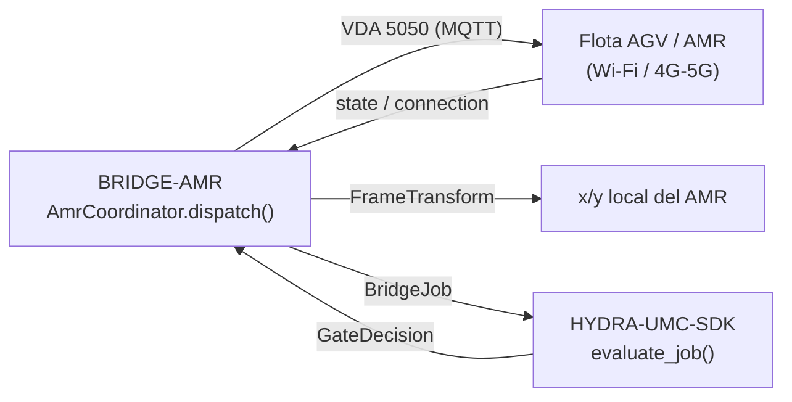

<!-- =============================================================================
HYDRA-UMC-BRIDGE-AMR - AMR/AGV coordination bridge
Copyright (C) JuanenRac (Electro Hobby 3D) <electrohobby3d@gmail.com>
GPL-3.0-or-later - see LICENSE
============================================================================= -->

<p align="center">
  
</p>

# 🚚 HYDRA-UMC-BRIDGE-AMR

<p align="center"><a href="README.md">🇺🇸 English</a> | 🇪🇸 <b>Español</b> | <a href="README_fra.md">🇫🇷 Français</a> | <a href="README_ita.md">🇮🇹 Italiano</a> | <a href="README_deu.md">🇩🇪 Deutsch</a> | <a href="README_zho.md">🇨🇳 简体中文</a> | <a href="README_jpn.md">🇯🇵 日本語</a> | <a href="README_por.md">🇵🇹 Português</a></p>

### 🔗 Frontera de coordinación sin dependencias entre HYDRA-UMC y flotas AGV/AMR

<p align="center">
  
  
  
  
  
  
</p>

---

> **Comprobación de honestidad - qué funciona realmente hoy:** la transformación de marco de coordenadas y la puerta de trabajos (`coordinator.py` con `AmrCoordinator`/`FrameTransform`, que hace pasar cada despacho por el propio `evaluate_job()` de `HYDRA-UMC-SDK`) y la lógica de forma de mensaje/topic VDA 5050 (`mqtt_transport.py` con `Vda5050Publisher`) son reales y están cubiertas por 110 tests unitarios que pasan (`python tools/build_test.py` - `test_coordinator.py`, `test_mqtt_transport.py`, más `test_vda5050_emulator.py`, que ejecuta el bridge contra un emulador de AGV VDA 5050 fiel al protocolo pero escrito a mano, no uno real en producción). Nada de esto se ha probado contra un broker MQTT real, un cliente `paho-mqtt` real, o un AMR/gestor de flota físico - el propio `FakeMqttClient` de `test_mqtt_transport.py` sustituye a `paho-mqtt` por completo (la librería real ni siquiera necesita estar instalada para que estos tests pasen), y todavía no existe un comando `run` en vivo porque no se ha seleccionado ni validado ningún transporte real de gestor de flota. Ver "Estado actual y próximos pasos" más abajo, que ya lo indica con claridad, y `CHANGELOG.md` para lo que se ha entregado exactamente hasta ahora.

> **Estado de seguridad física y de ciberseguridad:** este ecosistema no es un sistema de seguridad certificado. Todavía no existe una ruta de E-STOP por hardware, ni límites ni enclavamientos aplicados por el firmware, ni un comando de movimiento verificado; las imágenes de firmware se comprueban con CRC-32 y una firma Ed25519, y una compilación de versión rechaza las claves de desarrollo publicadas (los cabezales de herramienta y las placas de expansión detrás del relé siguen con cargadores de URTC, que usan un HMAC-SHA256 de clave compartida en lugar de una firma); TLS y TLS mutuo son opcionales y están desactivados por defecto; aún no se ha poblado ni probado ninguna placa propia. Lee la [línea base de seguridad](https://github.com/JuanenRac/HYDRA-UMC-DOCS/blob/main/docs/SECURITY_BASELINE.md) y el [modelo de amenazas](https://github.com/JuanenRac/HYDRA-UMC-DOCS/blob/main/docs/THREAT_MODEL.md) antes de fiarte de cualquier afirmación de aquí para la seguridad de una persona.

---

## 📋 De un vistazo

| | |
|---|---|
| Versión | `0.1.4` |
| Madurez | Funcional |
| Tests | 110 (`python tools/build_test.py`) |
| Tecnología | Python / VDA 5050 (subset) / MQTT / HYDRA-UMC-SDK |
| En hardware real | Solo simulado: probado con emuladores, dobles de prueba o simuladores; no consta ninguna ejecución en hardware real para esta versión |

**Ir a:** [Resumen](#-resumen) · [Arquitectura](#-arquitectura) · [Funciones](#-funciones) · [Seguridad y protección](#-seguridad-y-protección) · [Interfaces](#-interfaces) · [Configuración](#-configuración) · [Inicio rápido](#-inicio-rápido) · [Pruebas](#-pruebas) · [Resolución de problemas](#-resolución-de-problemas) · [Estructura del repositorio](#-estructura-del-repositorio) · [Proyectos relacionados](#-proyectos-relacionados)

## 🚦 Estado del proyecto

Cada línea es una parte de este repositorio y la luz dice hasta dónde llega hoy. Se escribe con lo que el repositorio puede demostrar (pruebas, compilaciones, ejecuciones), no con lo previsto.

🟢 Hecho y verificado · 🟡 Funciona, con límites conocidos · 🟠 Hecho a medias o sin verificar · 🔴 Sin hacer o sin funcionar

| Área | Estado | Qué significa aquí |
|---|---|---|
| Software | 🟡 | Funciona para su propósito principal; la comprobación de honestidad de arriba lista lo que aún falta |
| Pruebas | 🟢 | 110 pruebas automáticas, ejecutadas en cada cambio |
| Hardware real | 🟠 | Solo simulado: probado con emuladores, dobles de prueba o simuladores; no consta ninguna ejecución en hardware real para esta versión |
| Documentación | 🟢 | README en ocho idiomas, comprobado contra el manifiesto en cada cambio |

## 🎯 Resumen

**HYDRA-UMC-BRIDGE-AMR** es la frontera de coordinación bidireccional de alto nivel entre HYDRA-UMC y una flota AGV/AMR (robot móvil autónomo), accesible por Wi-Fi o un enlace celular (4G/5G). Hace exactamente dos cosas reales antes de que un trabajo llegue a un AMR: resuelve una coordenada del marco de fábrica al marco local propio de ese AMR mediante una transformación rígida 2D real y comprobable a mano, y mapea una fase de trabajo a una acción de orden mínima inspirada en VDA 5050. No tiene lógica propia de navegación, localización ni evasión de obstáculos, y no puede saltarse a HYDRA-UMC-SERVER, los límites del MCU, los watchdogs ni el E-STOP.

Pertenece a la familia **Mobile & Autonomous Bridges** junto a `HYDRA-UMC-BRIDGE-DROIDS` y `HYDRA-UMC-BRIDGE-UAV`, y comparte el mismo contrato de trabajo y seguridad de `HYDRA-UMC-SDK` que los **External Automation Bridges** estacionarios (CNC, LASER, OPENPNP, PRINTER3D, ROS2).

## 🧩 Papel en HYDRA-UMC

**HYDRA-UMC-BRIDGE-AMR** coordina una flota de AGV o AMR con una celda de robots. Convierte un trabajo de celda ya validado en una orden VDA 5050 (nunca movimiento crudo) y lee de vuelta los mensajes `state` y `connection` del propio vehículo, para que la puerta sepa si puede aceptar una orden.

Todos los bridges hablan el contrato de seguridad compartido de `HYDRA-UMC-SDK`: un trabajo solo se acepta cuando la puerta compartida `evaluate_job()` lo permite, y esa puerta falla cerrada. El proyecto padre es `HYDRA-UMC-SERVER`; este bridge no lo llama, responde por MQTT, a través de `HYDRA-UMC-MQTT-BROKER`, a quien manda en la celda.

## 🏛️ Arquitectura

<p align="center">
  
</p>

<details>
<summary>Versión en texto del diagrama (Mermaid)</summary>



</details>

**Por qué está hecho así**

* **Por qué vive aquí una transformación real de marco de coordenadas, y no solo un paso directo.** Las coordenadas propias de la celda HYDRA-UMC y el mapa local de un AMR concreto casi nunca comparten origen ni rumbo - la nota de arquitectura pegada de la que partió este proyecto lo señala explícitamente ("mapear coordenadas del mapa de fábrica al mapa local del robot"). `FrameTransform` es la matemática real y verificada a mano que cierra esa brecha, mantenida como trigonometría pura sin dependencia de ningún gestor de flota, para que se pueda probar en cualquier sitio.
* **Por qué el vocabulario de acciones de orden está moldeado según VDA 5050.** VDA 5050 es el estándar real, abierto y neutral de fabricante para integración de flotas que ya hablan varias flotas AMR comerciales (y un número creciente de stacks de código abierto) - nombrar las acciones propias de este repo según su vocabulario real (`CANCEL_ORDER`, movimiento con forma de nodo/acción) significa que un futuro adaptador VDA 5050 real encaja de forma natural en vez de necesitar una capa de traducción añadida después.
* **Por qué `AmrCoordinator.dispatch()` sigue canalizando cada trabajo por la puerta compartida `evaluate_job()`.** Un AMR es solo otro cliente del mismo `bridge_contract` que usan CNC, LASER, OPENPNP, PRINTER3D, ROS2 y DROIDS - no tiene ningún salto especial de la lógica IDLE/READY que hacen cumplir todos los demás bridges y HYDRA-UMC-SERVER.
* **Por qué `CANCEL_ORDER` sigue siendo solicitable durante un fallo.** El requisito de fase productiva de la puerta (`IDLE` + `READY`) deliberadamente no se aplica igual a una petición de aborto - un operador siempre debe poder cancelar la orden actual de un AMR, incluso en mitad de un fallo.
* **Por qué aún no hay un adaptador específico de un fabricante para el gestor de flota en este repositorio.** (El publicador MQTT de VDA 5050 existe, véase arriba.) Comprometerse con el protocolo REST/WebSocket real de un AMR concreto antes de seleccionar y probar una flota real arriesgaría a dar por sentadas suposiciones que este núcleo local y sin dependencias no puede verificar.
* **Cómo encaja esto en el resto del ecosistema.** BRIDGE-AMR se sitúa entre una flota AMR real y `HYDRA-UMC-SDK` → `HYDRA-UMC-SERVER` → seguridad MCU - es una frontera de coordinación, nunca un nodo de navegación o control de motores, y no puede saltarse HYDRA-UMC-SERVER, los límites del MCU, los watchdogs ni el E-STOP.

## ✨ Funciones

* 🧾 **Esquemas oficiales de VDA 5050 y una retención configurable:** las pruebas validan cada mensaje que construye el puente contra los esquemas JSON oficiales de VDA 5050 2.0.0 (`order` e `instantActions`, incluidos en `tests/vda5050_schemas`); una acción instantánea lleva ahora `actionName` junto a `actionType`, porque el esquema oficial de instantActions lo pide. `AmrCoordinator(abort_action=AmrCoordinator.START_PAUSE)` hace que la fase de aborto retenga el vehículo con `startPause` en vez de descartar su orden con `cancelOrder` (el valor por defecto); ambas se reenvían siempre. `MOVE_TO_HOME` pasa por la misma puerta que cualquier movimiento. `AmrCoordinator.resume()` envía `stopPause` solo con la celda en READY y un vehículo leído como en pausa, y `abort_action=AmrCoordinator.ABORT_BOTH` envía `cancelOrder` y después `startPause`. *(implementado)*
* ✅ **Transformación real de marco de coordenadas, comprobable a mano:** `FrameTransform` mapea una coordenada `(x, y)` del marco de fábrica al marco local propio de un AMR concreto, dados su origen y su rumbo reales en la planta - verificada con un caso identidad, una traslación pura, una rotación de 90 grados y un test real de ida y vuelta. *(implementado, probado en `tests/test_coordinator.py`)*
* ✅ **Vocabulario real de acciones de orden inspirado en VDA 5050:** `MOVE_TO_STAGING`, `PICK_LOAD`, `MOVE_TO_DESTINATION`, `DROP_LOAD`, `MOVE_TO_HOME` se publican en el topic `order` real de VDA 5050 (en cola, parte de una ruta); `CANCEL_ORDER` se publica en el topic `instantActions` real y separado (inmediato, se salta la cola de órdenes) - coincide con el nombre real de la acción `cancelOrder` de VDA 5050 Y con su canal real, comprobado contra los [esquemas oficiales](https://github.com/VDA5050/VDA5050/tree/main/json_schemas). *(implementado)*
* ✅ **Validación real de coordenadas por acción:** una acción de movimiento a la que le falten `x`/`y`, o con un valor no numérico, se rechaza localmente antes de que se ejecute la transformación. *(implementado, probado)*
* ✅ **Puerta de seguridad compartida real:** cada trabajo despachado mediante `AmrCoordinator.dispatch()` se evalúa con `evaluate_job()` de `bridge_contract` de `HYDRA-UMC-SDK`, la misma puerta que usan todos los bridges hermanos y HYDRA-UMC-SERVER; una fase productiva exige una máquina externa `IDLE` y una celda HYDRA-UMC `READY`, mientras que `CANCEL_ORDER` sigue siendo solicitable durante un fallo. *(implementado)*
* ✅ **Enrutado de fase con fallo cerrado y evidencia estática:** una fase futura del SDK desconocida se rechaza. `inspect_order_plan.py` emite el plan de orden estático del esquema `1.0` sin abrir ningún transporte. *(implementado, probado)*
* ✅ **Publicador MQTT VDA 5050 real:** `Vda5050Publisher` de `mqtt_transport.py` envía un despacho ya validado como un mensaje real, conforme al esquema, en el topic real correcto (`{interfaceName}/{majorVersion}/{manufacturer}/{serialNumber}/{order|instantActions}`) - un despacho rechazado nunca llega a la red. *(implementado, probado en `tests/test_mqtt_transport.py`)*
* ✅ **Build/test sin mutación:** `build-test.bat`/`.sh` compilan el código fuente y ejecutan tests deterministas sin cambiar versión ni CHANGELOG. *(implementado, ver BUILD Y EJECUCIÓN más abajo)*
* 🔜 **Adaptador REST/WebSocket específico de un gestor de flota** (para una plataforma de flota que no sea nativa de VDA 5050) - se introducirá solo tras seleccionar y probar esa plataforma. *(planeado)*
* ✅ **Estado observado de la máquina e ids de orden que sobreviven a un reinicio:** `AmrCoordinator.dispatch()` acepta el estado que el gestor de flota informó del vehículo, que la puerta compartida usa en lugar del `machine_state` escrito en el trabajo (un mensaje que cualquiera en el broker puede publicar); `Vda5050Publisher` da a cada orden un `orderId` con un token propio, de modo que un reinicio que vuelve a contar `headerId` desde el principio no reutilice el id de una orden anterior (VDA 5050 la rechaza). *(implementado, probado en `tests/test_observed_and_order_ids.py`)*
* ✅ **Nombres VDA 5050 en el cable, un cliente que el broker acepta y un observador que escucha:** los internos `CANCEL_ORDER` / `PICK_LOAD` / `DROP_LOAD` salen como los tipos de acción VDA 5050, sensibles a mayúsculas, `cancelOrder` / `pick` / `drop` (antes `CANCEL_ORDER` salía tal cual, y un AGV no lo reconoce como cancelación), y un movimiento es solo su nodo de destino, sin un tipo de acción inventado; `actionId` y `nodeId` llevan el token de sesión como el `orderId`; `header_id` y `timestamp_iso` pueden omitirse (el publicador cuenta por topic y pone la hora UTC) y se validan cuando se dan; se rechaza una coordenada que desborda, un número no finito o un punto fuera de `FrameTransform.bounds` (`allow_nan=False`). `open_mqtt_client()` recibe un `client_id` (el broker autentica por su prefijo), usa la API de callbacks v2 y espera la respuesta del broker en lugar de devolver un cliente que no puede publicar; con un `Vda5050Observer` se suscribe a los topics `state` y `connection` del AGV y deriva el estado de máquina que usa la puerta (OFFLINE si está caducado, no ONLINE o no está en modo AUTOMATIC; si no, SAFE_STOP, FAULT, HOLDING, RUNNING o IDLE). *(implementado, probado con dobles y con el emulador; nunca ejecutado contra un AGV ni un gestor de flota reales, y todavía NO se construye una ruta que parta del nodo en que está el AGV (dos nodos y una arista, que requiere el grafo de la planta), así que un AGV real rechazará estas órdenes de un solo nodo de destino)*

## 🔒 Seguridad y protección

| Amenaza | Defensa | Dónde |
|---|---|---|
| Un trabajo para una celda o máquina que no está en estado seguro | Todo trabajo pasa por la puerta compartida `evaluate_job()` del SDK, que falla cerrada; el bridge no tiene lógica propia de aceptar o rechazar | SDK `bridge_contract` |
| Datos de trabajo desmesurados | Como máximo 32 parámetros, claves de hasta 64 caracteres, valores de hasta 1024, identificadores de hasta 128 (`MAX_PARAMETERS`, `MAX_PARAMETER_KEY_CHARS`, `MAX_PARAMETER_VALUE_CHARS`, `MAX_IDENTIFIER_CHARS`) | SDK `bridge_contract` |
| Una orden repetida o reenviada | Un `IdempotencyStore` recuerda cada clave 24 horas y como máximo 10 000 entradas; una repetición recibe la primera respuesta en vez de evaluarse otra vez | SDK `job_intake` |
| Una orden de movimiento crudo enviada a un vehículo | El coordinador solo convierte el trabajo en una orden local del AMR; `simulated_amr.TRANSITIONS` dice qué acción es legal desde qué estado (por ejemplo `MOVE_TO_STAGING` solo desde `IDLE`) | `coordinator.py`, `simulated_amr.py` |
| Un mensaje VDA 5050 mal formado | Cada mensaje `order` e `instantActions` que construye el publicador se valida en las pruebas contra los esquemas JSON oficiales de VDA 5050 2.0.0, copiados sin cambios | `tests/test_vda5050_schemas.py` |
| Un vehículo que no puede aceptar una orden | Un despacho rechazado nunca llega a la red; el observador trata un `state` o `connection` ausente o viejo (más de 90 segundos) como no listo | `mqtt_transport.py`, `observer.py` |

**Lo que nunca hace:** nunca envía movimiento crudo y nunca ha corrido contra un vehículo ni un gestor de flota reales.

## 🔌 Interfaces

Los topics VDA 5050 son `{interface_name}/{major_version}/{manufacturer}/{serial_number}/{channel}` (`Vda5050Target.topic()`), por ejemplo `vda5050/v2/acme/agv-01/order`.

| Topic o ruta | Qué lleva |
|---|---|
| `order`, `instantActions` | se publican; cada uno lleva su propio contador `header_id` y una marca de tiempo UTC |
| `state`, `connection` | los observa `Vda5050Observer`; la suscripción se renueva tras cada reconexión |

La biblioteca: `AmrCoordinator`, `FrameTransform`, `Vda5050Publisher`, `Vda5050Target`, `Vda5050Observer`, `SimulatedAmr`, `open_mqtt_client()`. El ID de cliente MQTT por defecto es `hydra-umc-bridge-amr`.

## ⚙️ Configuración

| Variable | Por defecto | Qué fija |
|---|---|---|
| `HYDRA_MQTT_USERNAME` | ninguno | El usuario MQTT; el broker lo liga a un prefijo de ID de cliente |
| `HYDRA_MQTT_PASSWORD` | ninguno | La contraseña; solo vale junto con el usuario |
| `HYDRA_MQTT_PASSWORD_FILE` | ninguno | La contraseña leída de un fichero (secreto de Docker o systemd); se ignora si hay `HYDRA_MQTT_PASSWORD` |
| `HYDRA_MQTT_TLS_CA` | ninguno | El fichero de la CA que firmó el certificado del broker: la conexión es TLS y se verifica el certificado |
| `HYDRA_MQTT_TLS` | desactivado | `1` activa TLS, verificado con las CA de confianza del sistema |
| `HYDRA_MQTT_TLS_CERT` / `HYDRA_MQTT_TLS_KEY` | ninguno | El certificado de cliente y su clave para un broker que exige TLS mutuo; hacen falta los dos |

No hay fichero de configuración: el broker, `interface_name`, `major_version`, `manufacturer`, `serial_number` y la acción de aborto (`cancelOrder`, `startPause` o ambas) son argumentos de los constructores.

## 🚀 Inicio rápido

Requiere Python 3.11 o superior. Las pruebas y los scripts de compilación esperan `HYDRA-UMC-SDK` clonado junto a este repositorio (`../HYDRA-UMC-SDK`) o indicado con `HYDRA_UMC_SDK_ROOT`.

Pruébalo sin hardware (esto comprueba todo el bridge contra sus emuladores y dobles de prueba):

```bash
py -3 tools/build_test.py          # Windows
python3 tools/build_test.py         # Linux, macOS
```

Arranca el servicio (no hay un script de consola: el servicio es el `run_forever()` del transporte MQTT, que llamas desde tu propio código de arranque):

```python
from hydra_umc_bridge_amr import AmrCoordinator, FrameTransform, Vda5050Publisher, Vda5050Target, open_mqtt_client
client = open_mqtt_client("192.168.0.180")        # connects; the credentials come from HYDRA_MQTT_*
target = Vda5050Target("vda5050", "v2", "acme", "agv-01")
dispatch = AmrCoordinator().dispatch(job, cell_state, FrameTransform(map_id="hall", origin_x=0.0, origin_y=0.0, heading_rad=0.0))
Vda5050Publisher().publish(client, target, None, None, dispatch)   # a rejected dispatch is never sent
```

El usuario, la contraseña y los ficheros TLS salen de las variables `HYDRA_MQTT_*` (ver Configuración); el código de arriba no necesita credenciales propias.

## 🧪 Pruebas

110 casos automáticos de `unittest` se ejecutan con `python tools/build_test.py` (que también compila cada módulo). Las pruebas no necesitan hardware, red ni paquetes opcionales: las que necesitarían `paho-mqtt`, `pyserial` o una biblioteca del fabricante usan un sustituto o se saltan si falta el paquete.

| Fichero de pruebas | Pruebas | Qué cubre |
|---|---|---|
| `test_coordinator.py`, `test_observed_and_order_ids.py`, `test_edge_cases.py` | - | paso de trabajo a orden, transformación rígida de marco, ids, casos límite |
| `test_vda5050_schemas.py` | - | cada mensaje validado contra los esquemas oficiales VDA 5050 2.0.0 |
| `test_vda5050_emulator.py`, `vda5050_emulator.py` | - | el coordinador y el publicador reales contra un vehículo VDA 5050 a nivel de forma en el bus MQTT |
| `test_mqtt_transport.py`, `test_mqtt_environment.py`, `test_hardening.py`, `test_simulated_amr.py` | - | publicador contra un cliente MQTT simulado, credenciales del entorno, entradas hostiles, la tabla de estados |

El CI ejecuta `HYDRA_UMC_CI=1 python tools/ci_validate.py`, que comprueba el manifiesto, los documentos, los ocho README y las imágenes, y ejecuta las pruebas con una copia del SDK.

## 🏗️ Compilación y publicación

Requiere Python 3.11+. `tools/build_test.py` espera `HYDRA-UMC-SDK` clonado como directorio hermano (`../HYDRA-UMC-SDK`) o indicado mediante la variable de entorno `HYDRA_UMC_SDK_ROOT`.

```bash
# Windows
build-test.bat      # solo valida — sin cambio de versión/CHANGELOG
build.bat            # Valida y compila (compilar nunca cambia la versión)

# Linux/macOS
bash build-test.sh
bash build.sh
```

`build-test` compila cada módulo bajo `src/` con `py_compile` y ejecuta la suite completa de `unittest` descubierta en `tests/` (todos los ficheros `test_*.py` - 110 tests) - de forma determinista, sin conexión real a ningún AMR, sin red y sin cambio de versión/CHANGELOG. `build` ejecuta esa misma validación primero y, solo si tiene éxito, llama a `tools/bump_version.py` para sincronizar la versión entre `pyproject.toml`, `hydra-umc.project.json` y `CHANGELOG.md`. Todavía no existe un comando `run` con hardware real - eso requiere un adaptador de transporte de gestor de flota validado y una flota AMR real.

## 🩺 Resolución de problemas

| Ves | Porque | Haz |
|---|---|---|
| `ModuleNotFoundError: hydra_umc_sdk` | El SDK no está instalado ni junto a este repositorio | Clona `HYDRA-UMC-SDK` junto a este repositorio o define `HYDRA_UMC_SDK_ROOT` |
| `paho-mqtt is not installed` | El cliente MQTT es un extra opcional | `pip install ".[mqtt]"` (necesita `paho-mqtt` 2.1 o superior, menor que 3) |
| `password was given without a username` | Las credenciales MQTT necesitan las dos partes | Define `HYDRA_MQTT_USERNAME` además de la contraseña |
| `could not reach the MQTT broker after N attempts` | El broker está caído, la dirección es errónea o el puerto está cerrado | Arranca `HYDRA-UMC-MQTT-BROKER` y revisa el host y el puerto dados al transporte (lo intenta 5 veces, con 2 segundos de pausa); un fallo del handshake TLS no se reintenta |
| `the MQTT broker refused the connection` | El broker rechazó la credencial (o no respondió dentro del plazo) | Revisa `HYDRA_MQTT_USERNAME` y la contraseña; el ID de cliente debe empezar por el prefijo que el broker ligó a la credencial |
| `"allowed": false` + `reason` | La puerta compartida o una guarda rechazó la orden | Lee `reason` y arregla la causa; no reintentes a ciegas |

## 📂 Estructura del repositorio

<p align="center">
  
</p>

<details>
<summary>Versión en texto del árbol</summary>

```text
HYDRA-UMC-BRIDGE-AMR/
├── src/hydra_umc_bridge_amr/
│   ├── coordinator.py             convierte un trabajo en una orden local del AMR, nunca movimiento crudo; FrameTransform
│   ├── mqtt_transport.py          publicador VDA 5050 y el cliente MQTT
│   ├── observer.py                convierte `state` y `connection` del AGV en un estado de máquina
│   └── simulated_amr.py           tabla de qué acción es legal desde qué estado
├── tests/                         110 pruebas, con un emulador VDA 5050 y los esquemas oficiales
├── docs/                          guía del bridge
├── tools/                         ejecutor de compilación y pruebas, subida de versión, validador de CI, generadores y comprobaciones de README e imágenes
├── images/                        banner y las imágenes del README
├── .github/                       flujo de CI y plantillas de incidencias
├── pyproject.toml                 metadatos del paquete y dependencias
├── hydra-umc.project.json         manifiesto: versión, madurez, familia
├── CHANGELOG.md                   qué cambió en cada versión
├── build.sh build.bat             scripts de compilación (nunca cambian la versión)
├── build-test.sh build-test.bat   scripts de compilación (nunca cambian la versión)
├── test.sh test.bat               ejecutan las pruebas
└── SECURITY.md SUPPORT.md CONTRIBUTING.md CODE_OF_CONDUCT.md LICENSE LICENSE.md
```

</details>

## 🗺️ Hoja de ruta y límites conocidos

**Límites conocidos hoy**

**Real hoy:** versión `0.1.4`, funcional como núcleo de coordinación sin dependencias (`AmrCoordinator`) con una transformación real de marco de coordenadas verificada a mano (`FrameTransform`), enrutado de fase con fallo cerrado, un esquema de orden estático `plan-only` con la división real de canales order/instantActions de VDA 5050, un publicador MQTT VDA 5050 real (`Vda5050Publisher`), y scripts de build-test sin mutación integrados en CI con un checkout del SDK.

**Frontera de integración:** este bridge es solo una frontera de coordinación - no es un nodo de navegación ni de control de motores, y no puede saltarse HYDRA-UMC-SERVER, los límites del MCU, los watchdogs ni el E-STOP; cada trabajo despachado sigue pasando por la misma puerta compartida que usan todos los bridges hermanos.

**Todavía pendiente:** aún no se ha validado ningún transporte real de gestor de flota (VDA 5050, REST/WebSocket de fabricante) ni un AMR físico - un adaptador real se introducirá solo después de seleccionar y probar una plataforma de flota concreta.

## 🌍 Idiomas

Este README y los documentos del repositorio existen en ocho idiomas: inglés, español, alemán, francés, italiano, japonés, chino y portugués (Portugal). Se escriben a la vez y el CI comprueba que los ocho ficheros tengan las mismas secciones y los mismos enlaces. Este repositorio no tiene pantalla ni catálogo de mensajes propios, así que no hay cadenas de interfaz que traducir.

## 🔗 Proyectos relacionados

Este proyecto es parte del ecosistema de robótica HYDRA-UMC del mismo autor (JuanenRac / Electro Hobby 3D). Vale la pena conocerlo, ya que una petición podría en realidad ser sobre alguno de estos en vez de sobre este repositorio.

**Proyecto Padre**
- **[HYDRA-UMC-SERVER](https://github.com/JuanenRac/HYDRA-UMC-SERVER)** — el backend headless real (REST/WebSocket) con el que habla de verdad cada cliente de control; la frontera autenticada del ecosistema a la que reporta este bridge una vez cada comando ha superado la barrera de seguridad local de este propio bridge.

**Proyectos Hermanos** — también hablan con la propia API de HYDRA-UMC-SERVER, cada uno como su propio cliente
- **[HYDRA-UMC-STUDIO](https://github.com/JuanenRac/HYDRA-UMC-STUDIO)** — panel de control web con visualización 3D multi-robot en tiempo real.
- **[HYDRA-UMC-SUITE](https://github.com/JuanenRac/HYDRA-UMC-SUITE)** — centro de mando de enjambre de escritorio (PySide6) para varios servidores a la vez, empaquetado como ejecutable independiente.
- **[HYDRA-UMC-ANDROID-CONTROL](https://github.com/JuanenRac/HYDRA-UMC-ANDROID-CONTROL)** — app nativa de control para Android con inicio de sesión biométrico y un compañero Wear OS emparejado.
- **[HYDRA-UMC-IOS-CONTROL](https://github.com/JuanenRac/HYDRA-UMC-IOS-CONTROL)** — app de control para iOS/iPadOS (Flutter) con sincronización en tiempo real por WebSocket.
- **[HYDRA-UMC-DSI](https://github.com/JuanenRac/HYDRA-UMC-DSI)** — interfaz táctil nativa para la pantalla táctil DSI de 7" a bordo, embebida en el propio CM5.
- **[HYDRA-UMC-BRIDGE-CNC](https://github.com/JuanenRac/HYDRA-UMC-BRIDGE-CNC)** — coordinador de alto nivel para celdas CNC con acceso a estado/bytes de control GRBL (probado solo contra un emulador).
- **[HYDRA-UMC-BRIDGE-DROIDS](https://github.com/JuanenRac/HYDRA-UMC-BRIDGE-DROIDS)** — barrera de coordinación para droides con patas/humanoides, con un emisor de comandos para Boston Dynamics Spot (probado solo contra un emulador) — uno de los 3 bridges de flota móvil del ecosistema.
- **[HYDRA-UMC-BRIDGE-LASER](https://github.com/JuanenRac/HYDRA-UMC-BRIDGE-LASER)** — coordinador de celdas láser que lee 3 señales GPIO de llave/carcasa/enclavamiento (probado solo contra un chip simulado; no puede armar ni disparar un láser).
- **[HYDRA-UMC-BRIDGE-OPENPNP](https://github.com/JuanenRac/HYDRA-UMC-BRIDGE-OPENPNP)** — coordinador de alto nivel seguro para el flujo de placas de pick-and-place OpenPnP.
- **[HYDRA-UMC-BRIDGE-PRINTER3D](https://github.com/JuanenRac/HYDRA-UMC-BRIDGE-PRINTER3D)** — barrera de coordinación segura para impresoras 3D Moonraker/Klipper, con comandos de trabajo reales y controlados.
- **[HYDRA-UMC-BRIDGE-ROS2](https://github.com/JuanenRac/HYDRA-UMC-BRIDGE-ROS2)** — coordinador con un transporte ROS 2 rclpy importado de forma perezosa (todavía no ejecutado contra una instalación de ROS 2).
- **[HYDRA-UMC-BRIDGE-UAV](https://github.com/JuanenRac/HYDRA-UMC-BRIDGE-UAV)** — barrera de coordinación para UAV equipados con cámara, con un emisor de comandos MAVLink (probado solo contra un emulador) — uno de los 3 bridges de flota móvil del ecosistema.

**Directamente Relacionados**
- **[HYDRA-UMC-SDK](https://github.com/JuanenRac/HYDRA-UMC-SDK)** — el contrato JSON-Schema compartido y la barrera de software de puerta de trabajos contra la que cada bridge valida sus comandos (no es una función de seguridad certificada).
- **[HYDRA-UMC-CONNECTOR-HUB](https://github.com/JuanenRac/HYDRA-UMC-CONNECTOR-HUB)** — registro declarativo y validador de manifiestos de adaptador para conectores de máquinas externas; extiende la propia idea de contrato del SDK a máquinas externas sin sustituir a los proyectos de pasarela industrial.
- **[HYDRA-UMC-MQTT-BROKER](https://github.com/JuanenRac/HYDRA-UMC-MQTT-BROKER)** — el `Vda5050Publisher` de `mqtt_transport.py` envía cada despacho ya validado como un mensaje VDA 5050 `order`/`instantActions` real y conforme a la especificación — a diferencia del esquema de tópicos `hydra/bridges/<nombre>/...` propio del resto de bridges, este usa directamente la forma de tópico real de VDA 5050.

**También Forma Parte del Ecosistema**

*Hardware y Plataforma Base*
- **[HYDRA-UMC](https://github.com/JuanenRac/HYDRA-UMC)** — el diseño de la placa madre del brazo robótico: host CM5 + coprocesador STM32H745 de doble núcleo, pensado para coordinar hasta 8 brazos herramienta por CAN-OTA/SPI-OTA (firmware en fase temprana; todavía no hay ninguna placa poblada).
- **[HYDRA-UMC-OS](https://github.com/JuanenRac/HYDRA-UMC-OS)** — capa de producto reproducible sobre Raspberry Pi OS para el CM5: agente de solo lectura, config/perfiles validados, aprovisionamiento WiFi de primer contacto.

*Backend Central y Clientes*
- **[HYDRA-UMC-EDITOR-URDF](https://github.com/JuanenRac/HYDRA-UMC-EDITOR-URDF)** — creador/editor gráfico de URDF de escritorio que envía los modelos terminados al propio catálogo de STUDIO.
- **[HYDRA-UMC-EDITOR-STL](https://github.com/JuanenRac/HYDRA-UMC-EDITOR-STL)** — editor de escritorio de modelos STL, que transforma/reemplaza/quita/añade piezas reales en el mismo catálogo de modelos que también edita HYDRA-UMC-EDITOR-URDF.

*Plataforma de Herramientas URTC*
- **[URTC](https://github.com/JuanenRac/URTC)** — firmware para la placa física del Universal Robot Tool Controller, más de 25 perfiles de herramienta por bus CAN.
- **[URTC-FLASHER](https://github.com/JuanenRac/URTC-FLASHER)** — herramienta de escritorio con GUI para flashear placas URTC, CAN-OTA más SWD/JTAG de chip completo.
- **[URTC-TESTER](https://github.com/JuanenRac/URTC-TESTER)** — herramienta de escritorio de diagnóstico CAN-bus en vivo para placas URTC, un panel por perfil de herramienta.
- **[URTC-WEB-STUDIO](https://github.com/JuanenRac/URTC-WEB-STUDIO)** — alternativa basada en navegador a URTC-TESTER mediante la Web Serial API, sin instalación local.
- **[URTC-GATEWAY](https://github.com/JuanenRac/URTC-GATEWAY)** — pasarela delante del bus CAN de URTC: lista de identificadores permitidos, límite de tasa y clave de sesión; software probado en ordenador, aún no en un bus real.

*Nodo IA de Visión (Hailo-8)*
- **[HYDRA-UMC-VISION-NODE](https://github.com/JuanenRac/HYDRA-UMC-VISION-NODE)** — nodo de integración para el pipeline de visión Hailo-8, con una comprobación real de disponibilidad de hardware por etapa.
- **[HYDRA-UMC-DETECTION-HEF](https://github.com/JuanenRac/HYDRA-UMC-DETECTION-HEF)** — registro real de modelos compilados con verificación de carga segura por arquitectura Hailo/checksum.
- **[HYDRA-UMC-VISION-STREAMER](https://github.com/JuanenRac/HYDRA-UMC-VISION-STREAMER)** — generador real de pipeline GStreamer + config MediaMTX, con una frontera de integración HailoRT real.
- **[HYDRA-UMC-VISUAL-SERVOING-API](https://github.com/JuanenRac/HYDRA-UMC-VISUAL-SERVOING-API)** — ley de corrección Position-Based Visual Servoing con autorización condicionada al estado de zona; todavía sin estimación de pose por cámara.
- **[HYDRA-UMC-SAFETY-ZONES](https://github.com/JuanenRac/HYDRA-UMC-SAFETY-ZONES)** — lógica v0 de invasión de zona, vigencia de calibración y solicitud de E-STOP que toma las posiciones de los objetos de un fichero; ningún detector la alimenta y todavía no hay un E-STOP físico conectado.

*Nodo IA Cognitivo (Hailo-10)*
- **[HYDRA-UMC-COGNITIVE-NODE](https://github.com/JuanenRac/HYDRA-UMC-COGNITIVE-NODE)** — nodo de integración para el pipeline cognitivo Hailo-10 (orquestación de LLM/VLA/voz).
- **[HYDRA-UMC-VLA-ENGINE](https://github.com/JuanenRac/HYDRA-UMC-VLA-ENGINE)** — codificación/decodificación real de tokens de acción y generación de trayectoria para un modelo Vision-Language-Action.
- **[HYDRA-UMC-VOICE-UI](https://github.com/JuanenRac/HYDRA-UMC-VOICE-UI)** — front-end de voz real (VAD + analizador de intención) con un relé a Watch acotado y con confirmación.
- **[HYDRA-UMC-SEMANTIC-PLANNER](https://github.com/JuanenRac/HYDRA-UMC-SEMANTIC-PLANNER)** — descomposición real de tareas basada en reglas y recuperación semántica de errores sobre códigos de error del MCU.
- **[HYDRA-UMC-DOCS-QA](https://github.com/JuanenRac/HYDRA-UMC-DOCS-QA)** — búsqueda real de documentos TF-IDF (solo librería estándar) sobre los propios documentos Markdown de este ecosistema.
- **[HYDRA-UMC-LOCAL-TECHNICIAN](https://github.com/JuanenRac/HYDRA-UMC-LOCAL-TECHNICIAN)** — técnico de mantenimiento con IA local y con puertas de política para el propio ecosistema - observa, diagnostica y propone arreglos; los dos niveles de riesgo más altos están deliberadamente sin implementar todavía.

*Orquestación y Enjambre*
- **[HYDRA-UMC-ORCHESTRATOR](https://github.com/JuanenRac/HYDRA-UMC-ORCHESTRATOR)** — nodo de integración con un contrato real de informe de salud gRPC/Protobuf y una máquina de estados de misión.
- **[HYDRA-UMC-JOB-DISPATCHER](https://github.com/JuanenRac/HYDRA-UMC-JOB-DISPATCHER)** — cola de trabajos real basada en prioridad con deduplicación, sobre una API HTTP real.
- **[HYDRA-UMC-NODE-HEALING](https://github.com/JuanenRac/HYDRA-UMC-NODE-HEALING)** — watchdog de salud de flota real basado en gRPC, con reintento/backoff y detección de discrepancia de identidad.
- **[HYDRA-UMC-PATH-PLANNER-3D](https://github.com/JuanenRac/HYDRA-UMC-PATH-PLANNER-3D)** — planificador de rutas 3D real basado en RRT, con validación real de colisión de obstáculos/espacio de trabajo.
- **[HYDRA-UMC-SWARM-SYNC](https://github.com/JuanenRac/HYDRA-UMC-SWARM-SYNC)** — sincronización de estado real mediante CRDT LWW-Element-Map, con pruebas de propiedades para convergencia multi-celda.

*Gemelo Digital y Simulación*
- **[HYDRA-UMC-TWIN](https://github.com/JuanenRac/HYDRA-UMC-TWIN)** — nodo de integración para el motor de gemelo digital, con un contrato real de sincronización por compatibilidad de versión.
- **[HYDRA-UMC-HIL-BRIDGE](https://github.com/JuanenRac/HYDRA-UMC-HIL-BRIDGE)** — enrutador hardware-in-the-loop con un enclavamiento de software por colisión entre simulación y hardware real (probado sin hardware real).
- **[HYDRA-UMC-PHYSICS-REPLICA](https://github.com/JuanenRac/HYDRA-UMC-PHYSICS-REPLICA)** — cinemática directa real y validación de límites articulares sobre un subconjunto real de URDF.
- **[HYDRA-UMC-SYNTHETIC-DATA-GEN](https://github.com/JuanenRac/HYDRA-UMC-SYNTHETIC-DATA-GEN)** — generador real de escenas 2D procedurales con exportación de anotaciones YOLO/COCO.

*Datos y Analítica*
- **[HYDRA-UMC-DATALAKE](https://github.com/JuanenRac/HYDRA-UMC-DATALAKE)** — almacén de series temporales real respaldado por sqlite3, con una API HTTP real de ingesta/consulta.
- **[HYDRA-UMC-ANOMALY-DETECTOR](https://github.com/JuanenRac/HYDRA-UMC-ANOMALY-DETECTOR)** — detector de anomalías real basado en FFT + línea base estadística, con monitorización de deriva.
- **[HYDRA-UMC-PRODUCTION-REPORTS](https://github.com/JuanenRac/HYDRA-UMC-PRODUCTION-REPORTS)** — cálculo real de OEE/disponibilidad sobre el histórico de DATALAKE, con exportación CSV reproducible.
- **[HYDRA-UMC-TELEMETRY-COLLECTOR](https://github.com/JuanenRac/HYDRA-UMC-TELEMETRY-COLLECTOR)** — pipeline real de ingesta CAN/WebSocket hacia DATALAKE, con deduplicación por secuencia.

*Pasarela Industrial*
- **[HYDRA-UMC-GATEWAY-INDUSTRIAL](https://github.com/JuanenRac/HYDRA-UMC-GATEWAY-INDUSTRIAL)** — nodo de integración que retransmite a protocolos industriales, con una capa real de lista blanca de comandos/contrapresión.
- **[HYDRA-UMC-OPCUA-SERVER](https://github.com/JuanenRac/HYDRA-UMC-OPCUA-SERVER)** — espacio de direcciones OPC-UA real, verificado con una sesión de cliente real del protocolo binario.
- **[HYDRA-UMC-MTCONNECT-ADAPTER](https://github.com/JuanenRac/HYDRA-UMC-MTCONNECT-ADAPTER)** — endpoints XML reales `/probe` y `/current` de MTConnect, con salida en modo degradado.

*Herramientas Complementarias y Operaciones del Ecosistema*
- **[HYDRA-UMC-DASHBOARD-AI](https://github.com/JuanenRac/HYDRA-UMC-DASHBOARD-AI)** — paneles de Resúmenes Inteligentes y Resaltado de Anomalías sobre DATALAKE/ANOMALY-DETECTOR, con un respaldo estadístico honesto.
- **[HYDRA-UMC-TOOL-CLI](https://github.com/JuanenRac/HYDRA-UMC-TOOL-CLI)** — CLI de flota con un contrato real y estable de códigos de salida, cliente real y en vivo de la propia API de HYDRA-UMC-SERVER.
- **[HYDRA-UMC-WATCH](https://github.com/JuanenRac/HYDRA-UMC-WATCH)** — app compañera de WearOS con patrones de alerta háptica y un relé de voz al teléfono emparejado (todavía no ejecutada en un reloj físico).
- **[URTC-SMART-RACK](https://github.com/JuanenRac/URTC-SMART-RACK)** — firmware para un rack de montaje de placas con decodificación real de ID de herramienta y lógica de precalentamiento Smart Idle.
- **[URTC-VISION-TOOL](https://github.com/JuanenRac/URTC-VISION-TOOL)** — firmware más un compañero de visión real en Python para un cabezal de inspección térmica/RGB.
- **[HYDRA-UMC-UPDATER](https://github.com/JuanenRac/HYDRA-UMC-UPDATER)** — herramienta administrativa de escritorio que descubre, clona y actualiza cada repositorio de este ecosistema.
- **[HYDRA-UMC-OS-REBUILDER](https://github.com/JuanenRac/HYDRA-UMC-OS-REBUILDER)** — herramienta de escritorio Windows/Linux que construye una imagen de la CM5 lista para grabar, precargada con las versiones más actuales del ecosistema, con configuración de primer arranque de Wi-Fi/usuario/SSH al estilo de Raspberry Pi Imager.
- **[HYDRA-UMC-OPS-AGENT](https://github.com/JuanenRac/HYDRA-UMC-OPS-AGENT)** — coordinador de incidencias de mantenimiento: un rol edge de bajo privilegio recopila un snapshot de inventario/salud saneado, un rol control-plane lo renderiza de solo lectura y pide a un proveedor de IA que sugiera un diagnóstico - nunca aplica un parche ni despliega nada.
- **[HYDRA-UMC-DEV-SERVER](https://github.com/JuanenRac/HYDRA-UMC-DEV-SERVER)** — host de desarrollo reproducible (Raspberry Pi 5 / CM5) que almacena el código del ecosistema y ejecuta tareas acotadas de compilación/pruebas bajo una cola duradera; un rol de desarrollo dedicado, explícitamente distinto de un CM5 operativo.

## 📚 Documentación

Dónde leer más:

* [docs/BRIDGE_GUIDE.md](docs/BRIDGE_GUIDE.md) - alcance, los mensajes VDA 5050, marcos de referencia, scripts
* [Base de seguridad del ecosistema](https://github.com/JuanenRac/HYDRA-UMC-DOCS/blob/main/docs/SECURITY_BASELINE.md)
* [Modelo de amenazas del ecosistema](https://github.com/JuanenRac/HYDRA-UMC-DOCS/blob/main/docs/THREAT_MODEL.md)
* [Historial de cambios de este repositorio](CHANGELOG.md)
* [Licencia de este repositorio](LICENSE.md)

## 🤝 Contribuir y comunidad

* Antes de un pull request ejecuta `HYDRA_UMC_CI=1 py -3 tools/ci_validate.py` (o `HYDRA_UMC_CI=1 python3 tools/ci_validate.py`): debe imprimir `CI_VALIDATION=PASS`. No ejecutes `build.sh` ni `build.bat` para esta comprobación; compilar no es comprobar.
* Los ocho README se escriben desde una sola fuente en HYDRA-UMC-DOCS; no los edites a mano. Cambia la fuente y vuelve a escribirlos con `tools/make_readmes.py`.
* No afirmes en un README lo que no se ha ejecutado: di «simulado» o «sin probar en hardware» cuando esa sea la verdad.
* Mira [CONTRIBUTING.md](CONTRIBUTING.md), el [código de conducta](CODE_OF_CONDUCT.md), [SECURITY.md](SECURITY.md) y [SUPPORT.md](SUPPORT.md).

## 👤 AUTOR

**JuanenRac (Electro Hobby 3D)** · electrohobby3d@gmail.com

## 📜 LICENCIA

GPL-3.0-or-later - [LICENSE](LICENSE).
